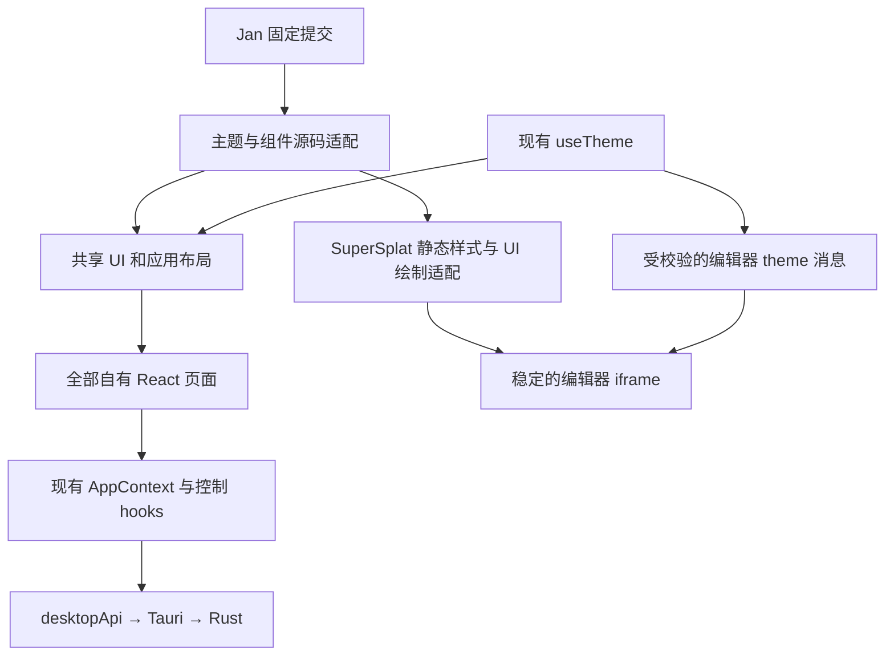

# MetOrigin Splat 前端迁移方案与实施记录

当前计划：**Jan 全页面迁移，实施与验收进行中，包含 SuperSplat 内部 UI。** 固定来源与验收要求见第 9 节；本轮实际改动、证据和未验项见第 10 节。2026-10-29 用户补充的桌面四区齐边布局优先于原浮动面板构图，主题及组件来源仍保持 Jan 固定提交。

既有实现记录：第 1–8 节描述已完成的宿主界面技术迁移、桌面壳/项目库重设计与双参考窗口导航；已有本机 macOS 调试版 .app 的构建和检查记录，原生发布矩阵仍有明确限制。更新日期：2026-10-28。这些记录替代 2026-10-21 的原始 Proposed 方案，但不表示第 9 节的 Jan 迁移已完成。

当前桌面前端已接入 **Tailwind CSS v4、基于 Radix 的 shadcn/ui 源码组件，以及受控的 Magic UI NumberTicker**。实际使用的项目中心、三步创建向导、导航与运行栏、重建工作台、设置和模型编辑宿主均已采用共享基础组件和主题。视觉与组件契约见[设计系统](design-system-proposal.zh-CN.md)。

第 1–8 节的历史范围是自有 React 宿主。此前 SuperSplat iframe 内部仍使用固定上游版本的独立 UI 与样式；其返回、保存、加载、错误和离开保护外壳已迁移。没有将第三方编辑器内部重写为 React，也没有改变项目 schema 或引擎协议。随后桌面壳重设计增加了窗口拖拽与双击缩放权限，范围见第 5 节。

## 1 已落地的技术栈

| 层 | 当前实现 | 职责 |
| --- | --- | --- |
| React / React DOM | 19.3.1 | 页面、状态与组件组合；支持 React 19 ref prop |
| 构建与类型 | Vite 5.4.21、TypeScript 5.9.3 | 保留现有桌面构建，不引入 Next.js |
| 样式 | Tailwind / `@tailwindcss/vite` 4.3.3、tw-animate-css 1.4.0 | 语义 token、布局、响应式和有限状态过渡 |
| 基础组件 | shadcn `new-york-v4` 源码、radix-ui 1.8.1 | 控件、模态、菜单、Tabs、折叠与可访问行为 |
| 类名合并 | clsx 2.1.1、tailwind-merge 3.7.0、CVA 0.7.1 | 单一 `cn` 工具与完整变体类名 |
| 可调面板 | react-resizable-panels 3.0.6 | 稳定视口宿主上的宽度调整 |
| 有限动效 | Magic UI NumberTicker、Motion 12.23.24 | 完成汇总数的低频变化；业务层使用 `ResultNumber` |
| 原生与渲染 | Tauri 2、Three 0.185.1、Spark 2.1.0、独立 SuperSplat | 维持 IPC、任务执行和渲染生命周期边界 |
| 字体与图标 | 本地 Inter Variable、JetBrains Mono、Lucide | 离线使用；没有 CDN 或在线字体依赖 |

实际安装版本由[前端依赖](../apps/desktop/package.json)和[锁文件](../pnpm-lock.yaml)约束。shadcn CLI 4.23.0 仅用于获取组件，不是产品运行时；远程 registry 内容通过源码哈希记录，CLI 版本本身不能固定 registry。

## 2 实际目录与样式入口

```text
apps/desktop/
  components.json          shadcn、Magic registry 和 @ 别名
  ui-sources.json           上游文件哈希、许可证、本地改动
  src/
    App.tsx                应用壳与导航
    pages/                 Home / NewProject / ProjectDetail / ModelEditor
    components/
      ui/                  shadcn 源码、Resizable 适配、模态 Portal context
      magicui/             NumberTicker 适配源码及 MIT 许可证
      motion/              ResultNumber 动效策略
      primitives/          保留 ModalSurface 领域接口，内部使用 Dialog
      shell/               导航、菜单、运行栏、删除与项目选择
      settings/            五类设置与资源信息
      workspace/           活动、检查点、确认、点云与高斯预览
      feedback/            异步状态、错误、回执、读屏通知
    lib/utils.ts           共享 cn
    styles/
      app.css              唯一宿主样式入口与 Tailwind 主题映射
      tokens.css           light / dark 语义变量
      workspace.css        工作台与视口的领域布局规则
    services/              desktopApi、editorBridge；契约保留
    hooks/、context/、types/、i18n/
```

没有为迁移机械新增 `features`、`domain` 或第二套状态框架。原业务目录继续承担原职责。`@/*` 同时配置于 TypeScript、Vite 和独立的 Vitest 配置，避免测试与开发解析不同。

`app.css` 引入 Tailwind、tw-animate-css、theme layer 中的 tokens 和工作台样式。`data-theme` 仍是唯一主题源，`dark:` 直接映射该属性。旧 renderer/domain 变量是新语义变量的别名，不再维护另一套颜色值。

以下旧实现已移除：`buzz.css`、`interaction-surfaces.css`、`model-editor.css`；未被实际页面使用的 `ProjectCard`、`EmptyState`、`PipelineProgress`、`StageProgress`；旧 `useModalFocus`、`useMenuFocus`、`useRovingFocus`。`workspace.css` 是保留的领域布局层，不能将它当作独立 Tailwind 编译入口；其 `@apply` 由 `app.css` 的上下文解析。

## 3 页面与行为迁移

| 范围 | 已实现 | 保留的业务约束 |
| --- | --- | --- |
| 项目中心 | 单一标题/搜索/打开/新建工具区、60px 最近项目主列表、小型总数/完成数；取消大统计与固定环境栏 | 完整原路径用于搜索和导航，显示尾部路径且可查看完整值；陈旧列表与引擎异常仍有反馈 |
| 三步创建 | Tailwind 布局、共享表单控件、Collapsible 帮助、明确底部操作 | 草稿、预检失效、取消复制、原生文件选择和创建结果 |
| 全局外壳 | 连续工作区、40px一体窗口导航与28px侧栏/前后退按钮；macOS保留原生交通灯；240px紧凑侧栏，正常快捷行32px、路径异常行56px | 真实页面历史；创建向导不入历史且禁用跳页；编辑器离开先确认；移除/重新定位同步历史；compact抽屉由App统一控制 |
| 设置 | 常规、引擎、性能与存储、外观、诊断五个 Radix Tabs | 即时偏好立即保存；数值本地草稿、范围校验、显式保存和失败重试 |
| 工作台 | 四阶段 Collapsible、实际 Badge/Progress、可调视口与 Inspector、窄窗详情模态 | 不因面板显隐重建 renderer；实际进度和产物来自既有状态 |
| 活动与检查点 | Radix Tabs、共享输入、按钮和模态；搜索 180ms debounce | query generation 同时保护结果、cursor 与缓存，过滤晚到旧查询；保留后端分页 |
| 模型编辑宿主 | 共享工具栏、载入/错误/保存反馈与离开弹窗 | iframe 身份、dirty 判断、bridge 校验、保存确认和二进制 transfer |
| 异步反馈 | ErrorNotice、AsyncStatus、ActionReceipt 使用统一语义样式 | 脱敏、陈旧数据、部分失败、真实恢复结果；失败不能伪报成功 |

通用选择控件使用带统一样式的 `NativeSelect`，保留系统选择与键盘行为。当前没有引入自定义 Select、Sonner 或 ScrollArea；回执仍由应用的 `ActionReceipt` 呈现，滚动区域使用稳定的原生 overflow 容器。

`ModalSurface` 保留已有 props，由 Radix 负责焦点陷阱，应用负责 busy 关闭限制、初始焦点和返回焦点。菜单与 Tooltip 的 Portal 挂到当前模态容器内，避免视觉上可见但被模态无障碍隔离。危险操作保留原有确认与 token 校验，不使用动画推断完成。

项目详情与模型编辑页面按需加载，工作台弹窗从具体模块导入，避免首页经 barrel 引用加载点云/Three 运行时。生产构建已生成独立 ProjectDetail、Gaussian 及 NumberTicker 分块；具体产物见下文。

## 4 Magic UI 的实际使用边界

仅引入 NumberTicker，用于项目中心的“已完成项目数”。页面通过 `ResultNumber` 使用它：

- 首次显示为静态数值，只有真实数值变化时才按需加载 Motion。
- 单次动画 350ms，按当前 locale 格式化，继承语义文字色。
- 实际重建任务活动、页面隐藏或系统要求减少动效时直接显示最终值，并卸载动画。
- 读屏始终获得静态最终值；切换语言、恢复页面或动效策略变化不重播旧变化。

未引入 BlurFade、AnimatedList、BorderBeam、Particles 或其他持续装饰。训练进度、GPU/VRAM、日志计数使用真实即时数值。Magic registry 只参与开发获取源码，应用运行不访问 registry。

## 5 平台、离线与安全边界

Windows 使用 WebView2；macOS 已有独立配置，最低系统版本为 **15.0**，使用 WKWebView。Tailwind v4 官方浏览器基线为 Chrome 111、Safari 16.4、Firefox 128；必须按实际安装的 WebView 验证，不能仅根据 OS 名称断言兼容。[Tailwind 兼容性](https://tailwindcss.com/docs/compatibility)、[Tauri WebView 版本](https://v2.tauri.app/reference/webview-versions/)。

Windows 完整安装器沿用 `offlineInstaller`，没有改为固定 WebView runtime。字体、图标、组件、脚本、编辑器资源继续本地打包。CSP 配置保持不变；桌面壳增加 `core:window:allow-start-dragging` 与 `core:window:allow-internal-toggle-maximize`，用于自定义标题栏。macOS 配置 `titleBarStyle: Overlay`、`hiddenTitle: true` 与原生交通灯位置，保留系统 decorations；Tauri 仅在 macOS 应用这些标题栏选项。CSP 加固需按 IPC、模型 blob、worker/WASM、iframe 真实需求独立验证。

本次不改变 typed IPC、project/session/sequence 约束、晚到事件过滤、暂停/取消/恢复的后端确认、确认 token、编辑器 origin/source/channel 校验。渲染模型更新失败仍应保留最后可用画面和相机，不能用一次 UI 样式重构代替渲染性能工程。

## 6 已执行验证与限制

以下记录截至 2026-10-28 本次迁移最终本地验证；真实执行结果与本地日志位于 Git 忽略的 `.test-results/ui-migration/`。

| 检查 | 已知结果 |
| --- | --- |
| 迁移前基线 | 36 个测试文件、296 项测试通过 |
| ESLint 与 TypeScript | 当前迁移代码 lint、严格类型检查通过 |
| 单元与交互测试 | 38 个测试文件、320 项测试通过；最后布局修复后，受影响的 5 个测试文件、80 项测试再次通过 |
| 完整生产构建 | `pnpm build` 通过，包含 SuperSplat `prepare.mjs`、类型检查和 Vite 构建；最后布局修复后再次通过 |
| 集成回归 | Spark、Three 生命周期及 SuperSplat 打包 Node 测试合计 124/124 通过 |
| 真实开发页面 | 1440×1024 / 1024×768 检查中文浅色首页、向导第一步、工作区、设置；项目选择弹层底部菜单、窄窗 Inspector / 活动弹层、英文深色设置正常；控制台无 error/warn |
| 预览数据边界 | 使用开发专用 `?ui-preview`，有“界面预览 · 示例数据”标记；不能证明真实任务、文件或 GPU 行为 |
| 许可证 | shadcn/Magic 文本与来源已保留；收集新增块用实际文件验证了两份文本、来源清单、21 个源码哈希、SBOM 依赖链接与缺来源失败；脚本语法检查通过 |

开发预览曾在迁移组件与 `@` 别名尚未就绪时提前打开，旧 Vite 进程保留过期配置，造成模块解析错误。组件补齐、配置生效并重启服务后，实际页面已恢复。后续必须同时检查正式 CSS/JS 入口的 Vite 开发编译及真实浏览器，不能只凭 Vitest 或生产构建就宣称预览可用。

2026-10-28 桌面壳重设计后的原生调试包构建体积沿用 Vite 的十进制 kB；gzip 仅用于比较，不等于 Tauri 本地加载量：

| 分块 | kB | gzip kB |
| --- | ---: | ---: |
| App | 317.01 | 97.90 |
| ProjectDetail | 614.93 | 162.84 |
| GaussianSplatPreview | 4941.25 | 1756.29 |
| NumberTicker / Motion | 64.37 | 22.84 |

分块结果不能单独证明冷启动、帧率或训练吞吐改善。恢复首页和英文深色窄窗设置截图分别为本地验证目录的 `restored-home.jpg`、`settings-dark-en-1024.jpg`。

以下不在已通过结果中：正式签名/公证安装包、Windows 各 WebView2/DPI 组合、跨设备 macOS WKWebView 矩阵、真实文件导入与重建恢复、真实 GPU/VRAM/训练吞吐、读屏、200% 缩放、1 小时任务与 20 次渲染器进出。早期迁移阶段因未找到 `cargo` 没有执行完整 macOS 许可证收集；本轮已恢复 Rust 并完成调试 .app 构建，但没有重新运行完整许可证收集流程，新增 UI 收集块的独立验证仍有效。不得用测试执行耗时冒充产品性能指标。


### 6.1 AFFiNE 参考下的桌面重设计复核

本轮只调整应用壳、导航和项目库的层级与密度，没有新增文档、标签、收藏或标签页功能。运行环境集中在设置；引擎不可用时首页仍提示并提供设置入口。正常项目状态与路径不再重复占据侧栏多行；失败、暂停和路径异常仍明确可见，路径异常的修复按钮保留。

- 原生启动时自动打开 WebInspector 曾占用近半窗口；现仅在调试构建且 `METORIGIN_OPEN_DEVTOOLS=1` 时打开。重新构建后的截图已确认 Inspector 不再挤占内容。
- 本轮相关 40 项测试通过；另外导航/侧栏/抽屉 14 项、主页 9 项通过，设置 10 项包含未知磁盘值与有效零值断言。上述是分批验证记录，不与前次 320 项相加成新的全量总数。TypeScript、ESLint、完整前端构建通过。
- `pnpm tauri build --debug --bundles app` 成功，日志在 `.test-results/affine-design-comparison/native-build.log`。在本机原生窗口检查了 17 条真实记录，包括中文、空格、emoji、长名称和长路径；已有路径丢失状态如实显示，未为了截图隐藏。
- 原生主题切换成功并恢复用户原浅色偏好；全屏进入、退出成功，原生项目菜单打开后按 Esc 关闭并返回原触发器焦点已验证。标题栏双击后窗口截图从 2880×1770 变为 3024×1772，确认缩放响应。没有据此宣称拖拽已验证；左上角 macOS 控制状态标识遮挡了交通灯区域，交通灯精确位置与视觉仍需无覆盖时复核。
- 浏览器 1024×768 英文深色项目库与工作台检查通过，搜索和主操作可见，没有水平溢出，浏览器控制台 warn/error 为空；示例预览仍有明确标记，不能证明 GPU 或重建结果。
- 完整视图及侧栏、项目行细节已与 AFFiNE 截图合并对照。当前范围无未解决 P0/P1/P2 视觉问题；照片式像素复制不是本轮目标，差异与限制见根目录 [design-qa.md](../design-qa.md)。

截图在 Git 忽略目录 `.test-results/affine-design-comparison/`：`07-native-dark-final.png`、`13-native-light-final.png` 分别为最终原生深/浅色结果，`12-native-fullscreen.png` 为全屏状态，`08-comparison-full.png`、`09-comparison-sidebar.png`、`10-comparison-rows.png` 为对照证据，`05-browser-1024-en-dark.png` 与 `06-browser-workspace.png` 为窄窗检查。旧截图 `03-native-light.png`、`04-native-dark-before.png` 仅用于记录异常行密度修复前状态。

### 6.2 双参考窗口导航调整（最新）

用户新增的AFFiNE与Claude红框截图共同要求窗口级控件整合。最新实现使用40px工具栏和28px侧栏/后退/前进按钮，移除重复页面标题、侧栏重复开关与横贯窗口的分隔线；侧栏色块上延，主内容背景连续。没有新增伪标签页或切换桌面框架。

- 页面历史最多50项，同页去重、后退后跳页截断forward；移除项目清理历史，重新定位同步路径。创建向导不写历史、保留自己的安全退出入口，成功创建后Back不会返回空向导；工具栏和reducer均保护向导期导航。
- 前后退等待编辑器`leave()`通过后再提交，并防止等待期重复触发。App统一持有compact断点与项目抽屉状态，顶部按钮在窄窗打开可搜索项目抽屉；Windows/Linux及浏览器也保留应用导航入口。
- `.test-results/window-toolbar/frontend-tests.log`：38个测试文件、333项全量前端测试通过。随后新增`uiPreview.test.ts`的7项测试单独通过；不合计声称一次340项全量运行。TypeScript、ESLint通过。
- 交互验收发现并修复开发预览身份混淆：`open_project`按`path`、`get_pipeline_state`按`projectPath`选择fixture；未知显式路径不再静默返回主项目。已手工确认Museum → Back → Forward身份一致，此改动不改写真实项目数据。
- `.test-results/window-toolbar/native-build.log`确认Vite生产构建与原生debug `.app`构建成功；这是调试包，未宣称完成签名、公证或发布安装器验证。
- 主代理验证了真实原生项目后退/前进、侧栏折叠和标题栏双击缩放。独立视觉复核实际打开`comparison-top.png`（两源与实现同一输入）、`comparison-full.png`、`native-light-1x.png`、`native-dark-1x.png`和`browser-1024-en-dark.png`，当前范围没有未解决P0/P1/P2。
- 交通灯仍被macOS紫色控制标识遮挡，精确位置与实际拖动未验证；未重跑GPU、真实重建恢复或跨平台原生矩阵。完整验收依据与前轮历史见根目录[design-qa.md](../design-qa.md)。

## 7 发布验收与后续性能工作

发布验收应覆盖明暗主题、中英文、1024×768 与 1440×1024、长路径/项目名、未知/陈旧/失败数据、键盘与焦点恢复、真实原生选择器、未保存离开、暂停/取消/恢复、模型更新失败与资源释放。安装包与离线首次运行分别在目标 OS 执行。

以下是原方案的独立优化候选，**未因本次 UI 迁移而自动完成**：

| 候选 | 本次实际状态与下一步 |
| --- | --- |
| 活跃任务摘要请求合并 | 保留既有事件和轮询策略；后续用 IPC 计数验证 single-flight 与终态延迟 |
| Context 订阅细分 | 保留原 Context；先用 React Profiler 测量无关页面的提交再决定拆分 |
| 大日志虚拟化与有界缓存 | 已加入 debounce 和乱序保护；当前仍渲染已加载记录，虚拟化及 10k/100k 压测未完成 |
| 点云按需绘制与缓冲优化 | 保留 renderer 行为边界；不能宣称隐藏绘制、截图缓冲或 GPU 峰值已完成优化 |
| 数据轮询和产物扫描 | 延续现有节奏；后续按任务阶段测量 IPC/磁盘负载 |
| 训练与动效性能对比 | 动效范围已限制；CPU/GPU、帧时间、step/s 改善尚需同硬件同模型实测 |

回退以代码/构建版本为单位，本次不迁移用户工程数据。回退前安全退出编辑会话，避免热替换 iframe 导致未保存状态丢失。无需维护两套永久 UI。

## 8 组件来源和更新流程

[ui-sources.json](../apps/desktop/ui-sources.json)记录 19 个 shadcn registry 组件和 Magic NumberTicker 的获取日期、registry URL、上游源码 SHA-256、MIT 许可证、本地修改；Resizable 明确标记为本地适配而非原样 registry 文件。提交的源码与 lockfile 是可复现构建依据。

此前阶段，shadcn MIT 文本位于[ui/LICENSE](../apps/desktop/src/components/ui/LICENSE)，Magic MIT 文本位于 `components/magicui/LICENSE`；Magic 源码及该本地许可证文件现已随 Jan 迁移移除。[macOS 许可证收集脚本](../scripts/macos/collect-app-licenses.mjs)当时单独将两份文本、来源清单及本地源文件哈希写入许可证包的 `ui/`，因为复制源码不会出现在 npm 依赖闭包中。现行来源与收集范围见第 9 节。

更新顺序是读取上游差异，检查依赖/ref/Portal API，保留本地控件与业务契约，更新来源哈希，运行 lint/typecheck/test、完整生产构建及真实开发页面检查，再验证主题、语言、键盘和动效策略。业务页面不得直接绕过 `components/motion` 引入新的 Magic 动效。

## 9 Jan 全页面迁移实施方案

状态：**实施中，不能据此宣称全量验收完成**。用户已确认迁移包括 SuperSplat 编辑器内部的工具栏、菜单和属性面板。本节是本轮实施依据；第 1–8 节是此前宿主迁移的实现与验证记录，不能用其测试结果证明 Jan 迁移完成。

### 9.1 固定分析基线与交付范围

| 基线 | 固定值 |
| --- | --- |
| Jan 仓库 | https://github.com/janhq/jan |
| 上游分支 | main |
| 本次查询到的最新提交 | `b8d58255baf6d9e870025d3f0c60a5b80a63143b` |
| 提交时间 | 2026-10-28 09:47:12 UTC，即北京时间 17:47:12 |
| 提交链接 | [固定提交](https://github.com/janhq/jan/commit/b8d58255baf6d9e870025d3f0c60a5b80a63143b) |
| 当前本地分支 | `codex/macos-gaussian-generation` |
| 本地 HEAD | `b0fb4c170cede9d8ccbf04c43ae66b9940695039`，分析包含当前未提交的前端改动 |
| 内嵌编辑器 | 官方 SuperSplat 3.7.0 tag，`b89029dd20911fd18905b61de2701094ac390a73` |
| 编辑器数据转换 | `@playcanvas/splat-transform` 3.10.2，`e0dab1fa0b7f7546d2b4b197f6294570e53ba3b8`；独立 `integrations/supersplat/webp-overlay-3.10.2/` 配对源码、glue/WASM与构建证据 |

“最新”指本次分析时查询到的 main HEAD，不等于稳定发行版。实施与来源记录使用完整 SHA；提取期间不再跟随 main 漂移。若开始实施时需要更新基线，先比较新的提交差异并更新本节与来源清单，再提取文件。

上述“最新”说明对应Jan分析来源；当前SuperSplat基线已独立固定到官方3.7.0 tag，不跟随其main。旧3.0.1及splat-transform 3.4.2的包、overlay与既有验证身份保留为历史，不作为本轮升级的通过证据。

交付目标是所有应用可见界面的主题、字体、组件状态和布局具有一致的 Jan 风格，同时保留三维重建、编辑与保存行为。范围包含四个页面组件、全部活跃子视图、设置、应用确认、全局反馈，以及内嵌 SuperSplat 的内部界面。系统文件/目录选择器和系统窗口控件使用操作系统提供的样式。

迁移完成不以替换四个 page 文件为判断标准，而以 9.3 的覆盖矩阵及 9.9 的状态验收全部通过为准。当前没有独立素材库、文件树管理页或多项目标签系统；素材视图仍属于向导和工作台，本轮不为模仿 Jan 增加无对应业务的导航入口。

### 9.2 现有项目与 Jan 的结构对照

| 层 | MetOrigin 当前代码 | Jan 固定版本 | 接入决策 |
| --- | --- | --- | --- |
| 桌面与后端 | Tauri 2、Rust、`desktopApi`、本地工程与任务状态 | Tauri 2，模型引擎、ServiceHub、扩展插件 | 复用视觉层；保留现有命令、事件、权限和后端 |
| React 与构建 | React 19.3.1、Vite 5、pnpm | React 19.0、Vite 6、Yarn workspaces | 按当前工具链编译提取源码；不整体替换 package.json 或 lockfile |
| 基础 UI | Tailwind 4.3、Radix 合并包、shadcn new-york、CVA | Tailwind 4.1、shadcn new-york、独立/合并 Radix 混用 | 以现有组件 API 为兼容层，归一到当前 Radix 导入形式 |
| 主题 | `useTheme`，`light/dark/system`，`html[data-theme]` | Zustand theme store、`.dark`、InterfaceProvider 运行时覆盖 | 现有 useTheme 继续唯一拥有主题，显式映射 Jan 最终主题值 |
| 页面导航 | AppContext reducer，3 种 Page 状态；模型编辑由独立会话控制 | TanStack Router、LeftPanel store、多业务 Provider | 保留导航与安全离开流程；提取 Sidebar/Header 的结构和样式 |
| 设置 | 一个弹窗内五类设置 | 路由页、设置侧栏、Card/CardItem | 采用 Jan 双栏设置布局，沿用受控弹窗入口与现有保存语义 |
| 视口 | Three、Spark、点云预览、稳定 canvas 宿主 | 聊天、Cowork 与文件预览 | 专用三维布局采用 Jan 组件语言；保留 renderer 生命周期 |
| 编辑器 | PlayCanvas/PCUI 的独立 iframe | React UI | 独立静态样式派生与主题桥接，不重写编辑器运行时 |
| 国际化 | 当前中文/英文资源与 t/localizeMessage | Jan TranslationProvider 与多语言键 | 转换提取组件文案，继续使用现有 i18n |
| 反馈 | ErrorNotice、AsyncStatus、ActionReceipt、StatusAnnouncer | Jan 全局错误、Sonner、模型/工具业务弹窗 | 改现有反馈的视觉，保留错误持久性与读屏语义 |

现有主要复杂度集中在 `App.tsx`（773 行）、`NewProjectPage.tsx`（923 行）、`ProjectDetailPage.tsx`（994 行）。它们混合了请求、状态保护和布局。迁移时按实际区域分离展示组件与控制逻辑，每次拆分后保留原有行为测试；不另建一套项目或训练状态 Store。

三个不能机械复制的上游实现：

- `routes/__root.tsx` 包含 ServiceHub、下载事件、遥测、扩展、模型异常和更新器；只借其 Sidebar/Inset/内容区域构图。
- `providers/ThemeProvider.tsx` 和 `hooks/useTheme.ts` 依赖 Jan 后端存储、Zustand、原生命令；将默认主题结果适配到当前 useTheme，避免两个来源争写 DOM 和持久化设置。
- `lib/utils.ts` 除 cn 外还引入 ExtensionManager、Node path 和 Markdown 处理；继续使用当前仅包含 clsx/tailwind-merge 的 cn。

### 9.3 全量页面与状态覆盖矩阵

下列行均为必做项；每行同时覆盖适用的加载、空、失败、陈旧、禁用、进行中和成功状态。

| 编号 | 页面或区域 | 当前入口 | 目标改造与关键约束 |
| --- | --- | --- | --- |
| J01 | 窗口与应用壳 | `App.tsx`、`DesktopTitlebar` | Jan 风格侧栏/内容面板；合并窗口控件与页头，保留拖动、前后退和 macOS 交通灯 |
| J02 | 项目侧栏与窄窗抽屉 | `ProjectSidebar/ProjectNavigator/ProjectDrawer` | 统一导航行、搜索、选中、菜单、宽度调整；路径缺失、不可读和检测失败有恢复入口 |
| J03 | 项目中心 | `HomePage` | Jan 页面标题、列表、空态与动作；保留完整路径搜索、引擎异常、时间和真实状态 |
| J04 | 向导第一步 | `NewProjectPage` | 视频/图片文件夹选择、分析结果、缩略图、说明；保留分析乱序保护与原生选择器 |
| J05 | 向导第二步 | `NewProjectPage` | 预检、预设和高级参数采用统一表单组；修改输入使旧预检失效，阻断项仍阻止继续 |
| J06 | 向导第三步及创建中 | `NewProjectPage` | 名称/路径/结果摘要、创建与创建后启动、复制进度、安全取消；准确表达部分成功 |
| J07 | 项目运行栏 | `TitleRunBar` | 统一标题、启动/暂停/恢复/取消/重试/编辑操作；区分当前查看项目和真正运行项目 |
| J08 | 阶段导航 | `ProjectDetailPage` | 单行四组阶段、可展开子阶段及预览选择；保留键盘导航、真实运行/异常状态和陈旧提示，移除子阶段重跑入口，真实失败恢复仍由Inspector处理 |
| J09 | 素材、点云和高斯预览 | `ProjectDetailPage`、`PointCloudPreview/GaussianSplatPreview` | Jan 工具栏、占位和错误；固定视口宿主，不因主题、分栏或 Inspector 显隐重建 |
| J10 | Inspector 与资源详情 | `ProjectDetailPage`、`RuntimeResources` | 分组参数行、质量/产物/资源/错误恢复；未知值不能呈现为零，统一内存语义不变 |
| J11 | 活动日志 | `ActivityWorkbench` | 活动/事件/警告/错误四标签、搜索、过滤、详情、分页、跟随；保留 generation/cursor 防乱序 |
| J12 | 检查点 | `CheckpointDrawer` | 列表、当前/无效状态、预览/恢复/定位/删除；保护当前检查点与恢复前提 |
| J13 | 质量详情与风险继续 | `ProjectDetailPage` | 统一指标、检查项、报告空态和继续按钮；仅真实 requires_confirmation 可确认后继续 |
| J14 | 操作影响与删除确认 | `WorkspaceActionDialog` | 统一影响列表、警告、busy、错误和确认；保留 previewToken 过期后重新预览/确认 |
| J15 | 常规设置 | `SettingsDrawer` | 默认预设、创建后自动开始；采用 Jan 分组行与说明 |
| J16 | 引擎设置 | `SettingsDrawer` | 路径、版本、检测、定位与系统信息；保留真实错误与重试 |
| J17 | 存储与性能设置 | `SettingsDrawer/RuntimeResources` | 数值草稿、范围提示、显式保存、资源信息、macOS 空闲睡眠；未知与估算有文字 |
| J18 | 外观设置 | `LanguageSelector/useTheme/useLanguage` | 中文/英文、浅/深/系统；同一次变更同步到宿主与编辑器内部 |
| J19 | 诊断设置 | `SettingsDrawer` | 真实引擎状态与脱敏导出；未打开项目时解释不可用原因 |
| J20 | 编辑器宿主 | `ModelEditorPage` | 返回、保存、加载、导出、失败、离开检查；稳定 iframe、保存与离开互斥 |
| J21 | 编辑器内部基础 UI | SuperSplat `src/ui` | 主菜单、左右/底部工具栏、场景和对象列表、数据/颜色/外观/变换/设置面板、状态栏 |
| J22 | 编辑器内部其他可达界面 | SuperSplat `src/ui` | 时间轴、叠加层设置、相机/性能/尺寸信息、直方图、快捷键、关于、通用弹窗、图像/视频/导出/发布设置及提示；按可达入口逐项登记，不新增云功能 |
| J23 | 应用级原生确认替换 | `desktop.ts`、`ModelEditorPage` | 将安全取消、移除最近项目、未保存离开等应用确认统一为 Promise 型 Jan Dialog，保留 await 与保守拒绝语义 |
| J24 | 全局反馈与快捷键提示 | `components/feedback/*`、`App` | 统一错误、回执、忙态、读屏通知及预览示例标识；保留脱敏与非成功状态 |

每个编号都应在验收记录中对应入口、截图、状态与测试结果。`DeleteProjectDialog`、`SystemStatusBar`、`BackgroundTaskSummary`、`WorkspaceHeader` 当前仅发现定义/导出或测试使用，先确认引用，再决定清理；不把未挂载组件计为已迁移页面。

### 9.4 Jan 源码提取清单

下表所有 Jan 路径都相对于固定提交的 `web-app/src/`。来源链接见 9.11。

| 上游来源 | 本地落点 | 处理方式 |
| --- | --- | --- |
| `index.css`、`hooks/useInterfaceSettings.ts`、`providers/InterfaceProvider.tsx` | `styles/tokens.css`、`styles/app.css` | 提取实际默认语义值、字号、圆角、阴影；不引入 Jan 运行时设置 Provider |
| `components/ui/{button,input,dialog,dropdown-menu,tooltip,switch}.tsx` 等已用组件 | 现有 `components/ui/*` | 逐文件比较并融合视觉；保持本地 props、默认 button type、国际化与 Portal 保护 |
| `components/ui/sidebar.tsx`、`hooks/use-sidebar-resize.ts` | `components/ui/sidebar.tsx`、`shell/DesktopAppShell.tsx` | 抽取分栏、导航行和 resize 行为；去除 cookie、重复快捷键及平台全局变量 |
| `components/left-sidebar/index.tsx` 与 Nav 系列 | `shell/ProjectSidebar.tsx` | 借层级、间距与浮动面板构图；用项目数据替代 thread/model/Cowork 数据 |
| `containers/HeaderPage.tsx` | `shell/PageHeader.tsx` 与 `DesktopTitlebar` | 去除下载管理、Jan LeftPanel/titlebar Store；接现有导航和平台检测 |
| `containers/Card.tsx` 的 Card/CardItem | `settings/SettingsSection.tsx`、`settings/SettingsRow.tsx` | 提取纯 React 展示组合；命名避免与现有 ui/card 冲突 |
| `containers/SettingsMenu.tsx`、`routes/settings/interface.tsx` | `settings/SettingsShell.tsx` 与五个 section | 提取设置导航、内容滚动和表单分组；移除 Jan 路由/供应商/账号业务 |
| `components/ui/sheet.tsx` | 现有 sheet 或本地抽屉适配 | 去除 titlebar-layout-store，使用统一的标题栏安全区域 |
| `components/ui/kbd.tsx` 等确有使用的纯展示组件 | `components/ui/*` | 按实际页面需要提取，更新来源记录 |
| `lib/merge-button-refs.ts`、必要纯 hooks | `lib/*`、`hooks/*` | 仅在提取组件真实依赖时加入；评审 cleanup、单位换算和事件注册 |

上表中的“直接提取”只表示依赖较少，仍需完成当前 React/Radix 版本编译、可访问交互及许可核查。不能把整个 ui 目录都视为无业务依赖：sheet 使用 Jan titlebar store，sonner 使用 Jan theme，dropdrawer 引入 Vaul/Framer Motion，`ui/settings.tsx` 实际只是动画齿轮图标。

本轮继续使用现有 ActionReceipt/StatusAnnouncer，不为视觉替换引入 Sonner；保留当前 Tabs、Badge、Progress、NativeSelect 等接口并匹配 Jan 外观。Jan 没有覆盖的成功/警告/训练状态是必要的本地扩展。

### 9.5 目标主题与布局规范

**主题的唯一所有者。** 保留 `metorigin.ui.theme`、`light | dark | system`、`html[data-theme]`、系统变化监听及存储不可用 fallback。把上游 `.dark` 选择器转换为现有 data-theme 选择器。显式初始化 Jan 所需的 `--font-size-base: 16px`，避免省略 InterfaceProvider 后字号变量为空。不同时写两套 theme store。

| 设计项 | Jan 固定版本实值或结构 | 本项目采用方式 |
| --- | --- | --- |
| 默认侧栏 | gray 方案：浅色 `#f1f1f1`，深色 `#171717` | 取运行时结果；不采用 index.css 中会被覆盖的绿色 `#194D24` |
| 内容表面 | 浅色 --background 为 `oklch(1 0 0)`，AppLayout/Outlet 外层实际用 neutral-50；深色背景 `oklch(.18 0 0)`，卡片/弹层 `oklch(.205 0 0)` | 区分应用外层与内容表面，沿用 Jan 层级；菜单、表单、编辑器面板按对应语义映射 |
| 主色方向 | 默认运行时 `#f17455` | 采用暖橙方向；填充按钮、文字与图标分别检查对比度 |
| 圆角 | 基准 10px；sm/md/lg/xl 为 6/8/10/14px | 写入统一 token；按钮按 Jan 的 pill/圆角变体，视口工具按钮保留紧凑规则 |
| 字号 | --font-size-base 默认 16px，正文 text-sm 为其 0.875 倍，即 14px | 保留本地 Inter 与中文系统回退；技术数值使用 JetBrains Mono；字号变量不等于 html font-size，rem 布局单独处理 |
| 按钮 | 默认 36px、sm 32px、xs 24px、lg 40px | 延续现有尺寸 API；焦点和 disabled 状态统一 |
| 左侧栏 | 默认240px，可调224–320px；LeftSidebar显式offcanvas | 齐边、全高桌面分栏；隐藏后正文占位归零，不保留图标轨道，展开恢复记住宽度。侧栏与窄窗抽屉移除最近项目标题和列表，仅保留项目中心与底部设置。App唯一拥有compact/drawer状态；窄窗抽屉独立于隐藏侧栏并采用相同内容，宽度、开合及模态安全行为仍由本地壳控制 |
| 项目中心 | 用户选定Meshroom Projects照片网格作为视觉参考，保留本地项目与路径健康模型 | Jan桌面壳保持，侧栏移除最近项目不改变主区网格；数量/搜索/打开/新建为可换行的单行工具栏，不增加重复打开图块。180–220px方形真实素材照片下只显示项目名；按圈选移除状态select、卡片训练状态行及常驻路径异常/重新定位块。仅名称/完整路径搜索，不按状态隐藏项目；状态/阶段/路径健康/时间保留title、无障碍说明及安全逻辑。成功打开前移、后台更新保序，全库及原更多/右键管理恢复动作保留，实际操作后的relink错误/UUID不匹配仍反馈 |
| 项目缩略图 | 借鉴Meshroom输入照片识别项目的组织方式，不复制其QML代码 | 只读get_project_thumbnail校验项目身份与项目内文件边界，frames首张优先、source复制照片回退，返回最长边360px JPEG或null；无引擎调用或磁盘缓存写入。可见区懒加载、并发2、48项内存LRU及ID/路径/updated_at隔离，局部缺图/失败反馈不生成假照片 |
| 页头 | Jan HeaderPage为60px；macOS展开触发器靠侧栏右缘，隐藏时进入主区首行，32px圆形按钮/18px图标 | 用户桌面参考优先：共用48px首行；展开左区仅原生控件安全区/靠右开关，内容页头直接紧接；按用户最新要求移除后退/前进按钮及占位。隐藏时页头随开关的内容宽度紧接，与主区同背景/无竖分隔；本地macOS安全区84px。原生三灯按实际AppKit按钮frame对齐首行24pt中心，移除仅调容器的`trafficLightPosition`，全屏使用系统布局。稳定控件与header portal不随开合重挂载。工作台操作菜单不再提供“从最近项目移除”，项目中心管理动作保留 |
| 设置布局 | 左侧分类约 232px、右侧内容独立滚动 | 五个现有分组使用同样结构，窄窗切紧凑分类导航 |
| 新建项目向导 | 保留本地三步业务流程与Jan共享组件 | 素材→预检与参数→确认创建不变；24px紧凑步骤标记去卡片背景与重复可见说明，正文最大960px，底部操作保持。紧凑素材入口、默认折叠拍摄建议且本机说明保留、最多6张预览按2/3/6列；桌面三列预设选中用default主色填充/primary-foreground文字/勾选及ring、未选outline，aria-pressed与切换不变。重复帧数/分辨率/迭代汇总收进参数详情，环境检查集中下方；正常详情折叠，can_continue为false自动展开，warnings/blockers及设置修复入口置于折叠外。已知Mac执行提示从后端实际数值生成短摘要，原文留title，未知警告不改。确认页标签行表单及轻量摘要，移除额外复制说明、保留copy方式。元数据与原目录重检/预检/取消/退出保护保留 |
| 工作台页头 | 48px共用首行采用compact运行栏 | 保留项目名、实际任务控制、编辑和操作菜单；移除状态/进度入口及完成项目独立“文件”按钮，文件定位仍在操作菜单。非compact完整详情继续显示路径、真实整体进度、状态/阶段、适用工作量与最近更新；任务控制与冲突保护不变 |
| 工作台阶段导航 | 四阶段Collapsible承载预览选择 | 桌面单行数字/完成勾、阶段名、细连接线及箭头，完成态不再逐格显示“已完成 · 100%”；运行/异常态简洁显示，完整状态和百分比留在title及无障碍名称。预览所选阶段轻量高亮，子阶段展开/键盘/预览选择及选中错误保留；移除子阶段恢复按钮和导航回调，真实失败恢复留在Inspector |
| 工作台Inspector | 按任务、重建质量和资源分组 | 完成态只留一个标题和一句说明，不重复完成标签、100%及满进度条；运行进度、失败恢复和质量风险动作保留。COLMAP结果明确标注相机重建检查，主要匹配组覆盖率解释图像分组；照片/视频帧/未知类型分别标注册率，高斯点数取splat_count，缺少时用sparse_points并标稀疏点数，缺值为未知。相机重建记录默认折叠，质量详情、原风险继续及阻断修复仍可用 |
| 工作台产物入口 | 保留真实产物校验与恢复协议 | 输出目录、PLY文件和恢复点数量使用32px紧凑按钮，主区与窄窗入口统一“恢复点（数量）”；PLY未通过校验不能执行打开。恢复点为Brush PLY几何恢复，不表示完整优化器状态恢复，原预览/恢复/定位/删除及影响确认流程保留 |
| 工作台恢复点反馈 | 保留现有AsyncStatus资源状态契约 | 成功为空时不传empty文案，父容器沿用:empty规则不占位；加载/refreshing/error/stale/partial和重试继续显示，控制器及恢复点数据不变 |
| 响应式 | Jan 移动断点 768px | 保留我们当前 1120px compact 判断起点，按 1024 最小窗口和三维可用空间调整 |

主色对比度是明确的适配项：`#f17455` 与白色的 sRGB 对比度约为 2.85:1，不宜直接作为普通字号白字按钮的配色。可采用较深的暖橙填充候选 `#be4c30` 配白字（约 4.92:1），或在原橙色上使用深色文字；最终组合必须同时验证默认、hover、focus 和暗色。保留 Jan 的设计方向，必要的可读性调整记录为本地差异。

不复制 StudioFeixen 字体或 Jan 字标；Jan 仓库中没有核实到这些字体的单独再分发授权。本地已有字体及其 OFL 来源继续使用。Jan 的全局 svg/Lucide 尺寸规则只在对应组件内实现，避免覆盖视口图标或图形。

工作台采用“项目侧栏 / 阶段与素材 / 主视口 / Inspector”的层级，活动日志按需打开。在最小窗口中优先折叠辅助面板并用抽屉显示，保持主视口节点稳定。三维画布背景可以保持专业深色；主题改变只作用于 UI 和宿主颜色，不改变模型材质、色彩输出或导出图像内容。

`workspace.css` 中阶段、日志、检查点、确认列表与视口工具栏需要逐块迁移。只替换 token 不算完成全量迁移。清理硬编码颜色时区分 UI 颜色与渲染器/模型本身的颜色，不做全仓无差别替换。

### 9.6 组件与业务的接入结构

源码提取和运行时职责如下。Jan 固定源码只作为构建期来源；应用运行时使用本地适配后的组件与既有业务接口。



以下目录是实施目标，新增文件按对应阶段实际产生，不预先建立空框架。

```text
apps/desktop/src/
  App.tsx                              保留根组合和 Provider
  components/
    ui/                                单一基础组件库，融合 Jan 视觉
    shell/
      DesktopAppShell.tsx              窗口与侧栏布局
      DesktopTitlebar.tsx              平台安全区域与历史导航
      PageHeader.tsx                   页面标题和动作
      ProjectSidebar.tsx               本项目导航
    settings/
      SettingsShell.tsx
      SettingsSection.tsx / SettingsRow.tsx
      sections/                        五类现有设置
    new-project/                       Import / Preflight / Confirm / Progress
    workspace/
      PipelineStageNavigator.tsx
      SceneViewportHost.tsx
      TaskInspector.tsx
      QualityReportDialog.tsx
      ActivityWorkbench.tsx / CheckpointDrawer.tsx
    feedback/                          现有反馈统一外观
    primitives/ModalSurface.tsx         继续承载业务模态保护
  hooks/
    useSafeNavigation.ts               编辑器离开与历史保护
    useNewProjectWizard.ts             原向导控制逻辑
    useProjectWorkspace.ts             原工作台请求与动作
  styles/
    tokens.css / app.css / workspace.css
  services/
    desktop.ts / editorBridge.ts        现有业务边界
integrations/supersplat/
  ui-theme/                            受版本管理的静态 UI 适配输入
  metorigin-bridge.ts                   增加受控主题消息
  prepare.mjs / prepared-assets.mjs     把适配纳入固定构建与哈希
```

展示组件接收数据、busy/error 和回调，不直接调用 Tauri 或持有另一份 pipeline。控制 hooks 可继续调用 desktopApi 和现有 Context，拆分时保持请求 generation、取消、事件清理和历史规则。

应用确认采用一个受控的 Promise 型确认入口。安全取消、移除最近项目、未保存离开迁入同一层，保证取消/卸载/关闭均能确定地 resolve 为拒绝，重复请求不造成两次后端动作。文件打开/保存对话框仍使用系统服务。WorkspaceActionDialog 的影响预览与 token 执行保留独立领域协议，不能降级成普通 yes/no 确认。

确认 Provider 挂在稳定 App 壳，独立于页面和 iframe；Dialog 必须位于编辑器 leaving 遮罩之上。原生 close/quit 等待确认时不得卸载 Provider 或销毁窗口，取消、关闭失败和 Provider 清理都 resolve false。控制器先等待确认再调用服务，不让 desktop.ts 反向依赖 React 展示组件，避免不可见确认和导航死锁。

设置继续作为稳定壳上的浮层：采用 Jan 的导航和内容布局，打开设置不切换项目 Page、不卸载视口或 iframe。若以后改成独立路由，需要单独评估保存与历史语义，本轮不借布局迁移引入该变化。

### 9.7 SuperSplat 内部迁移

全量范围包含编辑器内部，但实现采用 PlayCanvas/PCUI 源码派生适配。当前上游 SCSS 大量使用编译期颜色，单向 iframe 发送几个 CSS 变量不足以覆盖；必须逐项登记可达控件并建立受控样式映射。

当前固定SuperSplat 3.7.0与splat-transform 3.10.2，WebP派生资源使用独立`webp-overlay-3.10.2`并按新依赖身份配对，不向新版本覆盖旧3.4.2分发字节。Jan palette、语言所有权与稳定iframe沿用既有集成契约。嵌入菜单隐藏menu-home及其separator，宿主标题、右下版本、About与NOTICE保留。`presentation.ts`在`registerPreferences`前执行一次迁移：仅将`supersplat:preferences.values`的`camera.showInfo`与`view.perfOverlay`设为false，保留其他值和顶层字段，成功写入后设置`metorigin:supersplat:overlay-defaults:v1=1`；后续手动开启仍记忆。standalone不迁移，未知/损坏/不可用存储不清空，失败写入不标记完成。main/menu固定源码同样纳入source-inputs与准备身份。

1. **登记内部界面。** 对固定上游 `src/ui` 的 editor/menu/menu-panel、right/bottom toolbar、scene/splat-list、data/color/appearance/settings/transform、timeline/status、overlays-panel/camera-info-overlay/perf-overlay、histogram、dimension/bounds labels、popup/tooltip/progress、export/image/video/publish settings、shortcuts/about 等可达区域建立 J21/J22 子清单。记录默认、选中、禁用、拖动、错误和弹窗状态。
2. **建立受控适配。** 在 `integrations/supersplat/ui-theme/` 保存主题值及选择器样式。将 PCUI 控件、菜单、输入、滚动条和字体映射到与宿主一致的 Jan token；必要时对固定 SCSS 入口做显式补丁。性能图、直方图等使用 Canvas/像素颜色，需最小 TypeScript 补丁读取受控主题并重绘 UI；这些补丁同样纳入来源与构建哈希。禁止依赖临时 target 文件的人工修改。
3. **同步主题。** 在现有 bridge 增加 `theme` 请求，仅接受明确的 light/dark 枚举和受支持的主题版本标识。静态 token 在构建时进入 iframe；不允许任意 CSS、HTML、脚本或远程 URL 通过消息注入。
4. **处理初始与后续更新。** 主题初始化在握手完成后、编辑器开放操作前执行；随后监听已解析主题。主题消息不得触发 iframe reload、模型 load、scene 重建或 dirty 重置。隐藏显示前可维持宿主加载遮罩，避免首帧主题闪烁。
5. **验证协议。** 保留 origin/source/channel/id 校验；新消息校验非法值、超时、过期响应、重复同步和 dispose。若主题同步失败，显示非阻断提示并允许重试，不能伪报模型加载失败或丢弃修改。
6. **纳入构建身份。** `prepare.mjs` 在固定上游的生成副本内应用适配；`prepared-assets.mjs` 的 preparationSignature 包含全部主题输入及 helper 哈希。缓存失效、资产清单、源码 map、LICENSE 和 THIRD_PARTY_NOTICES 同步更新。
7. **验证输出。** 开发与打包资源都必须含适配。手工验证内部每个可达界面，真实模型修改后切主题/语言/分栏，保存重开，PNG/JPEG/WebP 图像导出与关闭保护均正常。

模型仍通过同源父窗口鉴权的load/export/dirty/saved/save-failed协议加载和保存，保留单飞、会话确认及失败仍dirty的语义。3.7.0的`shBands`会显式补齐指定阶数，宿主保存使用空设置`{}`保留实际SH0–3，不把原`maxSHBands:3`机械替换成`shBands:3`。主题/语言消息只更新界面，不重载iframe、重导入模型或确认模型已保存；原生图像保存协议继续使用begin/save/end与真实保存结果。

宿主与 iframe 复用同一组设计值，建议在构建时从受版本管理的主题数据生成编辑器变量，避免维护两套独立色表。生成步骤必须离线且确定，同一输入产生相同输出。

除嵌入模式的menu-home及其separator外，SuperSplat自带功能入口按现有集成可达性保留；统一 UI 不新增云发布、账号或外部上传能力。使用 Jan 视觉也不更换 SuperSplat 的坐标轴、模型选择标识、色彩算法及导出内容。

### 9.8 分阶段任务与依赖

| 阶段 | 任务与改动范围 | 完成条件 |
| --- | --- | --- |
| M0 基线与来源 | 记录当前 dirty 工作区、固定 Jan SHA；先跑现有 lint/typecheck/test/build 并记录既有失败；检查实际开发页与原生启动；建立 J01–J24 截图/状态清单；获取文件与许可；测量启动/视口基线 | 当前改动可恢复；既有失败与新回归可区分；所有活跃区域有覆盖项；来源路径和哈希可追溯 |
| M1 主题与基础组件 | 映射真实默认主题；统一 Button/Input/Dialog/Menu/Tooltip/表单/状态；保留本地行为契约；补源清单和共享许可收集 | 明暗主题、焦点、disabled、错误、模态嵌套通过；依赖闭包中没有 Jan 业务代码 |
| M2 应用壳与项目中心 | 新壳、侧栏、标题栏、列表和空态；抽 useSafeNavigation；保留安全历史与项目状态 | 从项目中心打开项目/返回/切换、窄窗导航、原生拖拽与交通灯验收通过 |
| M3 向导与设置 | 三步向导、创建过程、五类设置、统一应用确认；分离展示和原控制逻辑 | 真实图片/视频导入、预检失败、取消、创建后启动失败、设置校验均正确 |
| M4 三维工作台 | 阶段、运行栏、素材、视口工具、Inspector、日志、检查点、质量与操作影响 | 调整布局不重建 renderer；活动项目隔离、token 确认、错误/陈旧与恢复通过 |
| M5 编辑器内部与宿主 | 宿主统一；PCUI 全部可达 UI 适配；theme bridge；固定构建/资产签名 | J20–J22 全部覆盖，真实编辑/切主题/保存/导出/退出通过，脏状态与场景不丢失 |
| M6 收尾与双平台打包 | 清理未引用旧组件/CSS；处理 Magic 动效；更新文档/来源/两平台许可清单；执行全部门禁 | 无遗漏旧 UI；macOS 与 Windows 资源/许可证据完整，未执行项目明确标记 |
| M7 全量验收与交付 | 逐行关闭覆盖矩阵；真机、失败恢复、长时间任务、资源测量与截图对照；记录剩余问题 | 所有范围完成且无阻断交互/数据风险；限制与平台缺口不能以测试模拟代替 |

依赖顺序为 M0 → M1 → M2；M3 和 M4 的独立展示区域可在同一稳定组件契约上并行。M5 的内部盘点与协议设计可从 M0 开始，最终视觉依赖 M1。M6、M7 在全部页面完成后汇总。

关键工作项应拆成可评审提交：主题/组件、外壳、项目库、向导、设置、工作台、编辑器宿主、编辑器内部、来源与打包。保持当前分支，先保护既有未提交改动，不 reset/stash 丢弃此前迁移。每个阶段的快照和回退都包含必要未跟踪源码，不只记录 HEAD。

Magic UI 的 NumberTicker 在本轮目标中替换为稳定静态数值，移除对应无用封装/测试/来源项；只有确认 Motion 无其他引用后才移除其依赖。许可收集器必须同批取消对 Magic 非空清单的硬要求，避免界面完成但打包失败。

### 9.9 验收与验证方式

**视觉覆盖。** 每个 J 编号检查 light/dark、中文/英文及 1440×1024/1024×768；普通页面还检查系统主题跟随，所有控件检查焦点和禁用。每类具有加载/空/失败/陈旧/busy 的区域都要实际展示相应状态。200% 缩放使用重排/抽屉保证主要动作可达，长路径、长项目名、中文输入法和英文增长不得产生遮挡。

**行为覆盖。**

| 测试组 | 现有基础与应增加断言 |
| --- | --- |
| 导航与项目 | App/appContextValue 测试；A 运行时查看 B、回 A、向导不入历史、重定位修正历史、离开编辑器取消后页面不变 |
| 创建 | NewProjectPage 测试；分析/预检晚到响应、修改参数失效、创建单飞、安全取消、创建成功启动失败 |
| 基础组件 | ModalSurface、DesktopMenu 与 UI 测试；busy 不关闭、焦点恢复、菜单 Portal、IME/输入框/模态挡全局快捷键 |
| 工作台 | ProjectDetail、ActivityWorkbench、Checkpoint、WorkspaceActionDialog；过滤和 cursor 乱序、分页、过期 token 重确认、质量状态 |
| renderer | GaussianSplatPreview、orbit-lifecycle、gaussianFraming；新增切主题/分栏/设置开关不增加 viewer 初始化次数，点云输入引用稳定 |
| 编辑与 bridge | ModelEditorPage、editorBridge、useModelEditor、useAppExit；新 theme 消息合法/非法/失败、src 稳定、dirty/保存/导出/退出互斥、确认浮层可见且 Promise 必定结束、非 CSS 绘制的 UI 随主题更新 |
| 来源与生成资产 | 来源固定 SHA/原文哈希/本地差异；编辑器主题变化使缓存失效；损坏/缺失适配资产构建失败；两平台 copied UI 许可测试 |

主门禁使用仓库现有命令：

```sh
pnpm lint
pnpm typecheck
pnpm test
pnpm build
pnpm test:supersplat:packaging
pnpm test:spark:lifecycle
pnpm test:three:lifecycle
```

前四项覆盖每个阶段受影响代码，集成命令在相应输入变化后执行。纯视觉调整以截图和交互核查为主；新增行为、协议与回归风险补最小有效自动化测试，不添加只复述 className 的测试。

开发页必须验证 `pnpm dev` 的实际加载与控制台；现有 `?ui-preview` 可做可重复视觉 fixture，扩充场景时继续明确示例标识。它不能证明真实文件权限、原生能力、GPU 或重建成功。

原生启动采用 `pnpm tauri dev`；macOS 调试 app 构建可用 `pnpm tauri build --debug --bundles app`。Windows 使用项目既有 Windows 构建/安装验证流程，实际检查 WebView2、DPI、原生标题栏和文件选择。涉及 Rust/原生配置的变更执行适用的 fmt、Clippy、workspace tests 与平台构建；主题提取本身不扩大 Tauri capabilities。

**真实场景必须包括：** 图片工程与视频工程各走一次创建到预览；一次失败/暂停后恢复；运行 A 浏览 B；一次检查点操作；模型编辑后主题/语言切换、保存重开与图像导出；取消保存、未保存离开、关闭窗口和菜单退出；最少 20 次视口进入退出及一次长时间训练观察。测试素材使用获准的公开或测试数据，不把用户媒体与绝对私有路径提交入库。

M0 与 M7 在同机、同模型、同分辨率下比较首屏可交互时间、GPU/进程内存、视口帧时间和训练吞吐；记录测量方法、重复结果与波动，按项目既有资源预算判断回归。编译耗时、jsdom 测试耗时和 fixture 进度不作为产品性能证据。

截图/日志放在被忽略的 `.test-results/jan-ui-migration/`，用脱敏 fixture。验收记录写入现有 `design-qa.md` 与本文件对应阶段；没有执行的平台或场景明确保留待验，不能标记全量完成。

### 9.10 来源维护与回退

`apps/desktop/ui-sources.json` 扩展为可表达多来源许可的记录。每个提取文件至少包含：repository、完整 commit、upstreamPath、upstreamSha256、localPath、licenseFiles、保留版权/NOTICE、localChanges。构建证据另计算 localSha256；本地更新不能伪称原样上游文件。

Jan Apache-2.0 与原 shadcn MIT 来源同时保留，不能把整个 components/ui 统一重标为 MIT，也不能用 Jan 根许可抹掉已有组件的原声明。上游未发现 NOTICE 时如实记录，无需伪造；附 Jan 原始 LICENSE、适用 Apache 全文、修改说明与 Menlo Research 归属。

当前 macOS `scripts/macos/collect-app-licenses.mjs` 只硬编码 shadcn/Magic 两组且强制 MIT，需要改为按清单声明收集。Windows `scripts/windows/Generate-ReleaseEvidence.mjs` 主要扫描 Cargo/npm，需要增加复制 UI 源码的收集与验证。两者宜共享一个只读清单校验模块，验证路径范围、源码哈希、许可文本和本地文件；不能只更新 macOS。

后续更新 Jan 使用“比较固定版本差异 → 只挑已提取文件 → 更新适配与来源 → 行为/视觉验收”的方式。不定时拉 main，不在用户启动时下载 Jan 资产，不把整个 Jan monorepo 作为运行时依赖。

回退以完整代码/构建快照为单位，包括 Jan 派生组件、编辑器派生资源、来源清单和生成脚本。由于工程 schema、Rust pipeline、PLY 与检查点格式保持兼容，不需要迁移用户工程数据。回退前先保存或安全退出编辑会话，重建生成资产，禁止在有未保存修改时热替换 iframe。

### 9.11 设计依据与架构检查

Jan 固定源码：

- [前端依赖](https://github.com/janhq/jan/blob/b8d58255baf6d9e870025d3f0c60a5b80a63143b/web-app/package.json)、[shadcn 配置](https://github.com/janhq/jan/blob/b8d58255baf6d9e870025d3f0c60a5b80a63143b/web-app/components.json)
- [主题 CSS](https://github.com/janhq/jan/blob/b8d58255baf6d9e870025d3f0c60a5b80a63143b/web-app/src/index.css)、[运行时默认设置](https://github.com/janhq/jan/blob/b8d58255baf6d9e870025d3f0c60a5b80a63143b/web-app/src/hooks/useInterfaceSettings.ts)、[InterfaceProvider](https://github.com/janhq/jan/blob/b8d58255baf6d9e870025d3f0c60a5b80a63143b/web-app/src/providers/InterfaceProvider.tsx)
- [Sidebar](https://github.com/janhq/jan/blob/b8d58255baf6d9e870025d3f0c60a5b80a63143b/web-app/src/components/ui/sidebar.tsx)、[LeftSidebar](https://github.com/janhq/jan/blob/b8d58255baf6d9e870025d3f0c60a5b80a63143b/web-app/src/components/left-sidebar/index.tsx)、[HeaderPage](https://github.com/janhq/jan/blob/b8d58255baf6d9e870025d3f0c60a5b80a63143b/web-app/src/containers/HeaderPage.tsx)
- [设置页结构](https://github.com/janhq/jan/blob/b8d58255baf6d9e870025d3f0c60a5b80a63143b/web-app/src/routes/settings/interface.tsx)、[SettingsMenu](https://github.com/janhq/jan/blob/b8d58255baf6d9e870025d3f0c60a5b80a63143b/web-app/src/containers/SettingsMenu.tsx)、[Card/CardItem](https://github.com/janhq/jan/blob/b8d58255baf6d9e870025d3f0c60a5b80a63143b/web-app/src/containers/Card.tsx)
- [根布局及其业务依赖](https://github.com/janhq/jan/blob/b8d58255baf6d9e870025d3f0c60a5b80a63143b/web-app/src/routes/__root.tsx)、[LICENSE](https://github.com/janhq/jan/blob/b8d58255baf6d9e870025d3f0c60a5b80a63143b/LICENSE)

本地设计受 [.specify/memory/constitution.md](../.specify/memory/constitution.md) 约束：

| 原则 | 本方案的处理 |
| --- | --- |
| 分层架构 | 现有 Tauri/React、desktopApi、Rust 与引擎适配层不变，不引入 Jan Store/ServiceHub |
| 向后兼容 | 工程、IPC 和任务协议保留；theme 为受校验的编辑器前端协议扩展，主/子端同步发布 |
| 测试支持 | 按 9.9 对行为变化和边界补测试，原生/GPU 验证单列 |
| 安全持久化 | 不改变工程原子写、锁、编辑保存与恢复语义 |
| 结构化错误 | 保留 error/category/retryable、脱敏与部分成功表达 |
| 数据与权限 | 复用本地字体和静态资源；不带入 Jan 遥测、云服务、模型下载及新增权限 |

本节完成的是源码分析与实施设计。Jan 提取、页面改造、编辑器内部适配和本轮执行验证将在实施阶段分别登记，不能沿用历史检查结果填充。

## 10 本轮 Jan 实施与验收记录（2026-10-28 至 29 日）

本节记录真实执行结果。迁移目标已建立，不设置 token 预算。当前仍有平台和真实场景待验，不能标记目标达成。

### 10.1 M0 基线保护与初始门禁

- 保持 `codex/macos-gaussian-generation` 与原工作目录，没有创建分支或 worktree，没有 reset/stash/丢弃既有成果。
- 开始时 73 个受版本管理文件已有差异；完整 tracked binary patch、未跟踪源码 tar、状态及 SHA256 清单保存在被忽略的 `.test-results/jan-ui-migration/baseline-*`。这些快照包含此前组件、样式和文档，回退不能只依赖 HEAD。
- 本轮迁移前实际执行 Lint、严格 TypeScript、39 文件/340 项 Vitest 与生产构建，均成功。日志为 `m0-lint.log`、`m0-typecheck.log`、`m0-test.log`、`m0-build.log`，不是复用第 1–8 节历史结果。
- 未取得同机同模型的迁移前 GPU/吞吐/内存重复测量；后续当前值不能充当 M0/M7 性能差值。

### 10.2 已落地的代码与保护

| 阶段 | 本轮实现 | 当前验证与剩余条件 |
| --- | --- | --- |
| M1 | Jan 固定提交原文、Git blob/SHA256 来源索引；同源 `integrations/jan/theme.json`；主色可读性适配；基础组件融合且保留原 shadcn MIT 来源。 | 生成一致性与明暗文字/焦点/输入边界对比度自动检查通过；完整透明叠加/读屏仍需实测。 |
| M2 | 桌面壳、侧栏、可调宽度、页头与项目中心；`useSafeNavigation` 保留编辑器安全离开。 | 已改为 48px 四区齐边桌面结构；本轮原生明暗/中英/折叠复查成功，交通灯精确位置受系统覆盖、窗口拖拽位移与 Windows 仍待验。 |
| M3 | `useNewProjectWizard` 拥有分析/预检 generation、单飞创建和安全取消；步骤展示分离。设置拆为稳定 SettingsShell 与五类展示分组。 | 设置草稿、失败、busy、单飞与确认回归通过；M7候选照片与照片派生视频均真实创建、重建到Gaussian预览。 |
| M4 | `useProjectWorkspace` 保留项目/任务隔离、请求与领域动作；阶段导航、SceneViewportHost、TaskInspector、QualityReportDialog 独立展示；日志/检查点/影响确认统一表面。 | 自动化保留预览生命周期、乱序与 previewToken 再确认；512×384 CSS 像素重排已实查，底部主要操作可达；它不等于原生 200% 缩放验收。 |
| M5 | SuperSplat 全部 PCUI 区域的版本化样式、Canvas UI 绘制最小补丁；theme 枚举/版本协议、非阻断重试；iframe 地址及模型 dirty/scene 生命周期保持稳定。 | 新主题、宿主与旧图像导出协议回归已通过；真实 GPU 编辑/保存/三格式导出由自生成模型独立验收，不能算训练证据。 |
| M6 | 删除未挂载旧壳组件与 Magic 数字动效，移除 Motion 依赖；双平台使用同一 copied-UI 与 npm-notice 收集器，固定原文/许可/NOTICE 哈希，构建前拒绝损坏输入。 | 已收集 20 个 shadcn 源/适配和 23 个 Jan 映射；macOS 完整许可证据已生成，恢复一个确切发布提交的 npm 原文后仍有一项 npm notice 缺口，Windows 实机打包待验。 |
| M7 | 本轮截图与回归记录集中在 `jan-ui-migration/`。 | 尚未关闭全量 J 矩阵，不把 fixture、测试耗时或旧安装窗口当真实 GPU、性能或本轮原生证据。 |

修复了三项独立复核发现：向导内全局 Mod+O/N 绕过退出流程；同一项目重定位时复用旧路径的挂载状态；设置错误通知处于模态读屏树外。另补了极窄工作台滚动，以及许可截断/NOTICE 篡改的失败门禁。具体 fail-before/pass-after 记录见 `settings-confirmation-review.json` 与对应测试日志。

### 10.3 来源、构建与许可身份

- `integrations/jan/source-index.json` 与 `apps/desktop/ui-sources.json` 记录固定提交、上游路径、原文 SHA256/Git blob、本地映射及差异。原文不是运行时业务依赖；未引入 Jan 路由、Zustand、ServiceHub、遥测或模型业务。
- `scripts/shared/copied-ui-evidence.mjs` 被 macOS、Windows 收集器共同调用。固定许可/NOTICE 字节及范围受校验，本地适配文件另算哈希；不会把 Jan Apache-2.0 统改成 MIT。Jan 原始短 LICENSE、Apache 全文、Menlo Research 归属与修改说明分别保留。
- 开发/构建前运行 Jan 输入、copied UI 与 SuperSplat prepare 校验；编辑器主题、补丁、字体与许可均进入 preparationSignature、缓存和资产清单。详细 J21/J22 可达区域映射见 `integrations/supersplat/ui-theme/README.md`。
- 本轮最终 macOS 许可结果位于 `target/jan-ui-migration/final-app-license-evidence-v3`（诊断修复后重新生成）：291 Cargo、115 npm、693 份原始许可文本；`react-resizable-panels@3.0.6` 的原文已通过官方 npm gitHead、固定提交与全部 30 个安装文件字节闭合恢复。`react-remove-scroll-bar@2.3.8` 安装包漏原始许可，其发布 gitHead 公开不可达，仍保留一项缺口及 `release_ready:false`。独立复核确认官方tarball仅声明MIT、无完整许可原文，不能用main/邻版本补齐。copied UI 两组完整通过不等于整个发布链已通过。

### 10.4 用户桌面布局修正

2026-10-29 用户提供 Claude 桌面红框参考，要求以桌面窗口适配取代网页式浮动面板。图中红框是验收标注，不是要进入产品的边框；聊天、账号、分享等参考业务不新增到三维应用。

实施约束：左上原生控件/折叠/前后退与左下侧栏同宽；右上当前页或项目标题/真实动作与右下主内容同宽；两列共享一条首行，移除外围空隙和大圆角，保留实际 resize/compact/导航/保存语义。截图本地副本为 `.test-results/jan-ui-migration/reference-desktop-four-regions.png`，3024×1770@2x；归一化为1512×885后比较。最终视觉验收由 `design-qa.md` 单独记录。

### 10.5 Jan主迁移与诊断修复阶段代码门禁（后续侧栏修复见10.10）

以下结果来自当时迁移与诊断修复改动，不复用旧记录；执行环境为 **Node 22.23.2 / pnpm 11.12.0**。早期默认 shell 的 Node 24 与修复前失败日志保留作过程记录，不能替代这些结果。完整退出码/命令/时间为 `.test-results/jan-ui-migration/final-node22/results.json`；诊断缺口后的Rust门禁与重建见`post-diagnostics-results.json`。用户后续侧栏隐藏修复的最新门禁与产物单独记录于10.10。

| 门禁 | 本轮结果 | 证据 |
| --- | --- | --- |
| `pnpm lint` / `pnpm typecheck` | 成功，零警告与类型错误 | `final-node22/lint.log` / `typecheck.log` |
| `pnpm test` | **40 文件、388 项通过** | `final-node22/test.log` |
| `pnpm build` | 成功；Three/Spark 大 chunk 提示保留，不能从构建耗时推导运行性能 | `final-node22/build.log` |
| `pnpm test:ui:provenance` | **16 项通过**；复制 UI、原始 npm notice、主题生成与对比度 | `final-node22/ui-provenance.log` |
| `pnpm test:supersplat:packaging` | **30 项通过**；含适配哈希、缓存失效、缺损资源与主题协议来源配对 | `final-node22/supersplat-packaging.log` |
| `pnpm test:spark:lifecycle` / `pnpm test:three:lifecycle` | **60 / 39 项通过** | `final-node22/spark-lifecycle.log` / `three-lifecycle.log` |
| `cargo fmt --all -- --check` | 诊断修复后成功；固定1.97.0 | `final-node22/post-diagnostics-fmt.log` |
| `cargo clippy --workspace --all-targets --all-features -- -D warnings` | 诊断修复后全量成功，offline | `final-node22/post-diagnostics-clippy.log` |
| `cargo test --workspace --all-targets` | 诊断修复后**17组739通过、15按既有条件忽略**；比前轮738增加1个真实ResourceMetrics回归 | `final-node22/post-diagnostics-cargo-test.log` |
| `pnpm tauri build --debug --bundles app` | 诊断修复后最终macOS调试`.app`成功；不是签名、公证或发布安装包 | `final-node22/post-diagnostics-native-build.log` |

诊断修复时调试二进制SHA256为`6b3a7fb76c9b06d80c08f45d43bd7d79c4c2ee251e37b148d013bc3b8ca1db3e`，完整输入身份见`final-node22/native-build-identity.json`。真实M7训练/20次循环使用此前`d9ec7abacf474efeddf5bf73aef795a08d3ad73d8d4a4c792ec0dc918e9873ae`候选，旧身份另存`native-build-identity-before-diagnostic-fix.json`，不把这些操作冒称新包重跑。那两次构建的6个Vite哈希资产名、UI来源/锁文件、SuperSplat输入签名及32项资源身份相同，仅Rust诊断序列化与回归新增。更早`2ebf316b…`结果仍仅覆盖它实际包含的代码；之后侧栏修复改变宿主前端，最新产物见10.10。

补齐的回归包括：同 id 重定位后旧 `open_project` 晚回不得覆盖新路径 recent/snapshot；质量四种 decision、确认单飞、失败后不启动及其他活动任务阻断；活动日志首次失败不能伪报上次成功空结果；设置 busy/关闭/重复保存；renderer 与 iframe 在主题、语言、设置及分栏变化时保持所有权。

### 10.6 J01–J24 实施覆盖与验收台账

本表区分“已实现/已有证据”和“完整验收关闭”。每行仍受第 9.9 节的主题、语言、尺寸与状态矩阵约束；下表不将局部截图或单元测试计为整行全部通过。截图/日志均相对 `.test-results/jan-ui-migration/`。

| 编号 | 本轮实现入口 | 已有本轮证据 | 尚待闭合的真实或平台场景 |
| --- | --- | --- | --- |
| J01 | DesktopAppShell / DesktopTitlebar / App | `comparison-desktop-after.png`、`comparison-native-four-regions.png`；48px单行与240px上下齐边，原生明暗/中英 | 交通灯无覆盖精确位置、拖拽位移、Windows窗口 |
| J02 | ProjectSidebar / Navigator / Drawer / SidebarResizeRail | 浏览器真实拖动272px；键盘224/320px首行与侧栏同宽；完整路径搜索、前后退身份；原生异常路径入口 | Windows与真实路径重新定位的手工全过程 |
| J03 | HomePage / PageHeader | 真实17记录原生浅深/英文；示例1440/1024列表，长中文/路径/emoji | 全组合、读屏、缩放、初始加载/索引恢复手工矩阵 |
| J04 | WizardSteps Import / useNewProjectWizard | M7候选app原生选择并分析James40照片与20秒派生视频；照片复制40/40、视频复制SHA逐项独立核对；图片/视频fixture身份回归 | 其他媒体/失败状态的原生组合矩阵 |
| J05 | WizardSteps Preflight | `wizard-preflight-blocked-dark-en-1440.jpg`、512重排；阻断时Continue disabled，改参数使旧预检失效测试 | 真实引擎/磁盘失败与修复重试 |
| J06 | WizardSteps Confirm / 创建控制器 | M7候选app照片与照片派生视频均创建→40帧→COLMAP→训练→Gaussian完整流程；媒体复制身份通过；单飞/部分成功/启动失败回归 | 真实创建中取消清理及其他失败组合 |
| J07 | compact TitleRunBar / progress Popover | 主操作与项目标题并入首行；真实A运行查看B，在帧处理和Brush训练中均有后台新文件/新迭代证据；训练暂停→1500续训→3000完成 | 其他运行/失败组合与平台矩阵 |
| J08 | PipelineStageNavigator | 四阶段/展开/键盘/重跑影响回归；真实TrainingPreparation暂停后继续、Brush1500暂停续训到3000 | 真实失败恢复、重跑完整链路 |
| J09 | SceneViewportHost / PointCloud / Gaussian | 真实照片135130点/视频81439点Gaussian预览；40帧缩略与检查点500的48832点GPU预览；合成512点20次Home↔工作台；生命周期回归 | 其他真实阶段、长训练与GPU释放预算；跨项目加载瞬态继续观察 |
| J10 | TaskInspector / RuntimeResources | 原生与浏览器资源/质量区；未知CPU/磁盘与0区分回归 | 全平台真实GPU指标与长期资源采样 |
| J11 | ActivityWorkbench | M7候选app真实Export/checkpoint3000事件上下文、搜索checkpoint后清空；初次失败/重试、空/陈旧、1000行去重与cursor乱序回归 | 其他日志组合与读屏跟随 |
| J12 | CheckpointDrawer | 原生真实500检查点→48832点GPU预览；1500当前恢复点Restore/Delete禁用；空态/影响预览与状态回归 | 真实Restore/Delete完整链路，不能由Preview代替 |
| J13 | QualityReportDialog / 质量控制器 | M7候选app真实照片质量报告40/40、135130点、0.320px与检查明细；四decision/busy/单飞/活动隔离回归；风险确认/blocked截图仅示例数据 | 真实requires_confirmation/blocked风险确认场景 |
| J14 | WorkspaceActionDialog | 影响清单、previewToken过期重确认、执行失败回归；浏览器只查看影响后取消 | 真实检查点/重跑/危险操作完整链路 |
| J15 | GeneralSettingsSection | 本轮常规设置截图、显式保存与busy/失败草稿回归 | 原生完整设置保存矩阵 |
| J16 | EngineSettingsSection | 原生选择器写入alpha.6目录/ffmpeg；实际展示与execution-profile确认debug使用开发目录Brush.5；用户后续明确选择保留alpha.6配置；失败fixture可重试 | debug既有env优先级使本次选择未启用.6；Windows选择器 |
| J17 | PerformanceSettingsSection / RuntimeResources | 范围与草稿/保存、未知量、统一内存语义回归，存储截图 | macOS睡眠/真实资源与Windows指标 |
| J18 | AppearanceSettingsSection / useTheme / useLanguage | 宿主+iframe实际切深色/English仍保留0.25变换；最终包隐藏重复Language行，Reset保持宿主中文且iframe不重载；共享palette对比度 | 系统主题完整矩阵 |
| J19 | DiagnosticsSettingsSection | 实测发现system.disk_path绕过脱敏后已补回归修复；新包实际导出4项JSON/JSONL、CRC通过、无用户/工程绝对路径或媒体；原生系统/引擎实值 | Windows诊断导出与其他原生失败组合；本轮无上传 |
| J20 | ModelEditorPage / stable header portal | 原生修改→确认取消→保存→重开；三种图像导出实际写入；close/quit拒绝退出保留修改；新包经明确授权仅在合成工程执行一次Discard，重开X0、保存文件不变 | 其余平台/组合矩阵 |
| J21 | SuperSplat ui-theme / 源码绘制补丁 | 场景、变换、颜色、外观、数据、直方图、主菜单等实际截图；细目见内部README | 固定M7候选app完整组合与剩余工具状态矩阵 |
| J22 | 时间轴/Overlays/Canvas/弹窗/导出等 | 真实相机/尺寸/Canvas/快捷键/About/Image/Video/Viewer/Publish可达；最终包Perf三行在数据面板展开时无遮挡；未登录入口错误保留 | 剩余工具状态矩阵；没有宣称视频生成或云发布成功 |
| J23 | ConfirmationProvider / Promise service | 浏览器移除记录确认后Cancel；原生dirty Keep editing、关闭与菜单Quit保护；用户明确授权后的合成工程单次Discard通过；5项Provider回归 | 跨平台与辅助技术矩阵 |
| J24 | Feedback / StatusAnnouncer / shortcuts | 持久错误/回执/disabled/IME快捷键回归；仅fixture占位22px标识不盖主操作 | 读屏、forced-colors、中文IME实机与完整200% |

### 10.7 真实数据、当前实测与限制

本节M7训练和资源证据固定绑定`native-m7-current-run-observations.json`中的d9ec候选/PID287；诊断修复后的新包另行复验，不覆盖或改写旧证据身份。

- 所用512点Gaussian工程由本轮自行生成，明确标注“非训练”。已在真实原生GPU编辑，X变换0→0.25后主题/语言/侧栏切换仍保留；保存写回、回工作台重开成功。后续0.125变换也已保存，最终文件512点；几何坐标因上游导入flip XY总移-0.375。`native-editor-current-run-observations.json` 记录全过程，不将seed completed状态计为训练成功。
- PNG 224,059B、JPEG 21,323B、WebP 52,314B，均640×480、可解码且非空；PNG和WebP RGB逐像素一致。实际native保存取消后锁释放。证据：`native-editor-export-validation.json`。Video只检查参数/兼容警告后取消；Publish只到需账户错误；没有登录、上传或云发布。
- 本轮可用的James40素材40/40照片、原始归档和派生视频哈希已核对。CC0源：Mike R. James / Stuart Robson，DOI `10.6084/m9.figshare.9120020.v1`。视频由照片按2fps编码，实测20秒40帧、960×640，不是额外实拍视频。`current-material-identity.json`同时记录alpha.6引擎包身份；尚未仅凭这些素材准备结果宣称完成原生创建/训练。
- M7候选app实际创建照片工程`01a1839f-e650-7e31-bcdb-226b2d20d3be`并启动；视频工程`01a183a6-5ef4-77c2-b199-e9bd5603f123`使用“仅创建项目”，避免抢占照片任务。均在忽略的`native-created-projects/`隔离目录。独立只读审计`native-created-material-audit.json`确认照片40/40与原始锁逐字节匹配，视频复制为2,823,014字节且SHA256与素材一致。创建与复制不能计作重建或Gaussian预览成功。
- 照片随后完成全部真实流水线：COLMAP注册40/40、33,893个稀疏点、平均重投影误差0.31975px，质量校验通过；40帧中均匀显示12个缩略图已目视。先在TrainingPreparation暂停后继续，再在Brush1500暂停，确认500检查点GPU预览显示48,832点、当前1500恢复/删除禁用；UI继续后日志推进1601/1801/2001/2401，最终3000迭代、135,130点。`training/result.json`明确`resumed_from_iteration:1500`与`optimizer_state_restored:false`，这是PLY几何续训、优化器重置，不是完整优化器状态恢复。
- 照片`checkpoint_3000.ply`与`output/scene.ply`均SH0/7,567,782字节，SHA256同为`5375a5b0f289f10b394ce30ea886768ca46d712952bd1f049aad07f72b30754c`。独立只读校验确认全部float有限、结构与载荷完整，`training/validation.json`通过；`native-created-material-audit.json`记录逐项身份。没有启动第二份训练脚本或调用会写ACK的live-preview IPC冒充只读验证。
- 视频随后也完成40帧→COLMAP→Brush3000→最终Gaussian。COLMAP注册40/40、13,039稀疏点、平均误差0.229406px；六个已发布检查点与最终模型均按SH0独立验证结构、有限float与长度。最终81,439点、4,561,086字节，checkpoint3000与scene.ply同SHA256`1fc726f5b720c02e224ff23729fe9ef6a1fbaedf5e13c7865bd3996e8fa58814`。主代理实际打开`native-m7-video-complete.jpg`确认岩石可见、四阶段100%、Checkpoint6；视频源仍是同组公开照片的派生文件，不称额外实拍素材。
- 真实A运行浏览合成B在帧处理与Brush阶段均完成，B期间A磁盘文件/迭代仍增长；返回A的2950step截图`native-m7-photo-live-visible-before-reset.jpg`已由主代理目视模型可见。较早工具画面曾短暂未见模型，但其字节未保存；原`...after-b-black.jpg`名称误导，实际是在Reset之前保存的同一可见画面，已纠正并撤回“持续黑屏/Reset才恢复”归因。源码未据未确认现象修改；加载瞬态仍可后续观察。
- 本轮真实runtime是开发`.engines`目录的FFmpeg8.1.2/COLMAP4.1.0/Brush`1.0.0+metorigin-macos.5`。debug启动自动设置环境目录并优先于持久化偏好，属于`6afe76e7`既有行为，本轮未引入；alpha.6仅为已核对的可用包，不能写作实际使用版本。引擎定位测试已写目录和ffmpeg/ffprobe字段，缺少写前字段快照；后续用户明确选择保留alpha.6配置（10.9），不再等待恢复选择，也不宣称恢复了未知原值。
- 第一轮原生内部UI发现PerfOverlay遮住面板，以及内置Preferences语言/Reset可与宿主分裂；版本化样式与嵌入模式适配已进入M7候选app。主代理实际打开`native-final-editor-language-hidden.png`、`native-final-editor-perf-data-clear.png`与`native-final-editor-reset-host-zh.png`确认修复；没有人工改public/target产物。
- M7候选app PID287于本地01:38:02–01:39:04完成20次Home→512点Spark工作台→Home，每次保留截图与进入/返回AX；模型SHA256为`17b44811ab4b0b4b288ec54fa310bb0162caa987651c037055003c554201fea8`。`native-m7-20-cycles-summary.json`记录完整时序，主代理已目视第1、4、20次。原生CUA截图中沿用`.png`后缀的文件可能实际为JPEG，按解码格式识别，不把后缀当编码证明；图像导出三格式另经实际解码验证。此证据不代表GPU对象释放、训练或M0/M7性能门禁通过。
- `native-m7-resources-01.jsonl`为最终包10分钟只读采样，共291个样本，系统32GiB统一内存。采样仅归属确认的app进程及其后代，launchd/XPC WebKit无祖先证据时排除；RSS不能相加或当GPU显存，也没有迁移前同模型对照。
- `native-m7-resources-02.jsonl`另覆盖本轮照片/视频真实流水线的30分钟混合会话，1800.004秒/356样本，PID287身份全匹配，内存压力全normal；独立审计`native-m7-resources-02-audit.json`保留逐进程RSS。可归属Brush有63样本/3个PID，COLMAP有33样本/7个PID，WebKit因XPC归属未知无可归属样本，不是零内存。进程表没有项目UUID，不凭时间重叠将某PID归到某工程；没有GPU预算/M0对照或一小时连续训练结论。
- 最终浏览器预览1440×1024完整截图已重新获取并核实像素与DOM一致，控制台warn/error为空；跟随系统时解析dark与系统深色一致。已恢复light与system语言、关闭设置、reset临时viewport，并清理旧预览tab；详见`final-node22/browser-final-observations.json`。此前1440×810裁切图不作为完整视口证据。
- 原生Settings→Diagnostics实际在视频工程output生成本地zip（4个JSON/JSONL、CRC通过、无媒体），首包`system.json.disk_path`仍为绝对工程路径，其他三项无用户绝对路径；`native-m7-diagnostics-validation.json`保留失败证据。根因是既有后端直接序列化ResourceMetrics，绕过脱敏；已按10.8修复并经新包实际导出复验，原包保留作本地失败证据，没有上传。
- 首次自动审批拒绝了点击“Discard and leave”，理由为缺少用户对丢弃未保存修改的明确授权，当时选择Keep editing→保存→安全退出，没有重试或绕过。后续用户明确允许仅合成测试工程丢弃一次临时变换；追加执行与结果见10.9，不把先前保存分支计作丢弃通过。
- 仍未完成Windows/WebView2/DPI、读屏、forced-colors、真实200%/IME、同模型迁移前后GPU预算比较。512 CSS像素重排、jsdom和构建耗时不代替这些结果。当前目标保持未完成；中断后的平台目标状态仍为paused，状态工具未提供恢复入口，本轮依用户继续指令执行。

### 10.8 真实M7发现的诊断脱敏修复与最终复验

- 既有`export_diagnostics`将ResourceMetrics直接写入`system.json`，导致`disk_path`未走其他JSON已有的脱敏；本轮真实导出首次复现，来源为`16d74dd2`既有代码。现在通过生产共用的`serialize_diagnostic_system_metrics`复用现有递归JSON清理，失败时只输出合法空对象，不回退原始内容。
- 真实ResourceMetrics回归先失败、修复后通过；覆盖工程/引擎/home路径、warning内token，并逐值确认其余指标/null/有效零/嵌套runtime/process/preview字段不变。系统模块21通过、2按既有条件忽略；之后固定1.97.0全workspace fmt/Clippy及17组739通过、15忽略，macOS调试app重建成功。详见`diagnostic-system-redaction-regression.json`与`final-node22/post-diagnostics-results.json`。
- 新包`6b3a7fb7…db3e`实际启动为PID10125，并在既有已完成视频工程再次通过原生Settings导出`diagnostics-20261028-182848.zip`，5,099字节，SHA256`f4664289664d97387243b0837f58b5ec83bc96b93967b18775e031a536d24a53`。4项JSON/JSONL均可解析、CRC通过，无用户/完整工程绝对路径或媒体payload；`system.disk_path`为`[REDACTED_PATH]`。主代理独立重新打开ZIP核验这些条件及SHA，证据为`native-m7-diagnostics-postfix-validation.json`。没有上传。
- 前端源码/锁文件与SuperSplat资源未变，重建前后6个Vite哈希资产名一致；真实训练证据仍绑定d9ec候选，没有在新包重复训练。最终许可证据重收集为v3，原有1项npm原文缺口和`release_ready:false`保留，不称发布链已通过。
- 此次复验收尾时原生窗口保持打开，已载入81,439点视频结果，浅色/跟随系统语言/240px侧栏、无活动训练/dirty/模态。`native-m7-postfix-final-visible.jpg`为真实JPEG2880×1770@2×，主代理实际打开复核；`native-m7-postfix-observations.json`保存新包PID/输入/导出/偏好与原PLY未变的证据。当时引擎字段待选择，后续用户已明确保留alpha.6目录及ffmpeg/ffprobe，见10.9；旧时点记录不改写。

### 10.9 用户授权后的收尾（2026-10-29）

- 用户明确答复“保留 alpha.6 路径配置”。只读核对现有`engine_directory`与ffmpeg/ffprobe字段确实指向`target/distribution/macos-arm64/engines`，保持原字节，没有重写设置。此选择不改变debug环境目录的既有优先级，不称实际runtime已切换到alpha.6。
- 用户明确允许“仅限这个合成测试工程”丢弃一次未保存临时变换，范围为`Jan UI 合成模型（非训练）`（UUID`019a2b3c-4567-789a-abcd-0123456789ab`）；已保存模型和其他工程不删除。新包`6b3a…db3e`/PID10125在该工程只做一次Position X=0→0.5，Back后出现未保存确认，点击一次“丢弃并离开”返回同工程512点工作台，iframe与确认框均退出。随后重开编辑器，Position X回0、512点GPU模型可见；主代理已实际打开`native-m7-discard-reopened.jpg`并读取对应AX核对。干净Back未再触发dirty确认，没有第二次丢弃或保存。
- 独立before/after比对该合成工程和真实照片/视频工程的全部8个已记录project/manifest/PLY文件，字节数与SHA256均完全不变。合成PLY仍29,031字节/SHA`17b44811ab4b0b4b288ec54fa310bb0162caa987651c037055003c554201fea8`，两个真实工程的最终模型保持既有SHA；synthetic原本不存在的output manifest仍不存在。证据为`user-approved-closures-baseline.json`、`user-approved-closures-file-validation.json`及原生动作截图/AX。settings完整文件SHA也不变，alpha.6目录与ffmpeg/ffprobe按用户选择保留。
- 本次进入时界面已为dark/224px侧栏；这是与前一轮light/240px不同的当前起点，本次未写主题、语言或侧栏偏好，保留现状。用户切换前台应用后不再继续点击或抢回焦点。本次仅补授权后的限定行为验收，没有源码改动、重建或训练。完整新记录为`native-m7-user-authorized-discard-observations.json`，旧时点M7/postfix记录保持原样。

### 10.10 Jan侧栏隐藏逻辑修复（2026-10-29）

用户新截图与本轮原生before均复现：收起后仍保留约184px整列，中部图标居中而底部设置靠左。固定Jan LeftSidebar明确使用offcanvas，收起时Sidebar占位w-0，HeaderPage仅在首行避让macOS控件；此前本地184/112px图标轨道偏离了这一行为。

本轮移除该正文轨道，collapsed/compact时侧栏退出DOM及键盘焦点序列；展开宽度仍由App记忆。顶栏保持48px和稳定header portal，收起导航按内容自适应、使用主区背景且无竖分割，macOS安全区不再延伸到正文。ProjectSidebar去掉重复matchMedia/local drawer状态，由App唯一控制；compact Drawer移到隐藏面板之外，保留项目中心/新建/打开/设置入口，现有主页面、renderer与iframe位置不重挂载。另以跨两帧的真实App测试复现并修复Drawer→Settings关闭后焦点落BODY，复用ModalSurface已有fallback而不修改通用模态逻辑。

证据集中在`.test-results/jan-ui-migration/sidebar-hide-bug/`：`app-hide-before.log`/`app-hide-after.log`、`sidebar-hidden-drawer-before.log`/`after.log`、`sidebar-hidden-settings-focus-before.log`/`after.log`。Node22.23.2/pnpm11.12.0本轮Lint、严格类型、40文件396测试及UI来源16项通过；最终macOS调试app构建成功，SHA256为`fe2151c3cabcf840ee989b3bfd9c94b2c58a2c48382c4ac9ef8d5b2bed6da8a3`，见`build-identity.json`与`results.json`。Rust/引擎/协议及锁文件未改，不把此前739项Rust结果冒称本次重跑；SuperSplat输入签名/32项资源未变。复制UI本地修改说明与许可清单已同步，最新源码许可证据`target/jan-ui-migration/sidebar-hide-license-evidence`仍有原1项npm许可原文缺口，`release_ready:false`保留。

原生before与最终Home隐藏/展开均3024×1770真实JPEG、同为Home/深色/中文；用原生zoom还原相同尺寸，无截图拉伸。主代理实际打开`comparison-native-hidden.png`完整并排、`comparison-native-hidden-top.png`顶部裁片与`final-home-expanded-224.jpg`，确认隐藏时正文背景从左铺满，无184px空列/孤立设置/顶栏竖分隔，重新展开恢复运行内224px并上下对齐。真实索引行顺序在重启后不同，不将行位置差异算作样式误差。

原生合成编辑器仅切sidebar：同iframe URL、512点画面与相机P/T保持，无载入提示，Back直接干净退出；没有模型变换、Save或Discard。三个工程8个保存文件与settings完整SHA均未变，alpha.6字段按用户选择保留。最终停留干净Home/深色/隐藏、运行内记忆224，原3024×1770窗口保持。完整当前候选原生动作及15张JPEG索引为`final-observations.json`；主代理已打开最终`final-home-restored-hidden.jpg`再次确认，未再操作用户前台。

本轮IAB不可用，不以旧浏览器截图替代新实现验收。原生右边缘/角点拖窗两次后实际截图仍3024×1770，未进入compact，相关文件仅证明尝试；停止该项，不通过Tauri/backend控制绕过工具限制。compact四入口/Settings返焦由12项Drawer测试及跨两帧的真实App回归验证，不能写作窄窗原生通过。其他平台和完整迁移剩余矩阵继续保留。

### 10.11 参照Jan优化窗口首行（2026-10-29）

用户最新截图`codex-clipboard-d132de2f-76fa-4c0f-92b0-cbab4cff45b2.png`只标注左上交通灯/侧栏开关/后退前进。固定Jan `b8d58255baf6d9e870025d3f0c60a5b80a63143b`的LeftSidebar在macOS通过`reserveLeft → justify-end`将开关置于侧栏右缘；HeaderPage在隐藏时把开关放入主区首行，并使用32px圆形按钮、18px图标。本地据此调整控件归属，保留48px桌面首行和既有导航业务。

`DesktopTitlebar`维持navigation/history/page-header三个稳定相邻区域：展开左区与侧栏同宽，仅容纳靠右开关；历史按钮移到内容首行前缀，页标题/工作台动作跟随其后。隐藏左区按内容自适应，macOS 84px安全区后连续排列开关和历史按钮，正文仍零侧栏占位。三个按钮统一32px圆形点击区/18px图标，显式size class避免共享Button把SVG缩回16px。保留原toggle id、回调、禁用/安全导航、header portal及焦点，不引入Jan下载/聊天业务。

原生`trafficLightPosition`由`{x:16,y:16}`改为`{x:16,y:24}`。用户原图中可见灯组比24px按钮中心偏上约8 logical px，锁定tao0.35.3/wry0.55.1源码确认y增加8会使灯组下移8 logical px；这是结合截图与实现作的本地校准，不泛称配置y就是圆心。新截图的系统紫色控制标识遮挡灯组，未取得无遮挡精确位置证据；交通灯仍由OS提供。

本轮证据目录`.test-results/jan-ui-migration/firstrow-refinement/`。新增5项顶栏回归覆盖区域归属、开合时节点/焦点/ref/页头草稿保持、历史回调与禁用、compact语义，旧结构先失败、新结构通过。Node22.23.2/pnpm11.12.0的Lint、严格类型、41文件401项前端测试、16项UI来源测试与macOS调试app构建通过。最终二进制SHA256为`f69d5765c61018c45d7d164fefd5042dbdbf8002d0f770e7ca261ad2f4518a28`，见`build-identity.json`；SuperSplat输入签名及32项资源不变。旧M7训练/Discard仅保留其原包身份，不称新包重跑；本轮未修改Rust/引擎/协议或锁文件。

原生Home同态before/after均为3024×1770真实JPEG、深色/中文/224px展开；主代理已实际打开`comparison-header.png`及`comparison-expanded.png`，确认开关靠侧栏右缘、历史按钮归入内容页头，容器齐边。另实查224/320px展开、隐藏与同次运行宽度恢复，展开和隐藏时后退/前进均能保持项目身份；只读进入512点合成编辑器，隐藏/展开后header portal标题/返回/保存仍可见，相机P/T、X0和画面保持，干净返回无dirty确认。最终`final-home-expanded224.jpg`与AX确认恢复Home/深色/中文/224px展开、原窗口尺寸，app保持打开；主代理已打开最终全图及展开/隐藏首行裁片。

三个工程的8个已记录project/manifest/PLY文件与settings完整SHA保持不变，alpha.6路径配置按用户选择保留；debug目录优先级未变。当前复验没有变换、保存、Discard或训练。最新许可收集`target/jan-ui-migration/firstrow-license-evidence`为291Cargo/115npm/693许可文本，仍有`react-remove-scroll-bar@2.3.8`原文归属缺口，`release_ready:false`保留。本轮浏览器工具不可用；原生compact、无遮挡交通灯、拖窗位移和其他平台/辅助技术完整矩阵继续未验，不以本次局部优化关闭迁移目标。

### 10.12 macOS原生三灯与侧栏开关对齐（2026-10-29）

用户随后提供无遮挡截图，确认上一轮仅调`trafficLightPosition.y=24`并没有使圆心落到24pt。原生同态before为`traffic-light-alignment/native-before.jpg`，3024×1770、Home/深色/中文/224px展开；独立像素测量三灯中心16 CSS px、toggle可见glyph中心23.5 CSS px，差7.5±1 CSS px。glyph中心不是DOM点击区中心，48px首行点击区的布局中心仍为24px。锁定Tao/Wry只用`buttonHeight+y`调整标题栏容器，并只显式重设横坐标，配置y不等于圆心；此前线性偏移推断由实图否证，不再作为通过依据。

新增macOS专用`macos_titlebar.rs`，移除`trafficLightPosition`，通过`contentView → 每个标准按钮的实际superview`坐标转换，把三个AppKit原生按钮圆心直接定位到首行24pt。保留系统x/尺寸/动作；不缩放或假设固定两层标题栏祖先。除启动、resize/scale/focus/theme外，监听本窗口`NSWindowDidUpdateNotification`，在系统布局更新后于main queue校正；已对齐直接跳过，位置相同不执行setter。Destroyed置永久终态并移除观察器，阻止晚到通知重新入队。全屏使用系统布局，退出后重新校正。五个macOS直接依赖均来自既有锁版本，没有新增包版本。

最终调试app SHA256为`11454f750b277d1e4016054d9ae8460c66c324c64b7159bc115e6e935b0de09e`，原生PID48306，构建身份见`traffic-light-alignment/build-identity.json`。本轮desktop Rust测试131通过/3忽略、Clippy全部target且`-D warnings`及调试app构建通过；前端代码未改，401项前端测试保留10.11身份，不冒称本轮重跑。当前调试构建显式启用可选原生几何回读：在静止1秒后独立读取三个按钮转换后的实际rect，写入`native-geometry.jsonl`，没有使用目标值替代读数。PID48306在1440/1512pt窗口、缩放后及退出全屏后均读到三灯center=24pt、x=16/39/62pt、尺寸14×14pt。fullscreen=true行是系统隐藏/揭示标题栏坐标，不纳入24pt判定。

最终包实际完成Home启动、native zoom恢复3024×1770、侧栏224隐藏→展开保持、原生全屏3024×1898→退出回3024×1770。`verified-after-fullscreen.jpg`取得无遮挡彩色三灯；主代理已打开原图顶部裁片，确认三灯与开关在同一水平中心线上且没有裁切。前后完整图均按2×比较，没有拉伸；活动/非活动颜色不同，仅比较几何。`verified-final.ax.txt`确认最终Home/224px展开/深色中文，app保持打开。单独跨应用失焦复核未完成，不将受限的Codex绑定或Cmd-Tab尝试算通过。

三个工程8个受保护保存文件及settings完整SHA再次核对不变，alpha.6字段保留，debug引擎优先级未改；本轮没有模型变换、保存、Discard或训练。最新许可输出`target/jan-ui-migration/traffic-light-license-evidence-v2`仍为291Cargo/115npm/693许可文本、缺1项原文、`release_ready:false`。中间候选身份及失败的16pt回读保留在独立证据中；完整迁移的其他平台、辅助技术、compact及性能矩阵仍未关闭。

### 10.13 按用户要求移除后退/前进（2026-10-29）

移除`DesktopTitlebar`的history导航区域、两个Chevron图标及四个历史props，App不再传入其状态/回调；内容页头直接紧接侧栏区域，不留下按钮占位。更新现有顶栏与App测试，保留toggle/portal/ref/焦点/草稿、compact语义及侧栏导航的编辑器安全离开/向导退出覆盖，领域历史reducer不在本次删除范围。UI来源说明与9.5现行规范同步。41文件401项前端测试、Lint、严格类型及macOS调试app构建通过，最终SHA256为`16392042f4074005b4117e9a3b9d2b42e334e04a09e74231d157c12f97058e0c`。证据目录`remove-history-buttons/`的原生展开224/隐藏截图及AX均确认无这两个按钮、无多余空位；主代理已打开两张首行裁片。最终恢复Home/深色中文/224px展开/3024×1770，app保持打开。本轮未改原生三灯代码、引擎、模型或协议，没有重复训练/Discard/原生坐标矩阵验收。

### 10.14 侧栏与项目中心精简（2026-10-29）

按用户确认的精简方案及截图框选，移除侧栏应用图标与“MetOrigin Splat”品牌行、重复返回入口和新建加号。侧栏只保留项目中心、最近5个项目及底部设置与引擎；每项使用名称与单枚状态图标，路径异常优先提示，完整状态/阶段/路径/健康说明保留在title与可访问描述中。compact项目导航抽屉采用相同结构，去除独立新建/打开入口，保留模态关闭、Esc、焦点与设置返焦、安全导航及导航禁用控制。隐藏后的零占位、224–320px宽度与恢复语义沿用现有壳。

项目中心主区集中新建/打开操作和完整项目库。状态菜单默认“全部状态”，提供进行中、已完成、需处理，与名称及完整路径搜索取交集；进行中包括活动pipeline状态和creating，需处理包括failed/paused/cancelled或当前路径missing/unreadable/check_failed。路径健康只采用checkedPath与记录当前路径一致的结果，不把unknown/checking当成错误。在需处理视图执行本次重试时，checking行暂留至Promise结束，随后正常筛选；若成功移除当前焦点行而未产生其他焦点，返回稳定状态菜单。

全库复用ProjectNavigator的catalog呈现，并显式传入筛选后的记录数，避免组件默认50项限制。正常行压成名称/状态与短路径两行，保留末两段路径，更新时间独立右列；完整路径仍用于title、无障碍描述及搜索。侧栏与项目中心以实例级useId隔离描述ID。主区保留重新定位、重试检查、显示位置、移除、删除及独立打开入口，并接回既有App安全handler；异常、重试及UUID不匹配反馈未随视觉压缩删除。已无结果时可同时清除状态与搜索，空筛选不误报“创建第一个场景”。

最近顺序通过ADD_RECENT_PROJECT的可选recentlyOpened标志区分成功打开与普通后台更新：仅成功打开前移，迟到旧响应不覆盖较新项目与对应路径健康，pipeline/status更新保序。此轮未增加依赖、改动引擎优先级或模型协议，也未训练、保存或Discard模型；用户选择的alpha.6路径配置继续保留。

局部侧栏/导航/项目中心25项、最近顺序与项目详情64项及抽屉10项验证通过后，最终41文件407项前端测试、Lint、严格类型、16项界面来源检查和macOS调试app构建全部通过。全套检查另发现向导DOM提交后被动effect尚未替换旧首页快捷键监听的竞态；提交时派发Ctrl+O确定性复现，再将监听注册同步到layout effect修复，保留原断言。

最终调试包SHA256为`399811890b00817a8c69722a82aac2195d43080e6f29c582922973a04d996467`，完整证据在`.test-results/jan-ui-migration/simplified-project-center/`。原生最终展开/隐藏截图均3024×1770@2×、深色中文Home：品牌行移除、侧栏仅5项、主区两行短路径及右侧时间、隐藏零占位及恢复224px均实际查看。需处理筛选10/20、搜索组合0/20、清除后恢复20项及异常项目管理菜单打开/Esc关闭已验证；没有执行删除/重新定位或打开模型。55项全库及异步重试/焦点边界由组件验证，原生compact继续未验。8个已保存文件与settings完整SHA不变，alpha.6配置保留；应用最终停留全部状态/搜索空/224px展开并保持打开。原生三灯源码未改，本轮不重复其坐标矩阵。完整迁移目标、其他平台及辅助技术/性能矩阵继续按原台账跟进，release_ready状态不在本轮变更。

### 10.15 Meshroom Projects参考下的真实素材照片网格（2026-10-29）

用户在查看成熟项目的真实界面与源码依据后，明确选定Meshroom Projects照片网格并确认采用该效果。研究来源及官方PR截图身份保留在`.test-results/jan-ui-migration/project-center-reference/reference.json`；其初始研究阶段“尚未选择”的说明是历史记录，本次用户确认后进入实施。参考包括[Homepage.qml项目区](https://github.com/alicevision/Meshroom/blob/develop/meshroom/ui/qml/Homepage.qml#L330)与[app.py缩略图来源](https://github.com/alicevision/Meshroom/blob/develop/meshroom/ui/app.py#L460)。Meshroom用于视觉组织参考，未复制QML代码，Jan固定主题、桌面首行与最近5项侧栏继续沿用，没有引入依赖。

Home将数量、搜索、状态、打开和新建集中到一个可换行工具栏，移除重复排序文字和分散工具行，不额外添加“打开项目”图块。项目区使用180–220px方形照片，照片下保留名称与简洁真实状态，路径和更新时间移至title及无障碍说明，完整路径搜索与状态交集不变。ProjectNavigator新增gallery呈现，复用原项目菜单，并支持右键打开同一管理菜单；重新定位、重试检查、UUID不匹配与独立打开反馈，以及App安全导航handler继续保留。最近顺序、全库无50项截断和需处理重试中的保留/焦点恢复沿用10.14语义。

新增只读get_project_thumbnail命令，按项目ID与路径校验身份，优先取frames目录中排序首张图片，缺少帧时回退项目source中已复制的照片，不读取元数据中的外部原素材路径。命令校验项目根和图片目录为普通目录、project.json和图片为普通文件，确认项目内路径边界并拒绝符号链接，限制目录扫描深度/条目数、64MiB文件及64Mi像素，编码前后再次检查文件与项目身份。返回最长边360px JPEG数据或无图null；只读取一张代表照片，不调用引擎、抽取视频或写磁盘缓存。照片表示输入素材，不表示重建完成或模型渲染质量。

useProjectThumbnail在卡片接近可见区时请求，最多同时解码2个项目，以项目ID、路径、updated_at及状态/阶段形成资源键并保留48项内存LRU；切换路径/版本与卸载后隔离迟到响应，无消费者的排队任务可释放。当前路径missing/unreadable时使相关缓存失效，显式路径重查可触发失败读取重试；缩略图读取不修改路径健康或项目任务状态。缺图、加载和读取失败使用本卡片的局部反馈，不生成假照片或隐藏项目。ProjectThumbnail同时保留真实图片alt与原生懒加载，图片解码失败局部降级。

最终43文件435项前端测试、138项desktop Rust测试/3忽略、Lint、严格类型、Clippy、格式、16项来源检查与macOS debug app构建通过。首候选原生右键误触删除影响预览，已取消且未执行；完整指针序列先确定性复现，再以真正Radix ContextMenu及非主键释放保护修复，更多Dropdown与ContextMenu共享actions和原Portal scope。最终原生相同卡片右键仅打开菜单，Esc返焦更多按钮，Space可继续键盘打开菜单；相关代码局部23项和hook10项回归通过。无图缓存另覆盖同updated_at的训练状态/阶段变化，避免新抽帧始终无图。

最终调试app SHA256为`86881ed13c239ac2e857cd665cb5e9de79bf5d3b1620541370ef132b98626518`。证据目录`.test-results/jan-ui-migration/project-gallery/`记录最终真实照片网格、右键/键盘菜单、需处理10/20、组合搜索0/20、清除恢复20、隐藏零占位及恢复224px；最终完整及参考区域组合图均由主代理打开复核。8个已保存文件及settings完整SHA不变，alpha.6配置保留；没有启动训练或打开/保存/Discard模型。最终Home/深色中文/全部状态/搜索空/224px展开且app保持打开。整体迁移目标、原生compact、其他平台及辅助技术/性能矩阵仍按原台账跟进，release_ready状态未在本轮关闭。

### 10.16 按圈选移除照片网格的常驻元信息（2026-10-29）

用户在最新截图中圈选三处显示，要求移除顶部“全部状态”选择菜单、所有gallery卡片名称下的训练状态行，以及常驻“路径已丢失/重新定位”块。Home移除状态筛选状态、匹配分支、重试暂留集合及其筛选返焦逻辑，仅按项目名称和完整路径搜索；任务状态和路径健康不再参与项目可见性判断，各状态的记录均保留在项目库中。搜索无结果时提供“清除搜索”，项目数继续显示搜索匹配数及总数。

gallery卡片保留真实照片和项目名称，训练状态、阶段、完整路径、路径健康和更新时间继续保留在title与可访问描述中。ProjectNavigator只对gallery取消常驻状态和availability块，compact侧栏及catalog呈现不变；状态仍用于原操作禁用和安全导航，未删除领域数据。更多菜单与真正的右键ContextMenu继续共享原管理动作，check_failed的重试检查以及missing/unreadable的重新定位均可从两类菜单进入。仅用户实际执行重新定位后产生的UUID不匹配或错误反馈继续显示，以保留选择其他位置和独立打开等恢复流程。

本轮限于项目中心显示及相关测试/文案适配，没有修改缩略图后端命令、useProjectThumbnail、模型或引擎配置；真实素材照片来源、只读访问、并发与内存缓存边界沿用10.15。10.15的状态筛选和常驻状态行记录保留为历史阶段，当前规范以本节及9.5为准。

最终43文件438项前端测试、Lint、typecheck及macOS debug app构建通过；最终调试app SHA256为`16f62bc00871d7b8566f92c65717babbd2ed6fcc5d743076bb6335394febde9b`。证据目录`.test-results/jan-ui-migration/remove-gallery-metadata/`保留用户圈选`reference-user.png`、同态`before.jpg`与`final-home-expanded224.jpg`，均按Home/深色中文/224px展开比较，原生截图为3024×1770；`comparison-before-after.png`按2×归一化并排，`comparison-removed-regions.png`检查三处移除区域。主代理已打开实际截图和比较图，本次范围没有未解决P0/P1/P2。

原生确认三处显示均已移除、右键恢复菜单仅打开且Esc关闭、搜索“Jan UI”为1/20且清空恢复20项、侧栏隐藏占位0并恢复224px。AX Help仍含状态及健康文字是刻意保留的隐藏说明，不作为可见状态行仍存在的证据。8个已保存文件与settings完整哈希保持不变，未训练或进行模型操作，alpha.6配置保留。后端及thumbnail hook未改，本轮未重跑Rust，不将此前Rust结果计作本轮新通过。当前passed仅覆盖macOS宽窗深色中文，本轮原生compact、其他平台及完整辅助技术/性能矩阵仍未关闭；整体迁移及release_ready继续按原台账跟进。

### 10.17 移除侧栏最近项目（2026-10-29）

按用户要求，仅移除侧栏与窄窗ProjectDrawer中的“最近项目”标题、列表及对应ProjectNavigator数据/操作props。项目中心入口、底部设置、宽度与折叠、模态及安全导航行为保留；主区照片网格、项目数据与管理操作不变。本次不新增导航或改变默认折叠行为，也不关闭整体迁移与发布验收。

本轮43文件437项前端测试、Lint、typecheck及macOS debug app构建通过。调试包SHA256为`1cf7d680ff35fedab49fc1491250aeb83038649b0e85a9d17ad16ed25306b915`；`.test-results/jan-ui-migration/remove-sidebar-recents/`保留构建身份、日志与同态3024×1770原生前后图。新版Home确认侧栏最近项目已移除、主区20项保留，隐藏后展开恢复224px。窄窗抽屉焦点/设置交接与安全导航由组件覆盖，本轮未作原生compact矩阵。应用保持首页打开；原生源码未改且未重跑Rust。

### 10.18 保留三步流程的新建项目界面精简（2026-10-29）

用户明确选择先精简新建项目的界面与信息层级，并保留三步流程。NewProjectPage采用24px紧凑步骤标记，去掉卡片背景与重复可见“下一步”说明，正文最大960px，底部操作不变。WizardSteps将素材入口改紧凑选择区，移除大虚线与上传伪区域，拍摄建议默认折叠，最多6张照片按2/3/6列重排并保留目标元数据；预检页先展示桌面三列预设，参数详情折叠，下方统一环境检查；确认页改为标签行表单和轻量摘要。

原生首候选复核发现正常引擎详情仍过长，第二步进一步将重复的预计帧数、分辨率和目标迭代汇总收进“参数详情”。“运行环境详情”正常默认折叠，can_continue为false时由组件本地useEffect自动展开；warnings、blockers及设置修复入口置于折叠外直接可见。这里仅管理展示状态，不改变业务hook或预检结果。

本轮只调整呈现，hook、后端、引擎、参数协议、目录重检、预检门禁、复制取消与退出确认继续沿用原逻辑。最终19项既有向导回归、全量Lint、typecheck和macOS debug app构建通过；app SHA256为`b2b8c9d5f9044e03b7b9ac97e582531a916ef8933a7c7918d2a66de8169cf5d6`。本轮没有重跑整套437项前端测试或Rust。最终原生在相同40张照片素材下走完三步，参数和环境详情可展开，实际Mac提醒直接可见，确认字段与两种提交均保留；未提交创建或启动重建，结束时恢复空白第一步并保持应用打开。证据与同态对照位于`.test-results/jan-ui-migration/new-project-review/`；本轮只覆盖macOS宽窗深色中文，原生compact及其他平台/辅助技术矩阵继续保留，不以本次界面精简关闭整体迁移或发布验收。

### 10.19 按五处截图微调向导与恢复点反馈（2026-10-29）

按用户五处截图要求：拍摄建议移除“除非你主动导出，否则不会上传。”，保留“素材默认仅在本机处理”；预设选中项改为default主色橙色填充、primary-foreground文字、勾选与ring，未选项保留outline，aria-pressed及切换预设逻辑不变；已知Mac执行警告只提取当前后端提示中的实际数值，摘要如“本次 Mac：7,000 步 · SH1 · 1920px”，完整原文保留title，未知警告原样呈现；确认页移除“素材将复制到项目目录，原始文件不会被修改。”，摘要中的copy方式不变。

工作台恢复点AsyncStatus移除empty prop，成功为空时静默，父容器现有:empty规则不留占位；加载、refreshing、error、stale、partial及重试继续保留。本轮未改控制器、后端、引擎或模型数据。

19项向导与44项工作台共63项局部回归、全量ESLint、typecheck及macOS debug app构建通过；没有新跑完整前端套件或Rust。最终app SHA256为`a422477fb3fe7e26adea1d522784b54d63572d1e4360982b2b0166bb8cfed638`，新版正常重启，证据位于`.test-results/jan-ui-migration/wizard-five-fixes/`。主代理实际查看3024×1770、深色中文、224px展开的原生截图：拍摄建议仅保留本机处理句，三项预设均验证橙色随选择转移；实际Mac摘要单行呈现快速3,000步/SH0/1280px、均衡和高质量7,000步/SH1/1920px，目标参数保持。确认页指定副文案移除，字段、复制111.3MiB及两提交按钮保留；“M4 低纹理 24”工作台无“暂无恢复点”占位，Checkpoint(0)与原失败反馈保留。

James40 source目录40张照片仅作只读分析，未提交创建、启动训练或更改引擎/模型。最终停留第二步高质量以便用户查看，`final-preset-quality.jpg/.ax.txt`记录最终状态；其他复验图为`verified-capture-tips`、`verified-confirm`、`verified-empty-checkpoints`与各`verified-preset-*`。本次passed仅覆盖本机宽窗深色中文，既有历史、其他平台/原生compact及完整辅助技术/性能矩阵继续保留，整体迁移与发布目标未关闭。

### 10.20 按六处截图精简工作台层级与质量说明（2026-10-29）

按用户本轮六处工作台截图调整当前呈现：compact首行移除状态/进度入口和完成项目独立“文件”按钮，项目名、编辑、实际任务控制及操作菜单保留，非compact完整详情仍显示原进度与状态信息。四阶段改为单行数字/完成勾、阶段名、细连接线及展开箭头，完成格不再重复“已完成 · 100%”；运行/异常状态及title/无障碍完整信息保留。子阶段仍可展开、键盘移动和选择预览，移除导航中的重跑/重试按钮及其恢复props，选中错误说明保留，真实失败恢复继续由Inspector原入口处理。

Inspector完成态压缩为一个“重建完成”标题和一句说明，不再叠加完成标签、100%或满进度条；其他状态的进度与恢复反馈保留。质量区改称“重建质量”，COLMAP结果明确表达相机重建检查，主要匹配组覆盖率保留准确解释；注册率按照片、视频帧或未知图像来源命名，点数有splat_count时标高斯点数，否则以sparse_points标稀疏点数。相机重建尝试记录继续默认折叠，质量详情、风险确认和阻断修复保留。输出目录、PLY文件与恢复点数量改为紧凑小按钮，窄窗入口同步中文“恢复点”；既有产物校验和Brush PLY几何恢复语义不变。

最终4文件74项相关测试（ProjectDetail45、TitleRunBar9、App12、QualityReportDialog8）重跑全部通过，全量ESLint、typecheck及macOS debug app构建通过，未重跑整套前端或Rust。最终app SHA256为`5501e7107e2b1fcb4358d406bc8409139b812a953d65c53ecc37e92b910b3a35`，证据位于`.test-results/jan-ui-migration/workbench-refinement/`。精确bundle重启后，主代理实际查看阶段展开及相机/训练预览图：42,419稀疏点/40相机与静态226,803高斯切换正常，子阶段无重跑/重试入口；完成态无满进度，注册率100%、226,803高斯与0.340px保持真实。质量详情可打开/Esc关闭，该项保留AX证据。首候选窄Inspector产物按钮挤成三行，最终改为两列首行目录/PLY、次行恢复点7，原候选保留在`candidate-b566/`。

before为3024×1770/224px侧栏，重启后实际窗口恢复为2880×1770/240px，因此仅比较指定区域，不声明全图同态像素。最终`final-workbench`记录侧栏隐藏、阶段收起与结果预览，app保持打开。工程project/scene/manifest、7个已存恢复点及settings共11文件哈希前后不变，alpha.6保留，没有训练、编辑、保存或删除。历史记录保留，本次passed仅覆盖本机宽窗深色中文；其他平台、原生compact、辅助技术及性能矩阵仍未关闭，整体迁移与发布验收继续按原台账跟进。

### 10.21 移除工作台操作菜单的最近项目移除项（2026-10-29）

按用户圈选，仅移除TitleRunBar操作菜单中的“从最近项目移除”、对应prop/import及App单个传参；项目中心管理动作继续保留。TitleRunBar9项与App12项共21项测试、全量ESLint、typecheck及macOS debug app构建通过，未重跑全套前端或Rust。用户要求退出编辑器后再重启；2026-10-30主代理确认已回到frames工作台，再正常退出并从精确bundle加载新版。SHA256为`869aabac058fa2a349dc93a6ae8a242a44363cbf3ee42ced7785a0fd1516d474`。2880×1770原生截图与AX确认操作菜单仅保留“在资源管理器中显示”和“永久删除项目”，无指定移除项；只查看菜单，Esc关闭返焦，未执行任何管理动作。最终恢复侧栏隐藏并保持工作台打开，没有进入编辑、保存、丢弃、训练或修改配置。证据位于`.test-results/jan-ui-migration/remove-workbench-recent-action/`，初次暂缓记录保存在`pending-before-reload/`。本次仅本机宽窗深色中文范围通过，其他迁移与发布目标保持。

### 10.22 升级官方SuperSplat 3.7.0（2026-10-30）

编辑器来源由旧3.0.1固定提交升级为官方3.7.0 tag `b89029dd20911fd18905b61de2701094ac390a73`，配套splat-transform改为3.10.2/`e0dab1fa0b7f7546d2b4b197f6294570e53ba3b8`。新WebP派生资源与证据放入独立`webp-overlay-3.10.2/`，旧3.4.2 overlay及历史验证身份保留。主题补丁与源码绑定同步到新固定版本，继续使用Jan共享palette；相机信息和性能浮层仍由可选偏好控制，升级不强制重置用户设置。

宿主保持父窗口source/origin/channel鉴权、稳定iframe、load/dirty与保存ACK协议、单飞和图像原生保存边界。模型export改传`{}`以保留真实SH0–3阶数，避免新版`shBands:3`将低阶模型补齐到SH3；新增真实bridge→上游serializer→PLY写入/重读回归，核查阶数、点数、有限值、删除/顺序与变换及失败/成功保存确认。现有renderer测试绑定新scene/render源码身份并适配其枚举依赖，原安全断言保持。

本节只登记升级范围与当前契约，最终验证和构建身份另由本轮证据补充，不沿用旧版本结果证明新版原生通过。整体迁移、其他平台、完整辅助技术/性能矩阵与发布验收仍未关闭。

本轮构建与兼容验证：43文件438项前端、52项集成/打包测试、Lint/typecheck、macOS debug app构建及31项public/dist配对检查通过。新许可证据保留87份构建文件、48份原始notice与94个链接归档成员；独立消费者/Python测试分别10/25/28项通过，各门禁可能重叠。当前包SHA256为`412a32a8c8cbbd2aee4ab3131f98b8d661375d7dddb89135b486cae7d70b9919`，见`.test-results/supersplat-3.7-upgrade/`。用户明确确认退出编辑器后，正常重启精确bundle；本机宽窗深色中文的截图与AX显示SUPERSPLAT v3.7.0，512点合成模型加载、位置X变换及撤销/重做/撤销回0通过，128×128 WebP静态图像经原生对话框导出并读取检查通过。编辑器直接返回工作台，无保存或丢弃；最终停在frames工作台、侧栏隐藏。6个模型/工程/设置保护文件字节与SHA256均未变化，alpha.6配置保留。静态图像导出不作为WASM执行或视频导出验收；原生模型保存与视频仍未操作，既有许可缺项、其他平台及整体迁移发布验收继续保留。

### 10.23 精简嵌入菜单与首次叠加信息默认值（2026-10-30）

仅在embedded模式隐藏menu-home及其separator，保留宿主标题、右下版本、About和随包NOTICE。新增`ui-theme/presentation.ts`，在上游`registerPreferences`前一次性将相机信息与性能浮层偏好设为false；`metorigin:supersplat:overlay-defaults:v1`只在偏好写入成功后标记，其他偏好及顶层字段保留，之后用户手动开启仍记忆，standalone不变。main/menu源码pin及新helper进入准备与资产身份。8项主题/迁移与8项prepared资产回归共16项、typecheck、Vite、macOS debug app构建及31项public/dist配对校验通过，未重跑全套前端或Rust测试。最终SHA256为`1bef6d76f7008f99159316162a8ee0fa863723fbaaa7698d18677715ccff617e`，证据位于`.test-results/supersplat-embedded-presentation/`。本机宽窗深色中文frames工程226,803点验证：首进标志与两个面板均隐藏；两项可手动开启并在重新进入后保持；最后恢复关闭，最终精确bundle重启后再次确认隐藏，编辑器保持打开。未编辑、保存、丢弃模型或训练，6个模型/工程/设置文件大小及SHA256未变。其他平台与整体迁移/发布验收继续保留。

### 10.24 菜单与场景面板左右齐边（2026-10-30）

嵌入菜单与场景管理器共享24px左边距和320px内容宽度，保留各1px边框；菜单文字水平内边距12px。宽度仅限制展开且无menu-home的菜单，折叠保持按箭头收窄，独立品牌菜单仍自适应。本轮16项相关回归、typecheck、Vite/macOS debug构建、来源输入校验与31项public/dist配对通过，未重跑整套前端或Rust测试。最终SHA256为`cb215d0b1d7ed4e75f900590632e09ea060e0009d780f94efc5cc9482e686db8`。本机宽窗深色中文frames编辑器的实际菜单/场景外框同为物理x48–692（右侧exclusive），折叠/展开通过；6个模型/工程/设置保护文件未变化，未编辑、保存、丢弃模型或训练。证据位于`.test-results/supersplat-menu-alignment/`；其他平台及整体迁移/发布验收继续保留。
