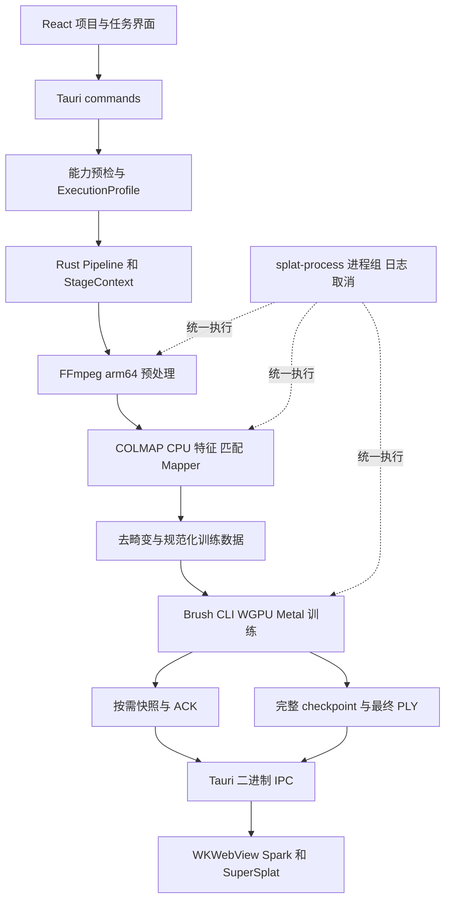

# MetOrigin Splat macOS 高斯生成实施方案

提交整理（2026-10-28）：实现、测试、依赖补丁和构建配置已保存到本地提交 `cad2638`。验收文档单独整理，内存稳定性及目标环境等未通过项保持开放；本次没有推送或发布。

最新进展（2026-10-28）：Release 候选仍为 `a2146f95`／`build.OX71fC`。OrbitControls 生产修复、完整 app／DMG 及六轮原生复测之后，已完成同一未改包的六轮 VM 分类诊断；本轮没有新生产修改或重建。490 个资源样本压力均为 normal，系统 swap used 始终为 1460.38M；该系统量不归因应用，也不补写上一轮未知值。Home1→Home6 的 WebContent footprint 增加 48,840,872 字节，主要落在 WebKit Malloc 与 Untagged；WASM dirty 基本不变、graphics dirty 不变、GPU 服务 footprint 略降。分类尚不能确定存活对象或分配归属，**M3 内存稳定性、完整 M4 与公开发布仍未通过**。13 张原图／AX、正常退出和测试副本完整性均已独立复核，八个精确实例 ESRCH，439 个文件不变。详见[分类诊断收尾](../target/macos-m4/native-orbit-category-20261028/native/closeout.json)与[分类结果及下一步](validation/macos-m3-resources.md#2026-10-28-unchanged-release-vm-category-diagnostic)。真实睡眠仍暂留。

状态：实施中。M0 独立引擎、M1 照片／视频核心流水线，以及原生照片完整生成、查看与 SuperSplat 编辑保存已有实测证据；M2–M4 的最终原生回归和安装包验收仍在进行，尚未通过完整 macOS 支持验收。最新 `a2146f95` 的生产清理修复、包体验证及六轮 Spark／项目中心限定显示、退出和完整性检查已完成；此前 `ee0f0bea`、`6a5c7be6` 的保留发现和更早生成／保存结果仍按原构建保留，不自动转移。评估与启动日期：2026-10-26。证据见 [M0](validation/macos-m0.md)、[M1](validation/macos-m1.md)、[原生桌面](validation/macos-native-ui.md)、[资源](validation/macos-m3-resources.md)及[引擎包](validation/macos-engine-pack.md)。

2026-10-27 已确认当前仅有 M1 Pro／32 GB／macOS 27.0.1 开发机。macOS 15／16 GB 干净环境和 Windows 原生回归仍需外部测试环境；当前主机的受限环境重定位、部署版本检查或 CI 配置均不替代这些验收。

用户随后明确本轮暂留真实睡眠恢复测试，先完成其他检查；本轮没有触发系统睡眠或更改睡眠设置。

`bb13a6ee` app/DMG 已完整打包，并绑定 Rust 705 项通过／14 项环境专用测试默认忽略、前端 190 项及 36 个 schema 用例。原生复测正确拒绝只读目录；工程视频 fast 3,000 步生成 81,368 高斯。独立副本显式恢复 2,500→3,000 后生成 79,786 高斯，checkpoint 与导出/manifest 一致；编辑保存、撤销/重做、未保存退出以及 NFC/NFD 路径读取通过。恢复暂停后仍显示已失效旧模型的前端缺陷已另行复现，后续修复见下一段。

`6784872d` app/DMG 已完整构建，前端更新为 195 项通过。仅详情页及测试改变，Rust 705／schema 36 与核心引擎证据按不变指纹复用。原生恢复复测确认已归档导出画面被清除，跟随阶段显示 2,500 步的 70,280 高斯；继续后实时帧推进，最终自动显示 79,741 高斯，新 checkpoint 与导出/manifest 一致。全部证据冻结；这次针对预览与恢复的验证不替代较早候选的原始生成、编辑或其他环境验收。

随后真实 Objectron 手机视频暴露了负角度显示旋转与恢复时旧帧缓存未重验的问题。`cfba918e` 修正这两处，Rust 716 项通过／15 项环境专用测试默认忽略，前端 195／schema 36 按不变输入复用。23.797 秒原始视频显式设置 5 fps／上限 150，从旧暂停项目继续后重建 119 张正向帧，119/119 注册，3,000 步导出 651,384 个 SH0 高斯；独立审计 1,317 项通过，抽查首／中／末帧与 FFmpeg 自动旋转参考像素一致。MediaValidation 复用旧结果，其余阶段重新执行，不能描述为全新项目的完整禁网运行。应用及观测到的引擎子进程禁网，XPC WebKit 未归因；最终模型在系统 warning 压力解除后自动加载，正常退出且无已知子进程残留。该包在普通启动和进程禁网启动下均复现帧缩略图无法显示；随后修复见下段。

随后 `4e763b58` app/DMG 已完整构建并独立审计，Rust 721 项通过／15 项环境专用测试默认忽略，前端 198 项通过，schema 36 按不变输入复用。帧预览改用受限尺寸的 JPEG data URL，校验项目身份与路径，每次最多 12 张；普通与进程禁网启动均已原生显示正确缩略图，并可切回已有 651,384 高斯最终模型。随后在该包中新建 Objectron 视频项目，应用关闭时显式设置 5 fps／上限 150，全部 12 阶段从头执行，119/119 注册，3,000 步生成 647,529 个 SH0 高斯。冻结的 419 个文件及六个检查点通过独立审计；最终时段出现系统 warning，保留的 2,961 步画面不作为这次初始运行的最终预览证据。

同一项目随后从 1,000 步继续，在核对进程身份后仅向测试应用发送 SIGKILL。重开时正确拒绝仍有原 Brush 进程使用的项目；该引擎自行退出后，项目恢复为暂停状态，再从 2,500 步 warm start 到 3,000 步，生成并自动显示 614,263 个高斯。正常退出后无已知子进程残留。此项验证应用异常退出后的恢复，不代表系统断电、真实睡眠或 GPU device lost；详细证据见 [退出与恢复](validation/macos-shutdown.md)。

同规范化 James40 数据的独立 CLI 对照已完成，固定 3,000 步／SH0，与 bb13 原始生成结果的 schema、坐标及尺度分布核对，三个 965×640 固定相机视角均已捕获和独立复核。CLI 81,656 对比应用 81,368 高斯，未见明显姿态、尺度或轮廓异常；逐视角差异只作诊断，未建立质量容差，也不是 held-out 质量或性能比较。范围及证据见 [CLI 对照](validation/macos-cli-adapter.md)。

历史 `8656d4e0` 候选已完成 311 张 room 原图、均衡 7,000 步原生生成：311/311 注册、737,307 个 SH1 高斯，训练中 ⌘Q、从 1,000 步 warm start、项目/窗口切换，以及 warning/normal 内存压力下暂停新帧并自动恢复均有记录。`006cfe46` 包内引擎禁网核心 smoke 通过（40/40 帧、300 步、16,022 高斯），随后以不变的 105 个核心输入和四引擎/manifest 哈希绑定到 bb13。各结果绑定实际构建，不将较早候选的原生通过自动转移给新包。

`4e763b58` 随后完成 40 张混合尺寸／EXIF 受控图片的原生全流程：四个相机组，40/40 注册，21,203 稀疏点，3,000 步生成并自动显示 121,334 个 SH0 高斯。9,407 项独立审查通过，40 张归一化图片与核心参考逐名一致，六个检查点及最终 PLY 一致。相机身份为人工测试标签，原生选择使用字节不变的平铺副本；此项不代表真实多相机拍摄或仅含子目录的根目录选择支持。

低纹理与低重叠原生测试分别正确返回 E-3010、E-3020，保留源图且未进入训练，但旧包具体诊断被本地化替换为通用引擎错误。新 `d91c49ed` app/DMG 已修复这两个诊断构造路径，Rust 729 项通过／15 项默认忽略，前端 198／schema 36 由不变输入绑定复用。两个全新原生负例均通过独立后端、AX 与截图复核：低纹理显示 24 图／0 特征和补拍指导；低重叠显示 24 图／40,498 特征／0 有效匹配和重叠指导。新包能在 Spark 查看旧包生成的 121,334 高斯模型副本，SuperSplat 手动框显后可渲染，但初始视角与重置视角看不到主体的问题仍待修复；此次没有重新生成正例或编辑保存。正常退出码 0，无已知测试子进程残留。独立 CPU CLI 与适配器均通过固定 SfM 门槛。后续固定两对四次同输入默认参数对照全部完成，四次均 40/40 注册；780 条原始匹配一致，同一运行方式的两次几何验证也有差异。原生产结果的质量差值仍在审查，不能由这四次重复直接豁免，见 [混合输入记录](validation/macos-mixed-input.md)。完整 M4 仍包括这些剩余验证、Dock／真实睡眠、原生离线 Finder 启动，以及上述不可用外部环境。全部候选仍限内部 Alpha，尚未关闭 M4。

随后 `9e25bb7c` 修复成功导入后的初始相机框显，完整 app/DMG 已构建；前端 202 项通过，Rust 729／15 忽略及 schema 36 按不变输入复用。混合 40 图模型副本的首次进入、再次进入均自动显示 121,334 高斯，返回 Spark 未提示未保存修改。Objectron 副本首次进入显示 614,263 高斯及场景几何，但默认角度主体不清晰；随后工具报告手动操作，变换 Y 变为 7.228，返回出现未保存提示。随后依用户明确授权保存到测试副本，复进加载及无修改返回通过，正常退出且无已知子进程残留。独立审计确认原始项目不变，副本仅 PLY 的 Y 平移正确写入，其余 13 属性逐点一致；但保存后 Spark 仍用原拍摄相机，主体不在画面，该取景缺口继续修复。被手动操作中断的首次无修改试验不倒推为通过。详见 [原生桌面记录](validation/macos-native-ui.md)。

进一步固定同一匹配后数据库，只执行 mapper 的 CLI／适配器／适配器／CLI 四次对照，均为 40/40 注册、22,449 点、112,487 观测、平均 track 5.01077999。独立解析确认完整拓扑一致、浮点值不同；平均误差最大差约 `3.08e-12 px`，单点存储误差最大差约 `2.15e-8 px`。四次实际 argv、51 个非路径 INI 参数及完整数据库前后值一致，无观察器错误、残留进程或输入变化。该结果限定于相同几何输入的生产 mapper 构造与执行器，不是完整 MappingStage；原始独立导入对照的 `0.277029 px` 质量差值仍保留，未新增质量容差或豁免。

建议以 **Apple Silicon 原生 arm64、macOS 15 及以上、COLMAP CPU 相机重建、Brush WGPU Metal 高斯训练** 为首版路线。保留现有 Tauri、Rust workspace、引擎适配器、项目目录、Spark 预览和 SuperSplat 编辑体系。核心算法已有可用基础，主要工作是解除 NVIDIA 绑定、适配 Brush 新版本、管理统一内存，以及完成 Mac 引擎打包和真机验证。

首版采用用户自己的 Brush fork，固定当前 1.0.0 源码提交；COLMAP fork 则建立与应用当前版本一致的 4.1.0 构建基线。**不要直接把本地两个仓库的 main 编译后替换现有引擎**：Brush CLI 和实时模型接口已经变化，COLMAP 4.3 开发版还修改了应用直接访问的数据库结构。

本方案区分三个成果：开发机可生成 PLY、完整桌面体验可用、独立安装包可分发。源码审计支持这条技术路线；构建成功、GPU 正确性、性能和最低系统兼容性仍须通过下述验收取得证据。

此前 `f7b7141a` 加入 Spark 拍摄相机与当前模型几何的兼容性判断；平移后旧拍摄视角几乎看不到模型时自动框显当前模型。前端 208 项通过，Rust 729／15 忽略及 schema 36 按不变输入复用。首次打包在 sandbox 内创建 DMG 失败，app-only 证据和失败记录均保留；随后独立完整构建 `build.XWwqBV` 成功，DMG 只读挂载、bundle 一致性及签名校验通过。该轮三副本原生复验正常退出：原始及混合模型 Spark 显示通过；同 ID 不同路径切换平移副本保留旧相机，编辑器往返后虽能整体框显但方向偏背面。后续修复见下段。该包历史 JSON 收据保留，但后续截图辅助函数误写旧目录，覆盖了 13 份图文资产；受影响文件不能再作为符合原哈希的历史证据，详见原生桌面记录。

此前 `e0863d0e` 已完成上述两项修复及完整 app/DMG 构建：预览身份包含项目 ID 与路径，自动回退按当前模型边界重新定位并保留有效拍摄朝向；同路径 live/final 更新仍保留导航，显式整体视图行为不变。定向 68 项、完整前端 219 项、typecheck、lint 及独立增量审查通过，Rust 729／15 忽略与 schema 36 按不变输入复用。原生直接从原始 Objectron 打开同 ID、不同目录的已保存平移副本，Spark 自动显示可辨的鞋与地毯；平移副本进入编辑器后无修改返回，自动取景仍正常；混合模型清晰显示岩石与转台。正常退出码 0、无已知子进程残留。编辑器默认角度仍模糊，不据此关闭其主体清晰度问题；没有将旧候选的生成或保存结果转移给新包。该候选当时为可用的内部 Alpha，完整 M3/M4、三项许可证据缺口与公开分发条件未关闭。

2026-10-28 此前 `6925467b` 已完成编辑器初始拍摄朝向修复及完整 app/DMG 构建：导入后先按当前模型边界取景，再通过实际导入变换恢复 capture forward，保持世界 Y 向上，不恢复拍摄 roll/up、位置或 FOV。本轮新跑前端 235 项、Rust 729 项／15 项忽略及 schema 36 项，typecheck、lint、fmt、Clippy 均通过；打包期间仅在输入匹配后复用这些结果。移除未使用的 shell 插件并绑定 Unicode 官方许可原文后，610 项许可文件仅余 WebP 来源一项缺口。三现有副本的[原生观察记录](../target/macos-m4/native-editor-capture-20261028/root-native-observation.json)确认：Spark 首次显示及返回后主体可辨；两个 Objectron 副本的编辑器加载后可辨两只鞋与地毯，但视野较广、主体偏小且周边重建仍模糊；混合模型的岩石与转台可辨但偏远。三次无修改返回均无未保存提示，正常退出码 0、无已知残留；独立退出审计确认六棵项目树不变，包体及输入核对完成，审计序列化边界另有说明。此项只关闭三副本初入主体可辨和干净返回缺口，不证明模型质量改善或新的生成、编辑、保存、相机导航、重置验收。完整 M3/M4 及公开分发条件仍未关闭；包与历史证据见[引擎包记录](validation/macos-engine-pack.md#2026-10-28-6925-editor-capture-direction-and-license-follow-up)。

2026-10-28 WebP 源码接入已完成：使用固定 libwebp 1.6.0、同树 sharpyuv 0.4.2 和 Emscripten 4.0.21 重建配套 JS/WASM，并为 splat-transform 3.4.2 的 ESM、CJS、worker、CLI 及源码映射提供 10 文件派生覆盖。实测发现并修复了原包装代码在编码失败时的临时内存泄漏；22 主用例、44 恢复调用、5 组成功输出比较和 18 项格式相关测试通过。接入侧 25 项 Node 检查、前端构建，以及 public／dist／许可证输入绑定通过。新独立许可证集合包含 722 份文件、611 条许可记录，验证结果为 issues=[]；这是新载荷来源链的关闭，不反向证明旧二进制的来源。详见[许可证接入记录](validation/macos-app-licenses.md#2026-10-28-fixed-source-webp-replacement)。

随后新 `ebefccae` 已完成完整 app／DMG 构建及只读挂载、包体一致性和签名检查，绑定新 722 文件许可集合且无剩余许可证 finding；旧 610 集合与 6925 DMG 保留。576 个源输入（显式含完整 118 个 overlay 文件）构建前后不变；235 前端、729 Rust／15 忽略按代码输入一致复用，36 schema 按 50 项实质输入一致和两项新增门禁命令的审查范围复用。两项实际引擎／应用预检及前端生产构建本次重新执行。原生打开 Objectron 副本、Spark 和编辑器初始主体显示正常，但 **320×240 WebP 图像渲染后的下载路径导致应用无响应**：主线程采样停在 Wry／WebKit 下载目的地的 SandboxExtension 系统调用，未取得可核验输出文件。取消操作也超时后，仅对本次已核对身份的 PID 发出 SIGTERM，不能算正常退出或导出通过。下一步需修复并复验原生图像保存路径；完整 M3/M4 仍未关闭。见[打包证据](../target/macos-m4/release-package-webp-20261028/acceptance-summary.json)与[原生失败记录](../target/macos-m4/native-webp-20261028/root-native-observation.json)。

后续 `6095c7b2` 已实现并打包原生 PNG／JPEG／WebP 保存路径，273 项前端和 738 项 Rust／15 忽略及静态检查通过；完整 app／DMG、578 项源码绑定、722 项零 finding 许可文件核验通过。原生三种格式均经保存窗口写出并完整解码为 320×240，取消未新增文件，返回／复进与 ⌘Q 后进程消失均有记录，439 个项目文件未变。这关闭了本次图片保存卡死的限定缺口，但当时实际 WebP／JPEG 比 PNG 明显呈点状噪声，未通过导出画质验证。该失败结果保留于[6095 观察](../target/macos-m4/native-image-save-20261028/native/root-native-observation.json)，后续修复见下段。

此前 `0f85289e` 已为宿主图片导出加入临时稳定渲染锁，并桥接固定上游的逐帧渲染请求，结束时恢复原状态。新跑前端 290 项、typecheck、两处变更文件的 lint 与生产构建通过；Rust 738 项／15 忽略、fmt／Clippy 和 schema 36 项按已记录的输入不变及范围审查复用。完整 app／`build.qhJJPk` DMG、578 项源码、118 项 overlay 和零 finding 许可集合均已绑定。新包原生 PNG／WebP／JPEG 三个 320×240 样本保存及完整解码通过，旧 WebP／JPEG 黑孔点噪已消除；PNG 与 WebP 仅 38 个像素存在最多 1 级通道差异，并非逐像素完全相同。取消第四次保存、干净返回 Spark、复进加载及 ⌘Q 后进程消失已确认；这不扩展为大图、360°、视频、SOG、新生成或模型保存验收。见[本轮收尾记录](../target/macos-m4/image-render-quality-20261028/native/closeout.json)与[独立图像复核](../target/macos-m4/image-render-quality-20261028/native/image-comparison-review.json)。当前仍为内部 Alpha，完整 M3/M4 未关闭。

同一 `0f85289e` 随后完成六次 Objectron 测试副本的 Spark／SuperSplat 无修改往返，每次加载 614,263 高斯；正常退出后应用及八个已归属进程身份均消失，439 个项目文件未变。新增只读采集以系统 coalition 明确归属 WebKit 内容／GPU 进程，补充了此前主进程 RSS 无法覆盖的部分。采样中 WebContent 同状态物理占用随轮次增长，编辑器第 3–6 轮中位数约 572／576／641／703 MiB；后续独立 Home 快照仍约 598 MiB。**本轮不通过“多次预览切换无持续增长”的验收**，也尚不能把保留内存直接定性为泄漏。正在针对实际渲染器、worker 与 iframe 释放链做有界定位；完整覆盖范围及采样空档见[资源记录](validation/macos-m3-resources.md#2026-10-28-six-viewer-cycles-and-explicit-webkit-attribution)。此前图片导出专项通过保持不变。

随后对固定 Spark 2.1.0 的真实模块做有界复现：当已提交的 GPU readback 在 `SparkRenderer.dispose()` 后成功返回，实际 `driveSort` 会重新创建 worker 包装对象及 Three 纹理；在 worker 调用挂起时释放的对照则正确拒绝。复现使用 GPU／Browser Worker stub，未执行完整 Three WebGLRenderer 清理，也未证明 WKWebView 中会出现同样的完成顺序，因此仅确认条件性生命周期缺陷，尚未解释实机全部增长。该独立复现阶段未修改生产源码及安装包；随后最小修复和原生复测见下文。详见[复现及边界](validation/macos-m3-resources.md#2026-10-28-bounded-spark-disposal-reproduction)。

此前 `6a5c7be6` 已将上述非 LOD 排序生命周期修复固化为 Spark 2.1.0 的 pnpm 补丁：释放时立即失效并清理排队的更新／排序定时器，每个异步等待后检查是否已释放，保留正常错误与 `onDirty` 回调顺序。真实模块测试由未修复基线的 2 通过／12 失败变为 14 项全通过，另有 17 项补丁来源测试；本轮前端 290、schema 36、typecheck 与完整 lint 通过。Rust 738／15 忽略及 fmt／Clippy 按已绑定源码不变复用，并非本轮重跑。完整 `build.Vw47qp` app／DMG 已完成签名、只读挂载与包体核对；587 项源码和补丁输入构建前后不变，726 文件许可集合零 finding。首次构建因新随包记录含开发机路径而在预检阶段主动停止；修正并增加回归后重新完成，失败记录与旧包均保留。**新包原生内存复测已完成，但仍观察到连续切换增长，不能关闭旧增长发现或 M3/M4**。见[修复包收据](../target/macos-m4/spark-lifecycle-fix-20261028/acceptance-summary.json)和[资源修复范围](validation/macos-m3-resources.md#2026-10-28-spark-lifecycle-patch-awaiting-native-memory-retest)。

此前 `6a5c7be6` 随后完成六轮 Objectron 测试副本的无修改 Spark／SuperSplat 往返，13 张加载画面均显示 614,263 高斯。每阶段停留至少 30 秒，项目中心静置 142.856 秒；正常 ⌘Q 后八个已归属进程均消失，439 个项目文件未变。两段只读采样保留原始数据并排除重叠，共 516 个样本；续流系统压力查询受限，66 个值明确记为未知。WebContent 返回 Spark 后的物理占用中位数逐轮约 356／423／487／553／618／681 MiB，Home 静置中位约 632 MiB，**“多次预览切换无持续增长”仍不通过**。这证明条件性 Spark 补丁尚未解决实机现象，不直接定性泄漏；下一步需隔离 Spark 和编辑器路径后再选择修复。见[该包资源复测](validation/macos-m3-resources.md#2026-10-28-patched-candidate-still-shows-native-growth)与[本轮收尾](../target/macos-m4/native-spark-lifecycle-cycles-20261028/native/closeout.json)。

同一 `6a5c7be6` 随后完成独立的六轮“打开 Spark → 返回项目中心”隔离测试，全程未进入编辑器。13 张捕获经独立图文复核，六次模型均为 614,263 高斯；441 个完整资源样本的系统压力全部 normal。WebContent 物理占用中位数由初始 Home 的 101.06 MiB 变为末次 Home 的 336.42 MiB（末次静置 141.093 秒），各轮并非严格单调。这说明观察到的保留不以进入编辑器为前提，但不能直接定性泄漏或量化编辑器贡献。正常 ⌘Q 后八个已归属 PID 均消失，439 个项目文件不变。真实 Spark／Three 模块的有界复现进一步确认共享几何体会保留各渲染器的释放监听器；使用的是 GL stub，未证明它对实机内存的贡献，且全局释放会影响其他仍在使用的渲染器。当时下一步为针对共享几何、材质和回退纹理设计完整的所有权释放，再复验；该诊断阶段尚未新增生产补丁或构建。见[隔离结果及机制边界](validation/macos-m3-resources.md#2026-10-28-spark-only-isolation-and-shared-resource-diagnosis)。M3 内存、完整 M4 与公开分发仍未通过。

历史 `ee0f0bea` 已实现上述共享渲染资源所有权修复：按底层 renderer 管理私有全屏几何、计算材质和回退纹理，最后使用者释放，保留既有异步排序保护；同时修复初始化失败时 renderer 清理。新增的真实 Spark／Three 模块检查使用 WebGL stub，不能代替原生内存验证。本轮 58 项 Spark（14 生命周期／27 资源所有权／17 来源）、292 项前端、typecheck、完整 lint、生产构建与两项运行包预检通过；Rust 738 项／15 忽略及 fmt／Clippy、schema 36 项按已审查输入复用，并非本轮新跑。589 项源码及补丁输入（含 118 项 overlay）检查／构建前后不变。完整 `build.Lotfbt` app／DMG 的只读挂载、包体一致性、ad-hoc 签名检查通过，726 个列出文件的许可证集合零 issue。主程序 SHA-256 为 `ee0f0beaae735811eaee41c068204e434d1208a4422afc1e7e2704fd9a65d1cd`，DMG SHA-256 为 `0ee24a97cfd2ffc0858b03c28a7d839ff803a191cf0bcd96cb789f03236aa617`。构建收据保留打包当时的 native-pending 状态；后续原生结果另记如下，旧包、失败证据及历史生成／保存结果各自保留。见[构建收据](../target/macos-m4/spark-resource-ownership-fix-20261028/acceptance-summary.json)、[检查与复用范围](../target/macos-m4/spark-resource-ownership-fix-20261028/gates.json)及[资源修复说明](validation/macos-m3-resources.md#2026-10-28-renderer-resource-ownership-patch-awaiting-native-retest)。

同一 `ee0f0bea` 随后完成六轮仅 Spark／项目中心往返，13 份原始截图及 AX 经独立复核，六次均为 614,263 高斯，鞋与地毯可辨。438 个完整资源样本的系统压力均为 normal；最后项目中心静置 129.859 秒，覆盖 65 个完整样本。WebContent 物理占用中位数由初始 Home 的 101.68 MiB 到末次 Home 的 345.61 MiB，Home 第 4→5 轮略降，整体并非严格单调。**共享资源补丁后仍观察到保留，内存稳定性未通过**；与旧 6a5 的比较仅作描述，不能据此定性泄漏或声称受控数值改善／退化。正常 ⌘Q 返回 `App quit`，八个已归属进程身份均为 ESRCH；应用 OS 退出码未知，采样器退出 0。测试副本 439 文件／1,047,169,524 字节未变。本轮未进入编辑器、编辑保存或重新生成，旧结果不转移。当时的下一步为有界保留路径诊断，再决定是否需要新补丁；随后完成的诊断、生产修复与新包复测见下文。见[本轮收尾](../target/macos-m4/native-spark-resource-ownership-cycles-20261028/native/closeout.json)及[资源结果与边界](validation/macos-m3-resources.md#2026-10-28-ee0f-native-spark-only-closeout-with-retention-unresolved)。仍仅为内部 Alpha，M3 内存、完整 M4 和公开分发未通过。

随后临时 `478f67f4` debug 应用完成有界保留诊断：六轮 Spark／首页测试发现每轮一个 controls／camera／canvas 存活，实际 OrbitControls 最小复现确认 DOM 脱离后的事件监听移除根不匹配。13 个自然协议采样点与 2 个单列 Inspector 诊断点、855 个 normal 压力样本均已保留；正常 ⌘Q 后 16 个观测进程实例均不存在，439 个测试副本文件未改。该阶段尚未安装生产修复，后续补丁与 Release 复测见下一段；诊断不能替代 M3/M4。详见[历史诊断与边界](validation/macos-m3-resources.md#2026-10-28-developer-census-and-orbitcontrols-root-mismatch)。重建前的收尾检查发现历史 `ee0f0bea` `.app` 不在原构建路径，原因未知，当时未恢复或覆盖；`build.Lotfbt` DMG 仍在且哈希一致，见[历史产物状态](../target/macos-m4/native-retention-census-20261028/native/release-artifact-status.json)。

最新 `a2146f95`／`build.OX71fC` 已把 Three 0.185.1 OrbitControls 的监听注册根保存并用于清理 keydown／keyup，覆盖 DOM 脱离、重复 dispose 与跨根 reconnect。原始真实模块 2 通过／16 失败，安装补丁后 18 项全通过；四个未改变的真实 React 卸载用例由失败变为通过。本轮新跑前端 296 项（36 文件）、Spark 60 项、Three 39 项（18 生命周期／21 来源），typecheck、lint、完整 app／DMG 构建及两项运行包预检通过；单列 18／4 项已包含在完整套件内，不重复加总。Rust 738 项／15 忽略及 fmt／Clippy、schema 36 项按已审查输入复用，不是本轮重跑。597 项来源记录在门禁前、门禁后及构建后快照一致；729 个许可文件、611 条许可文本记录均无 issue。主程序 SHA-256 为 `a2146f9544baf9dde30c4dbfd43371b296796b3c41c2495822024998175251c8`，DMG SHA-256 为 `3f2ce450159bd3f264cf454f3970da7069a893e8ad449d9f0ddb2fec2db33b0f`。见[包体收据](../target/macos-m4/orbit-controls-root-fix-20261028/acceptance-summary.json)与[门禁和历史复用边界](../target/macos-m4/orbit-controls-root-fix-20261028/gates.json)。

同一 `a2146f95` 完成六组仅 Spark／项目中心往返；末次 Home 静置 140.659 秒、70 个完整样本。WebContent Home0→Home6 物理占用中位数为 100.907／184.001／200.033／203.017／245.267／208.783／211.900 MiB，并非严格单调；Home1→Home6 RSS 中位数为 384.734／426.672／515.828／519.844／555.859／560.133 MiB。460 个样本的压力及 swap 全为未知，不能写作 normal 或零 swap。结合 RSS 阶梯增长与未知压力条件，尚不能确认“多次预览切换无持续增长”；不单凭相对初始基线残留定性泄漏，也不宣称对旧包有受控改善。[独立退出与完整性审查](../target/macos-m4/native-orbit-root-cycles-20261028/native/independent-exit-integrity-review.json)32 项通过，确认八个精确实例 ESRCH、439 个完整文件记录相等。应用 OS 退出码未知，采样器退出 0。见[原生操作记录](../target/macos-m4/native-orbit-root-cycles-20261028/native/root-native-observation.json)、[本轮收尾](../target/macos-m4/native-orbit-root-cycles-20261028/native/closeout.json)及[资源结果](validation/macos-m3-resources.md#2026-10-28-orbitcontrols-root-repair-and-release-observation)。本轮未编辑、保存或重新生成；真实睡眠、Dock、离线 Finder、目标硬件／系统环境及完整 M3/M4 仍开放，只提供内部 Alpha。

## 1 支持范围和完成定义

| 项目 | 首版范围 | 后续独立评估 |
| --- | --- | --- |
| 硬件 | Apple Silicon M1 及更新机型，原生 arm64 | Intel Mac、eGPU、Universal Binary |
| 系统 | 暂定 macOS 15.0 起；最低版本真机与全部依赖均通过才对外声明 | 降低系统最低版本 |
| 内存 | 16 GB 作为初始正式验证档，32 GB 及以上验证更大素材 | 8 GB 作为受限实验档，不先承诺常规可用 |
| 素材 | 当前支持的视频与 JPG、JPEG、PNG 图片文件夹 | 全景、HEIC、外部模型增量训练等新功能 |
| 相机重建 | COLMAP 4.1.0，CPU SIFT、CPU matching、Ceres CPU BA | 4.3 数据库升级、CoreML 特征、Metal SIFT |
| 高斯训练 | 用户 Brush 1.0.0 fork，headless CLI，默认 WGPU 路径在 macOS 选择 Metal | 原生 MSL 优化 feature、其他训练器 |
| 查看和编辑 | 最终 PLY、checkpoint、按需实时快照、现有 SuperSplat | 共享 GPU texture、原生 Metal viewer |
| 恢复 | 从最近完整 PLY 恢复模型，优化器重新初始化 | 完整 optimizer、RNG 和数据加载器状态恢复 |
| 分发 | 自包含 `.app` 和 `.dmg`；公开分发增加 Developer ID 签名与公证 | App Store / App Sandbox |

完整交付必须满足：用户在无 Homebrew、无 CUDA、无 NVIDIA 工具的目标 Mac 上，离线完成“导入 → 预处理 → SfM → 去畸变 → 训练 → 查看、编辑 → 导出”；任务可取消、可按既有语义暂停恢复，已有 Windows 项目仍可读取，Windows 重建流程不退化。

`macOS 15.0` 是为首版缩小验证矩阵而选择的产品基线，不是已经证明 Brush 算法只能在该版本以上运行。新系统上的开发验证也不能替代最低系统验证。

## 2 源码基线和参考项目结论

### 2.1 固定版本

| 仓库 | 审计基线 | 对实施的影响 |
| --- | --- | --- |
| MetOrigin-Splat | `161aa3306854944724bfb1cb0b5dcdd5b0b93cdf`，审计起始工作区干净 | 当前锁 FFmpeg 8.1.2、COLMAP 4.1.0 CUDA、Brush 0.3.0 |
| 用户 Brush fork | `MinKaiZhi/brush`，`1388f74c6fe0236f68ee4915564bf00e9d2e3747`，main，工作区干净 | workspace 1.0.0；已有 `apps/brush-cli`；无需再抽离 GUI 才能训练 |
| 用户 COLMAP fork | `MinKaiZhi/colmap`，`fa089062a56261d11b070aaea0c767cc3730526f`，main，工作区干净 | 当前版本 4.3.0.dev0，不能当作 4.1.0 的直接替换 |
| OOOSplat | `65193513fde9e5cb2bf5bd9b906c7221f834b077` | 本方案引用该固定快照，避免 main 后续变更使依据漂移 |
| 推荐 COLMAP release 基线 | 上游 tag `4.1.0` → `fa8e3b3ff591552855f8ad2806723c80f963f69c` | 已通过上游 Git ref 查询确认；实现时从该提交建立 fork 构建分支并记录补丁 |

初次审计时，本地 COLMAP 没有已获取的 tag refs，4.1.0 release commit 对象也不在本地对象库中。实施时需取得并校验目标源码，不能在脚本中假设本地已有 `4.1.0` tag，也不要改动用户现有 main。实施已在用户指定的新分支 `codex/macos-gaussian-generation` 启动；两个引擎使用 Git 忽略目录内的隔离 checkout，保留用户 fork 的 main。

### 2.2 从 OOOSplat 借鉴的做法

| 参考实现 | 采用方式 | 边界 |
| --- | --- | --- |
| COLMAP CPU 与 Brush Metal 分开检测 | 将相机重建能力和训练 GPU 能力建模为两个独立字段 | 没有 CUDA 不能等价为不能生成高斯 |
| Mac 原生 headless 引擎 | 构建用户 fork 的 `brush-cli`，打包 CLI-only COLMAP | OOOSplat 的 OOOBrush 与用户 Brush 不是同一 commit，不能默认功能等价 |
| COLMAP `--help` 检测参数族 | 锁定版本和命令能力，识别 `FeatureExtraction/FeatureMatching` 与旧 `Sift*` 参数差异 | 版本命令成功不代表整个 pipeline 兼容 |
| arm64 引擎目录、资源锁、运行库闭包 | 单独建立 `packaging/macos-arm64`，版本与哈希可追溯 | 使用 MetOrigin 的 manifest 和 resolver，不搬入第二套引擎管理体系 |
| `otool`、部署版本检查、受限 PATH 测试 | 检查所有可执行文件和 dylib，验证脱离构建机仍能运行 | Homebrew 仅用于构建依赖，不成为最终用户前提 |
| Unix 独立进程组与整组终止 | 补强统一 `splat-process` | 同时保留 Windows 的进程管理行为 |

参考项目也有不能直接继承的状态：其 macOS 总分发清单中的 `archiveSha256`、`integritySha256` 仍为 null；README 明确说明常规源码引擎下载因此会拒绝执行。其 Mac Alpha 声明为未签名、未公证。**有 Mac 配置与 CI 文件，不等于已经满足 MetOrigin 的公开分发门槛。** 此外其 Brush 启动策略某段诊断文字仍固定写 `backend=Vulkan`，应以实际 adapter 信息为准，避免复制这类展示假设。

参考源码链接见第 12 节。

## 3 当前项目的改造位置

| 优先级 | 文件或模块 | 已确认问题 | 目标改动 |
| --- | --- | --- | --- |
| P0 | `commands/project.rs:380`、`commands/pipeline.rs:103`、`stages/brush_training.rs:86` | 预检、启动和训练阶段均绑定 `nvidia-smi` | 统一训练能力检查，Mac 使用 Metal probe；三个入口一致 |
| P0 | `splat-hardware/src/detector.rs`、`splat-domain/src/hardware.rs` | detector 仍有占位实现；设备类型主要面向 CUDA/DirectX | 真实平台、架构、backend、统一内存和能力报告 |
| P0 | `splat-hardware/src/manifest.rs:13`、`:200` | pack 平台只接受 `windows-x64` | 识别 `macos-arm64`，校验当前 target 与包一致 |
| P0 | `splat-hardware/src/locator.rs:388` | Unix 只搜索 `brush`，不匹配 fork 的 `brush-cli` | 按 manifest 解析精确路径，开发模式补充 CLI 名称 |
| P0 | `splat-engine-colmap/src/feature.rs:29`、`adapter.rs:184` | extraction 默认 GPU，matching 未显式选择 backend | Mac extraction、matching 均传 CPU 参数 |
| P0 | `stages/colmap_feature.rs:101`、`:137` | 结果验证记录硬编码 GPU 已使用 | 记录 ExecutionProfile 指定的实际模式 |
| P0 | `splat-engine-brush/src/config.rs:133` | 固定发出 0.3.0 的 `--total-steps` | 按 CLI profile 生成 0.3 / 1.x 参数 |
| P0 | `splat-process/src/runner.rs:93`、`:618` | Unix 未建立独立进程组，kill 正 PID 只能杀直接子进程 | 建立并管理 PGID，终止整个任务进程组 |
| P1 | `splat-engine-colmap/src/runtime.rs:36` | 运行环境围绕 Windows PATH、Qt 布局 | 分平台构造；Mac 无 GUI、无 OpenGL，使用正确 rpath |
| P1 | `integrations/brush-live`、`Build-BrushLive.ps1` | 0.3.0 内部 API 与源码字符串补丁 | 在 Brush fork 内实现独立 bridge，保留旧 Windows companion |
| P1 | `commands/system.rs:611`、前端 system types | GPU 指标仅来自 NVIDIA，部分内存指标不可为空 | 区分统一内存和专用显存；未知指标显示未知 |
| P1 | `stages/colmap_support.rs:20`、训练缓存判断 | fingerprint 不含完整执行 profile；训练缓存主要看步数/PLY | 加 profile、引擎、素材和参数契约，避免错误复用 |
| P1 | `GaussianSplatPreview.tsx`、`commands/preview.rs`、editor bridge | 需验证 WKWebView；新旧 mesh 替换存在内存峰值 | 复用二进制 IPC 和现有渲染器，控制频率和内存 |
| P1 | `package.json`、`tauri.full.conf.json`、`scripts/windows`、CI | 打包和原生 UI 验证仅有 Windows 路径 | 增加 Mac 引擎脚本、Tauri overlay、arm64 CI 与真机 UI 验收 |

表中 `commands/` 指 `apps/desktop/src-tauri/src/commands/`，`stages/` 指 `crates/splat-pipeline/src/stages/`。行号以审计基线为准。

已有实现应继续使用：`training_preparation.rs` 已调用 `image_undistorter`，同步缩放相机内参与图片，生成 `training/dataset/images` 和 `sparse/0`；COLMAP 已有多模型选择；预览通过完整 PLY 和 Tauri 二进制 IPC 驱动 Spark/WebGL，并不依赖 Win32 原生渲染窗口。

## 4 目标架构和能力契约



### 4.1 每次运行冻结 ExecutionProfile

在 `splat-domain` 定义平台中立的数据结构；`splat-hardware` 负责主机信息和引擎包身份，具体 adapter 负责引擎 CLI/probe。Tauri 组合探测结果，在创建或启动运行时生成 profile，传入 `PipelineConfig` 和 `StageContext`。不要让 hardware 反向依赖 pipeline，也不要让 React 构造引擎命令。

建议字段如下，名称为待实施接口：

```text
ExecutionProfile
  version
  platform / architecture / os_version
  engine_pack_id / engine_commits / binary_hashes
  colmap_cli_profile / database_schema_profile
  colmap_feature_backend = cpu | cuda
  colmap_matching_backend = cpu | cuda
  colmap_ba_backend = ceres_cpu
  brush_cli_profile = legacy_0_3 | metorigin_1
  brush_backend = metal | existing_windows_backend
  brush_device_id / probe_result / supported_features
  memory_kind = unified | dedicated
  memory_budget / image_cache_budget / max_splats
  effective_resolution / frame_policy / threads
  live_protocol / resume_mode
```

同一任务的预检、命令生成、进度、质量报告应引用同一个 profile；训练开始前可再次验证 GPU 是否仍可用，但不要在长任务中静默改变引擎版本、backend 或质量参数。若选择了不兼容的引擎，返回带修复建议的稳定错误码。

### 4.2 Mac 训练能力探测

分开验证四层：文件完整性和架构、CLI 能力、GPU device 初始化、实际小型计算任务。`--version` 只能证明前两层中的一部分。

建议在 Brush fork 增加轻量 `--capabilities-json` 与显式 GPU probe 入口：输出构建 commit、CLI profile、WGPU backend、adapter、支持的预览协议、恢复模式和关键限制；GPU probe 执行微型渲染及反向传播 smoke。**这些是新增接口，当前 fork 尚未提供。** 首个 prototype 可先使用真实小数据集短训练取得 Metal 证据，再实现稳定 probe。

常规设置页面读取缓存的探测结果；引擎哈希、系统版本或应用版本变化时失效。避免每次输入项目名称都初始化 GPU。Mac 缺少 `nvidia-smi` 属于正常状态；Windows 首版继续保留已验证的 NVIDIA 路径。

### 4.3 项目格式与跨平台恢复

尽量保持 `project.json` v1 和既有 stage ID 不变。新运行信息放入独立、带 `schema_version` 的 `runtime/execution-profile.json`，每次尝试保存可追溯的 run ID；运行恢复时复用并校验对应 profile。该文件是拟新增产物，需要目录、schema、原子写入和旧项目缺失该文件的兼容测试。

如果实现需要改变既有持久化字段，必须同步增加 schema 版本、迁移器和 fixtures，不能仅凭 serde 默认值绕过仓库的迁移约束。旧项目缺少 profile 时保留读取与最终模型查看能力，重新执行前建立兼容性判断。

素材和产物使用项目相对路径；本机引擎绝对路径属于用户设置或诊断，不作为可移植项目配置。Windows 创建的最终 PLY 应能在 Mac 打开；不承诺 Windows 0.3 checkpoint 与 Mac 1.0 可以无损继续同一优化过程。跨版本恢复仅在验证过 PLY 语义后允许 warm start，否则保留旧产物并从已验证数据重新训练。

## 5 三个仓库的实施设计

### 5.1 MetOrigin-Splat 的流水线适配

1. 建立共享的 runtime preflight，替换项目预检、任务启动、Brush stage 三处 NVIDIA 硬门禁。检查失败应指明“训练设备不可用”“引擎包架构不匹配”或“内存预算不足”等原因。
2. `EngineLocator` 在发布版使用已验证 manifest 的 executable 映射；开发版支持显式 engine root、配置路径及现有受控 fallback。Finder 启动不能依赖 shell 的 PATH。
3. Mac COLMAP 显式 CPU extraction 和 matching；对图片组/视频保留现有相机分组和匹配策略，先验证正确性，再单独优化 CPU 代价。大规模无序图片仍可能触发 O(N²) matching，应在预检提示而非擅自按文件名当拍摄顺序。
4. 保留 image_undistorter、选中 sparse model、图像数量与相机内参尺寸一致性检查。无需执行 dense stereo 或 mesh reconstruction；高斯训练消费稀疏相机与影像数据即可。
5. `BrushAdapter` 根据精确版本、构建身份和 help/capabilities 选择参数 profile。不能在全局把 `--total-steps` 替换后破坏 Windows 0.3 引擎。
6. 成功条件必须同时包括正常退出、达到目标迭代、完整有效的最终 PLY，以及成功发布 `training/result.json` 和 `output/scene.ply`。fork 的导出失败可能仅输出 Warning，不能只凭 exit code=0 显示成功。
7. 加强 PLY 校验：完整 header、required Gaussian 属性、vertex 数、binary stride/长度、有限数值和 SH 阶数兼容；不能把只有正 vertex 数的截断文件当恢复数据。最终发布采用临时文件、验证、同步和替换，失败保留上一份有效结果。

建议新增或扩展：`splat-domain::runtime`、`splat-hardware::macos`、Brush `capabilities` 与 CLI profile、COLMAP matching backend 参数、pipeline profile 注入与缓存契约。实际命名按现有风格落地。

### 5.2 Brush fork 的构建与接口

首个独立验证命令如下，须在固定提交的隔离 checkout 中运行；这些命令尚未在本次审计中执行：

```sh
MACOSX_DEPLOYMENT_TARGET=15.0 cargo build --locked --release \
  -p brush-cli --target aarch64-apple-darwin
```

输出为 `target/aarch64-apple-darwin/release/brush-cli`。固定 Rust 工具链、Cargo.lock、Xcode/SDK 版本；项目根当前使用 Rust 1.97.0，而 fork CI 使用 1.95.0，M0 验证后选择并写入引擎锁文件。Burn 与 wgpu 包含 Git 依赖，必须保留 lock 中的精确 revision，发布构建禁止自动更新依赖。

默认 WGPU 在 macOS 使用 Metal；`brush-cube/metal` 是额外的原生 MSL 优化路径，其源码注明 Apple7 GPU family 与 Metal compiler 3.2 等要求，虚拟 GPU fallback 也有限制。**Mac MVP 使用默认 feature 集；不要给 Brush fork CI 套用 `--all-features`。** 后续优化需独立构建、正确性对比和真实硬件基准。

独立 smoke 的参数示意：

```sh
"$BRUSH_BIN" "$DATASET_DIR" \
  --total-train-iters 300 \
  --max-resolution 960 \
  --max-splats 300000 \
  --max-scene-batch-cache-size 512MiB \
  --sh-degree 0 --lod-levels 0 \
  --export-every 100 \
  --export-path "$CHECKPOINT_DIR" \
  --export-name 'checkpoint_{iter}.ply'
```

`DATASET_DIR` 和 `CHECKPOINT_DIR` 必须为绝对路径，dataset 应来自已验证的去畸变流程，M0 数据集中不带 `args.txt`。300 步仅用于证明训练和导出链路，不作为质量验收。显式固定 LOD 为 0，并按下述要求治理参数合并，避免默认行为变化导致多训练阶段或输出文件语义不一致。

| 契约 | 当前 0.3 接入 | 1.0 接入策略 |
| --- | --- | --- |
| 训练步数 | `--total-steps` | `--total-train-iters` |
| 输出与恢复 | export 参数、`--start-iter` | 验证保留参数语义，使用绝对输出目录 |
| 初始模型 | 现有恢复文件准备 | 放置明确的 `init.ply`；清理 dataset 内无关 PLY，避免自动选择其他文件 |
| 内存限制 | 未显式传新资源选项 | 传 max resolution、max splats、scene batch cache 等 |
| 训练进度 | 解析日志及扫描 checkpoint | 首版兼容日志；fork 新增版本化 JSONL 事件 |
| 模型快照 | 旧 TrainStep 直接带模型 | 从 `RunningProcess.splat_view` 的 Slot 取最新快照 |

fork 的 `args.txt` 会参与参数合并，当前 `brush-process/src/args_file.rs` 还存在两个需要处理的边界：等于默认值的显式 CLI 参数会被过滤，导致 `--lod-levels 0` 未必覆盖文件中的非零值；参数重新按空白拆分会破坏带空格的路径。M0 禁用 dataset 配置文件，MAC-10 修复参数来源识别和 token 边界，并测试“显式默认值覆盖文件配置”以及中文、空格路径。受管 dataset 只能包含由应用生成且被记录的配置；启动记录保存最终生效参数，不允许隐含配置改变步数、输出位置或内存上限。

建议在 fork 新增可选 `metorigin-bridge` 或独立 binary，提供版本化 JSONL：`started`、`progress`、`evaluation`、`checkpoint_committed`、`warning`、`failed`、`completed`。训练日志走 stderr；事件包含 protocol version、run/session ID、iteration 和必要数值；失败带稳定 error code。只有 checkpoint 原子落盘后才发送 committed 事件。

将当前普通 checkpoint 写入改为同目录临时写入和原子发布；导出失败应产生显式失败结果。上层 adapter 仍独立验证文件，防止错误事件造成误报。真实 loss/evaluation 若可获取才展示，未启用 eval split 时不能伪造 PSNR/SSIM。

### 5.3 实时预览移植

保留既有 `request.json → frame-N.ply → latest.json → 二进制 IPC → ACK` 协议和 session 隔离，在 fork 内移植 producer。无需引入 HTTP server、共享显存或第二套 viewer。

新 `TrainStep` 已不携带 Splats，模型结构也改为 packed transforms、SH 和 raw opacities。应从新 `RunningProcess.splat_view` 接入模型，并优先调用官方 `brush_serde::splat_to_ply`。官方导出会处理 Mip scale floor、旋转、SH 和坐标元数据；live 还须像正常 checkpoint 一样先应用 `units_per_meter` 缩放，并传入一致的 up-axis。直接照搬旧字段序列化会有尺度或透明度错误风险。

当前 Slot 的 `latest()` 只返回模型，不含迭代号，训练 actor 又会继续前进。bridge 应在训练端配对捕获 `(iteration, model)` 后发布，不能把早先的 `TrainStep.iter` 标在后来读取的模型上。latest 元数据必须如实描述这一帧。

实施要求：

- 用户打开实时预览且有新请求时才 GPU readback；关闭预览后不持续导出。
- 最多一个待 ACK 帧、一个最新候选快照；ACK 超时后丢弃过期需求，不能阻塞训练。
- 完整 PLY 发布后才原子更新 latest；切换项目、重启任务或恢复时更换 session，禁止串帧。
- 沿用协议 1 只限字段语义完全兼容的情况；若更改协议，显式协商版本并保留 Windows companion 路径。
- snapshot 和 checkpoint 分开，降低预览频率不能降低恢复能力；预览失败优先降级到最后有效 checkpoint。
- 不在无限消息队列中积累待导出模型；快照通道容量受限，日志消费与 GPU 回读分离。

开发版可先用 checkpoint 预览完成 M1，但完整 Mac 交付需完成 live bridge、视觉等价检查和内存验收。

### 5.4 COLMAP fork 的构建策略

首版从 4.1.0 release commit 建立自己的固定构建分支。保留 fork HEAD 不动。当前 4.3 dev 在提交 `f1ea91d024b23c789a590aca901ac55fce4d7b72` 引入多来源相机标定，`cameras` 主键变为 `(camera_id, source)`；应用的 `database.rs` 仍按单个 camera_id JOIN 和 COUNT，相机合并逻辑存在重复计数与错误处理风险。

若必须使用 4.3 HEAD，则将以下事项提升为 M1 前置：数据库 schema 检测、source 选择规则、相机分组/rig 更新、事务测试、旧数据库读取与迁移/重建策略。不能只改 GPU flag；也不要让新引擎直接原地升级唯一一份旧项目 database。

构建目标为 CLI-only、CPU-only，基本 CMake 选项为：

```text
CMAKE_BUILD_TYPE=Release
CMAKE_OSX_ARCHITECTURES=arm64
CMAKE_OSX_DEPLOYMENT_TARGET=15.0
CUDA_ENABLED=OFF
GUI_ENABLED=OFF
OPENGL_ENABLED=OFF
ONNX_ENABLED=OFF
CASPAR_ENABLED=OFF
TESTS_ENABLED=OFF          # 发行产物配置；测试构建单独启用
```

上述功能 flags 已与上游固定 4.1.0 的 CMake 声明核对，实际配置成功仍需 M0 构建验证。MVS、CGAL、LSD 等进一步裁剪单独评估，不照搬 ooosplat fork 的完整构建选项。固定 Ceres、Eigen、SQLite、图像库、Boost、libomp 等实际依赖的版本和构建选项；确保 AppleClang/OpenMP 可用，并记录 CMakeCache 与构建产物清单。缩小依赖时必须重新验证 JPG、PNG、EXIF、方向信息与 CPU SIFT，不得为了减小包体裁掉当前素材流程需要的能力。

适配器确认 help 后应为 Mac 发出：

```text
feature_extractor ... --FeatureExtraction.use_gpu 0
sequential_matcher ... --FeatureMatching.use_gpu 0
# 或 exhaustive_matcher，沿用当前素材策略
mapper ... --Mapper.ba_use_gpu 0
# 当前 pipeline 也优先尝试 global_mapper，需覆盖该命令的 CPU 参数
global_mapper ... --GlobalMapper.gp_use_gpu 0 --GlobalMapper.ba_ceres_use_gpu 0
image_undistorter ... --output_type COLMAP
```

CPU 参数覆盖 feature、matching，以及现有 pipeline 使用的 incremental/global 两种 mapper；GP、BA、线程选项均按固定版本 help 验证。纯 CPU 编译可能默认禁 GPU，但不能依赖默认值。GPU index 在 CPU 模式不传。线程数纳入 profile，避免 COLMAP、图像解码与 UI 抢占全部资源；先保留既有匹配算法，性能优化另做有质量对照的变更。

当前阶段有固定超时，例如 feature 1 小时、matching 2 小时、mapping 按尝试为 2/4 小时。M0 记录 CPU 耗时后制定平台预算，区分总体超时与长期无进展，避免将正常但较慢的 CPU 任务误判为卡死；取消入口始终可用。

本地 4.3 fork 的 ONNX 路径出现了 CoreML provider，但这不代表已有 Metal SIFT，也不等价于现有相机数据库、特征和匹配策略可直接切换。该路径不进入首版关键依赖。

## 6 统一内存和预设策略

Apple Silicon 的 CPU、训练 GPU、系统和 WKWebView 共享内存。不能把总 RAM 当作可独占显存，也不能把未读到 VRAM 当作零能力。建议通过系统 API 采集物理内存和内存压力，通过实际 Metal device 获取可用的推荐 working set 信息；获取失败时使用保守档位，并保留未知状态。

Brush 1.0 原生图像缓存默认 **6 GiB**，最大 splats 默认 **1000 万**。直接沿用会给 16 GB Mac 带来明显风险。训练过程还包含参数、梯度、优化器、渲染临时 buffer；预览有 GPU 回读、PLY buffer、JS 数据、旧新 mesh 重叠。因此不能只用 PLY 文件大小估算内存。

以下为待基准校准的初始限制，属于工程起点，不是已测得的能力上限：

| 档位 | 输入上限建议 | SfM / 训练最长边 | 图像 cache | max splats | 训练与 SH | 预览策略 |
| --- | --- | --- | --- | --- | --- | --- |
| 8 GB 实验 | 80–120 帧 | 1600 / 960 | 256–512 MiB | 30 万 | 3000 / SH0 | 默认 checkpoint，live 手动开启 |
| 16 GB 保守 | 150–300 帧 | 1920 / 1280 | 512 MiB–1 GiB | 50–100 万 | 3000–7000 / SH0–1 | 完整快照约 5–10 秒起步，按压力退让 |
| 32 GB 均衡 | 300–600 帧 | 2560 / 1920 | 1–2 GiB | 150–250 万 | 7000 / SH1 | 约 2–5 秒起步，单帧背压 |
| 64 GB 及以上 | 先沿用已验证素材规模 | 4096 / 2560 | 2–4 GiB | 300–500 万 | 30000 / SH2 | 以实测回读与渲染峰值控制 |

不直接改写 Windows 共用的 fast/balanced/quality 默认值。增加平台资源 profile，计算并显示“请求预设”和“实际执行参数”，写入运行记录。用户看到的抽帧数、磁盘估计和训练参数必须来自同一份 effective config。图片输入若需减少样本，应明确告知选择规则；不要训练时悄悄只加载部分已重建照片。

OOM 策略按成本顺序处理：停止请求新 live 帧 → 释放旧预览缓存 → 提供较低训练资源档位重新开始的选项。模型训练中无法安全改变的分辨率或算法参数不静默热改。保留有效 checkpoint，报告资源不足而非泛化为“未知引擎错误”。

验收必须记录应用、Brush、COLMAP 与 WebKit 进程占用，以及系统内存压力和 swap 变化；GPU/CPU 共享页可能重复统计，不能简单把各进程 RSS 相加作为物理内存结论。缓存上限只控制缓存，不等于总进程内存硬上限。

## 7 任务生命周期和 Mac 桌面体验

### 7.1 进程控制

Unix 子进程启动时创建独立进程组，保存 PGID；取消时向整个组发 SIGTERM，等待可配置的短宽限期，再 SIGKILL 剩余成员并回收直接子进程。直接子进程先退出也必须处理仍在组内的后代，防止管道不关闭、锁不释放或后台继续占用 GPU。实现应保证不会向应用自身组发送信号，并在异常路径执行清理。

Mac 暂停沿用当前产品语义：**终止训练并保留最近完整 checkpoint，恢复时重新启动并加载模型**。不引入 SIGSTOP 假装完整原位续训。UI 需说明可能损失自上次 checkpoint 起的进度，以及优化器不恢复。

恢复前比较 checkpoint 高斯数量与新的 `max_splats`。当前 Brush 会在加载时按该上限降采样；切换到更低内存档可能丢弃部分模型点。因此超限时要保留原 checkpoint，将降采样明确作为新的训练尝试，不能静默按普通恢复执行。

关闭窗口与退出应用分开定义：关闭主窗口可让任务继续，并提供重新显示入口；`Cmd+Q` 或系统退出则按明确的任务退出策略中止并持久化状态，不能留下不可管理的训练进程。崩溃或强制退出后的下次启动应检查 run owner、项目锁和产物，再提供恢复，不能只凭旧 PID 仍存在判断任务存活。

训练期间是否阻止系统空闲睡眠应成为明确的本地设置，可用系统 activity assertion 实现并在任务结束释放。合盖、系统强制睡眠和 GPU device lost 仍需测试，不承诺能够阻止所有系统休眠。

### 7.2 原生预览和交互

保持 Spark/WebGL 与 SuperSplat。重点验证 WKWebView 的 WebGL capabilities、纹理/缓冲限制、SH、透明度、坐标轴和摄像机方向。检查连续替换模型、切换项目、隐藏窗口、恢复显示、context lost 和编辑保存。

现有 `scripts/windows` 的 native UI 验证依赖 WebView2 CDP，不能原样作为 Mac 验收。新增 WKWebView 真机操作路径或仅开发构建启用的受控测试桥；任何测试桥不得进入正式包。浏览器 preview 的通过结果只覆盖前端，不代表 Metal 训练或 Mac 原生文件行为通过。

调整 Cmd/Ctrl 主修饰键、Cmd+N/O、编辑撤销和文件选择体验，保留表单与输入法保护。验证空格、中文、emoji、外接盘、只读目录、大小写敏感卷，以及 NFC/NFD 文件名差异。文件夹导入、视频方向/色彩、照片 EXIF 方向应与当前实现一致。

资源面板建议显示“COLMAP：CPU”“Brush：Metal / 设备名”“统一内存”“训练资源预算”。不可获取的 GPU 利用率显示未知，不填 0，也不显示 NVIDIA 驱动安装建议。

## 8 引擎包和应用分发

### 8.1 目录与版本锁

建议保持当前 manifest 机制，新增平台目录和构建脚本：

```text
packaging/macos-arm64/
  engine-lock.json
  THIRD_PARTY_NOTICES.template.md
  README.md
scripts/macos/
  build-brush.sh
  build-colmap.sh
  prepare-engine-pack.sh
  verify-engine-pack.sh
  build-release.sh
apps/desktop/src-tauri/tauri.macos.conf.json
target/distribution/macos-arm64/engines/
  engine-manifest.json
  ffmpeg/bin/ffmpeg
  ffmpeg/bin/ffprobe
  ffmpeg/lib/...
  colmap/bin/colmap
  colmap/lib/...
  brush/bin/brush-cli
  brush/bin/brush_live           # bridge 单独成 binary 时
  licenses/...
  BUILD-INFO.json
  SBOM.json
```

目录是拟议布局，logical engine `brush` 通过 manifest 映射到 `brush-cli`；无需为了兼容而假装它是 `brush_app.exe`。实现时与 resolver、资源映射、完整性校验和测试一起冻结。构建产物继续放入 Git 忽略目录。

lock 至少记录源码仓库和 commit、补丁版本、archive URL/本地构建来源、archive SHA-256、文件 inventory 与哈希、target、最低系统版本、编译器/SDK、feature 列表、许可证和源码获取方式。未填哈希的下载包应拒绝用于正式分发；本地构建必须产生自己的可验证 inventory，不能复用 OOOSplat 的哈希。

manifest 平台扩展需保留旧 Windows pack 可读；若新增持久化结构无法在当前 schema 表达，增加 schema 版本并明确旧包读取策略。校验大小写、可执行位、符号链接目标、路径穿越和架构；发布包缺文件或损坏时应明确报错，不回退系统 PATH。

### 8.2 FFmpeg 与动态库

FFmpeg/FFprobe 继续固定 8.1.2，原生 arm64。开发验证可配置已安装工具，最终包需包含自己的 FFmpeg/FFprobe 和必要运行库。VideoToolbox 加速属于后续可测优化，首版先保证解码、抽帧、方向和颜色一致。

对每个 Mach-O 递归读取 `otool -L` 和 `LC_RPATH`，复制非系统 dylib 到受管 lib 目录，并改写为合法的 `@loader_path` / `@rpath` 关系。保留 Apple 系统 framework 引用，拒绝残留 `/opt/homebrew`、`/usr/local`、构建机 home 和临时路径。只检查主 executable 不够，必须遍历全部依赖。

逐个检查 architecture、最低部署版本、执行权限和库闭包；用清理后的 PATH 启动版本/help/smoke，并在没有开发依赖的干净 Mac 执行完整任务。dylib 的加载不靠往 PATH 填 `lib` 修补，也不把长期设置 DYLD 环境变量作为发布方案。

### 8.3 签名、公证和许可证

构建顺序固定为：编译 → 收集 dylib → 改写 load commands → 签名嵌套引擎和 dylib → 生成这些最终文件的完整性清单 → 打包并签名外层 `.app` → 公证及 staple → 生成 `.dmg` 和最终分发哈希 → 验证安装包。签名会改变二进制字节，不能先锁未签名文件的哈希，再在安装包中更改它们。

必须确认 Tauri bundler 不会再次签名或改写 inventory 内的嵌套二进制；若会，在它的最终处理后生成清单，再签外层应用。对最终 `.app` 内的资源重新跑完整性验证，而不只验证 staging 目录。

内部 Alpha 可采用 ad-hoc 签名并明确交付限制；公开发布使用 Developer ID、Hardened Runtime 与所需的最小 entitlement，验证 Finder、Gatekeeper、移动到 Applications、离线运行和卸载。证书、密钥与公证凭据只进入 CI secret store。

许可证按实际二进制配置核算：应用 MIT/Apache、Brush Apache-2.0、COLMAP BSD-3-Clause；FFmpeg 的 GPL/LGPL 属性取决于 configure 与链接组件。优先构建所需的 LGPL 配置，记录所有静态/动态依赖、许可证文本和源码获取方式。Brush 嵌入 LPIPS 权重等资源也要确认来源和分发条件，不能仅凭源码仓库许可证覆盖模型权重。若复用 OOOSplat 代码，保留其 Apache 版权与通知要求。

## 9 实施任务与依赖

以下工作量以熟悉现有 Rust/Tauri 项目的工程师为假设，单位为人日；是排期估算，不含不可预知的上游修复或等待签名账号的时间。一个任务的通过结果应在对应 PR 中记录，不能用“已编译”替代真实引擎验收。

| 阶段 | 工作 | 依赖 | 可审阅产物和退出条件 | 估算 |
| --- | --- | --- | --- | --- |
| M0 引擎验证 | 固定 fork/release 源码、arm64 CLI 构建、小 dataset CPU SfM + Metal 短训练 | 无 | 两个引擎独立运行；有效 PLY；实际 backend、help、版本和资源记录 | 2–4 |
| M1 应用生成闭环 | profile、预检、locator、CPU COLMAP、Brush 双 CLI、进程组、最终产物校验 | M0 | 开发版从照片和视频分别生成可查看的 `scene.ply`；取消无残留 | 5–7 |
| M2 实时和恢复 | fork 原子 checkpoint、能力/事件接口、Slot live bridge、恢复与缓存契约 | M1；部分接口可与 M1 并行 | live 视觉一致、无串帧；暂停/重启/损坏文件测试通过 | 5–8 |
| M3 桌面与资源 | 内存档位、WKWebView、SuperSplat、Mac 快捷键和任务退出策略 | M1，最终回归依赖 M2 | 16/32 GB 真机记录；原生查看、编辑、保存与资源退让通过 | 3–5 |
| M4 可分发 Alpha | 引擎包、dylib、license、Tauri app/dmg、CI、干净机与 Windows 回归 | M1；最终验证依赖 M2/M3 | 自包含安装包、完整证据和哈希；公开版另通过签名公证 | 5–8 |

合计约 **20–32 人日**。两人并行时可按约 **4–6 周**安排，关键路径为 M0 → M1 → M2 → 最终 M4；打包依赖治理与 UI 工作可提前并行。M0 失败时先收敛引擎兼容，不继续扩大前端或分发改造。

### 9.1 可拆分的提交与任务

| ID | 主要仓库 | 内容 | 前置 |
| --- | --- | --- | --- |
| MAC-01 | 三仓 | 锁版本、帮助输出、构建 recipe、公开测试素材及基线记录 | 无 |
| MAC-02 | Brush | 默认 feature 的 arm64 headless 产物与短训练 | MAC-01 |
| MAC-03 | COLMAP | 4.1.0 CPU CLI 构建、影像读取、SfM、undistorter smoke | MAC-01 |
| MAC-04 | 应用 | 平台/engine capability DTO、ExecutionProfile、缺失字段兼容 | MAC-01 |
| MAC-05 | 应用 | Mac manifest、resolver、executable/arch 检查、开发配置 | MAC-02、03、04 |
| MAC-06 | 应用 | 三处训练门禁统一，CPU extraction/matching/BA，真实 backend 记录 | MAC-04、05 |
| MAC-07 | 应用 | Brush legacy/new 参数 profile、最终输出和完整 PLY 验证 | MAC-02、04 |
| MAC-08 | 应用 | Unix process group、取消/超时/异常清理和子孙进程测试 | MAC-04 |
| MAC-09 | 应用 | 照片与视频完整链路，保留去畸变、模型选择和质量检查 | MAC-03、06、07、08 |
| MAC-10 | Brush | capabilities/probe、JSONL、参数合并修复、原子 checkpoint 和失败契约 | MAC-02；接口与 MAC-04 同步 |
| MAC-11 | Brush、应用 | Slot live bridge、官方 PLY serializer、ACK 和 session 集成 | MAC-09、10 |
| MAC-12 | 应用 | warm start、profile/缓存失效、损坏产物与异常重启恢复 | MAC-09、10 |
| MAC-13 | 应用 | 统一内存指标、资源档位、effective config 和预览退让 | MAC-09；与 MAC-11 联测 |
| MAC-14 | 应用 | WKWebView、SuperSplat、Cmd、退出/休眠行为 | MAC-09；最终依赖 MAC-11、12 |
| MAC-15 | 三仓 | 引擎归档、dylib 闭包、构建信息、SBOM 和许可文本 | MAC-02、03、10 |
| MAC-16 | 应用 | Tauri overlay、app/dmg、签名公证流水线、pack 校验 | MAC-05、15 |
| MAC-17 | 三仓 | Mac CI、真实 Metal runner、无依赖干净机与 Windows 回归 | MAC-09 至 16 |
| MAC-18 | 应用 | 更新 README、开发/引擎/项目格式/发布/故障排查文档 | 各契约冻结，MAC-17 完成 |

建议按能力模型、适配器、进程控制、引擎 bridge、资源 UI、打包 CI 分 PR，避免三个仓库各自升级后才联调。Brush release artifact 先固定，再更新应用 lock；COLMAP 4.3 升级另开设计与验证任务，不混入上述关键路径。

## 10 验证矩阵与发布门槛

### 10.1 自动检查

应用保留现有检查：`pnpm lint`、`pnpm typecheck`、`pnpm test`、`pnpm build`、`cargo fmt --all -- --check`、`cargo clippy --workspace --all-targets --all-features -- -D warnings`、`cargo test --workspace --all-targets`，以及 schema fixtures 和 Windows Tauri build。

上述 `--all-features` 仅指 MetOrigin workspace 现有检查；Brush fork 按选定 feature 矩阵单独执行，不包含有额外硬件要求的 MSL feature。Mac CI 必须记录实际 runner architecture；构建/单元测试可以在普通 CI 完成，Metal GPU 及 WKWebView 集成要用已确认提供所需能力的真机或自托管 runner。

新增自动测试重点：

- 能力矩阵：Apple Metal 可用但无 NVIDIA、无 GPU、错误架构、缺库、CLI 不支持、probe 超时；创建、启动、stage 的判断一致。
- 参数契约：0.3 与 1.0 Brush、显式默认值覆盖、CPU feature/matching/global 与 incremental mapper、不传 GPU index、绝对输出目录、带空格/中文路径、未知版本拒绝。
- pack：Windows 与 Mac 正确映射、错误平台、哈希损坏、缺可执行位、dylib 缺失、缺资源不得 release fallback。
- 生命周期：子孙进程、忽略 TERM、父进程提前结束、超时、取消、应用退出、无残留写入和锁。
- 数据：模型编号不为 0、混合相机图片、注册失败、去畸变尺寸一致、旧项目、未来 schema 拒绝、只读和空间不足。
- 恢复：完整/半写/损坏 checkpoint，profile 变化、引擎变化、目标参数变化、降低 max splats 不能静默丢点、导出失败但进程返回 0，均不得误报完成。
- live：模型与 iteration 配对、单位缩放、旧 session、迟到 ACK、过期请求、并发项目切换、半写 latest、关闭预览、损坏 PLY 与释放旧 mesh。

### 10.2 真实引擎数据集

选择允许本地验证及必要再分发的固定素材，记录来源、许可和 SHA-256。私有用户素材不提交仓库。以同一份规范化 dataset 对比独立 Brush CLI 与应用 adapter，先隔离 SfM 差异，再验证端到端。

| 数据集 | 建议规模 | 验证目标 |
| --- | --- | --- |
| 小型物体照片 | 40–80 张，纹理充分、重叠良好 | CPU 相机注册、短训练、最终 PLY 正确性 |
| 短视频 | 20–40 秒，控制抽帧在 100–200 张 | 解码、方向、连续匹配、完整生成 |
| 混合尺寸图片 | 多相机/方向、有 EXIF 和无 EXIF | 相机组、内参与去畸变一致性 |
| 中型场景 | 300–600 张，用 32 GB 档 | 内存峰值、耗时、预览与训练并行 |
| 失败素材 | 低纹理/低重叠、损坏图像、错误目录 | 明确质量失败与可操作诊断 |

测试记录 CPU/SfM 各阶段耗时、注册率、重投影误差、稀疏点数、训练 iter/s、splats 数、PLY 大小、导出耗时、预览更新耗时、内存压力与 swap。记录芯片、内存、OS、引擎 commit、参数及是否开预览；不直接套用 OOOSplat 或 NVIDIA 的性能数字。

### 10.3 通过标准

| 类别 | 门槛 |
| --- | --- |
| 正确生成 | 每个主测试素材得到完整的 `output/scene.ply`，可被 Spark 和 SuperSplat 打开，含正确 Gaussian 属性，原素材哈希不变 |
| 相机重建 | 对标准正例建立独立 CPU CLI 基线；应用 adapter 不应降低该基线质量；最小注册率和误差门槛按选定 fixture 固定到测试清单 |
| 训练正确性 | 同一 dataset 下独立 fork CLI 与应用输出视觉、坐标、SH 和尺度一致；不要求 Metal 与 Windows 浮点或文件逐字节相同 |
| 质量度量 | 需要 PSNR/SSIM 时建立固定 held-out views 和相同参数/seed，先量化运行波动再定容差；未跑 eval 不填指标 |
| 取消 | 建议目标为请求后 10 秒内结束本任务进程组；超出时仍可可靠强制终止，项目可再次打开，原始数据不受损 |
| 恢复 | 暂停后从最近完整 checkpoint warm start；半写文件被忽略；跨引擎或参数不兼容时明确重训，不静默复用 |
| 内存 | 16/32 GB 对应测试档完整运行无 OOM、无系统持续严重内存压力；多次预览切换无持续增长。绝对峰值预算在 M0/M3 实测后锁定 |
| live | 多次更新、切换项目、关闭/恢复窗口不串帧；关闭预览不继续导出；snapshot 与最终 PLY 显示语义一致 |
| 安装包 | 干净目标 Mac 无 Homebrew、无系统引擎、离线，从 Finder 启动生成成功；最低 OS 与较新 OS 各至少一台验证 |
| 回归 | Windows 原引擎包、预检、生成、取消恢复、live 与打包通过原有基线 |

M0 的短训练只能通过链路 smoke；要标记“Mac 支持完成”，必须达到 M4 的安装包与回归标准。签名/公证尚未完成时只能标记内部 Alpha。

### 10.4 当前尚未关闭的验收（2026-10-28）

| 条件 | 尚未完成的验证 | 当前处理 |
| --- | --- | --- |
| 当前 Mac 上尚未关闭的范围 | a214 生产修复后的原生内存稳定性关闭验证；旧 ee0f／6a5 保留发现；CPU SfM 相对质量“不降低”的判定；原生离线 Finder 启动；Dock 专项；其余原生预览、内存与生命周期矩阵 | a2146f95 已完成 OrbitControls 注册根清理、真实模块／React 回归、完整 app／DMG 及六轮 Spark-only 原生复测，限定显示、正常退出操作和项目完整性通过。原复测末次 Home 140.659 秒、460 样本压力／swap 未知的证据保留。后续同包分类诊断末次 Home 160.395 秒，490 样本压力 normal／系统 swap 恒定；增长主要落在 WebKit Malloc／Untagged，具体归属仍未知，稳定性未证明。两轮均不由基线残留直接判定泄漏，不宣称受控改善。旧 ee0f／6a5 失败证据保留，不由主进程 RSS 或模块测试豁免。e086 与 6925 的取景、主体可辨及干净返回证据，9e25 授权保存结果仍绑定各自构建。SfM 有限诊断已结束，未定位到产品参数或 mapper 缺陷，但原始质量差值及相对质量验收仍开放，不继续无限复跑。真实睡眠依用户要求本轮暂留。各项只证明已记录范围 |
| 需要额外环境或硬件 | 实际 macOS 15、实际 16 GB、干净主机、Windows 原平台回归、物理外接盘 | 用户确认暂时只有当前 M1 Pro／32 GB／macOS 27.0.1。模拟卷、预算配置、部署版本检查或 CI 文件不能替代 |
| 公开分发额外条件 | Developer ID、公证，以及完整原生／目标环境验收 | 最新 a2146f95／build.OX71fC 已绑定 729 文件／611 条许可文本记录且零 finding 的许可证集合，并完成 ad-hoc 签名 app／DMG；六轮 Spark-only 原生显示、退出和完整性通过，内存稳定性仍未通过。历史 ee0f／6a5 失败证据及 0f85289e 的 320×240 三格式专项结果均绑定原构建。当前仍只提供内部 Alpha。6925、e086、9e25 历史包分别保留当时一项、三项、五项许可证记录，6095 的画质失败也单独保留，详见引擎包和许可证记录 |

当前主机已有多次成功生成和专项回归，但这些证据不能关闭 M3/M4 的完整矩阵。6925 三模型会话正常退出且无已知残留，独立退出审计确认六棵项目树不变，包体及输入核对完成，审计序列化边界另有说明。后续普通 Finder 启动中，Objectron 静态模型可见，发出最小化／关闭命令后经 Finder 再开可显示原模型，并保持同一进程身份；⌘Q 后进程消失，应用退出码未知。该副本 439 个文件不变。由于中间 minimized／hidden 状态未独立证明，此项不关闭完整最小化、Dock、离线生成或干净机验收，详见[原生记录](validation/macos-native-ui.md)。f7 的 13 份历史图文资产覆盖事故已单独记录，未将它们描述为完整保留；项目、素材及当前包未受影响。以上原生验证期间未提交、推送或发布；后续本地代码提交见本页顶部。

## 11 风险、回退和工程约束

| 风险 | 影响 | 处理与回退 |
| --- | --- | --- |
| Brush 1.0 CLI/API 漂移 | 训练参数、实时模型或导出语义失配 | 固定 commit + lock；双 CLI profile；bridge 隔离；回退上一版 Mac 引擎包 |
| COLMAP 4.3 多来源相机 schema | 图片分组与数据库操作错误 | 首版固定 4.1.0；4.3 独立适配，保留原数据库 |
| CPU SfM 很慢 | 大图和无序匹配耗时超出预期 | 限制初始素材/分辨率/线程；提供真实阶段进度；不承诺 CUDA 同等速度 |
| Metal 或 shader 兼容问题 | GPU 初始化、训练失败 | 默认 WGPU 构建、真实 kernel smoke；MSL 优化延后；保留诊断和已保存模型 |
| 统一内存峰值 | swap、OOM、WebView 崩溃 | cache/max splats 显式限额、单帧背压、先停 live、保守预设 |
| 新 PLY 的 Mip/坐标语义 | live 和最终模型形状不同 | 官方 serializer；字段和渲染对照；不重用旧手写导出器 |
| 半写 checkpoint 被缓存 | 假成功或无法恢复 | 引擎原子发布、完整格式校验、最后有效版本保护 |
| 构建机 dylib 泄漏 | 开发机能跑，安装机失败 | 递归闭包和 rpath 检查，受限 PATH + 干净机验证 |
| 签名改变哈希 | 包完整性验证拒绝正常产物 | 嵌套签名后生成 inventory，外层签名后生成发布归档哈希 |
| 最低系统版本漂移 | 新 SDK 编译产物无法在旧 Mac 启动 | 检查每个 Mach-O minos 与依赖，再做最低版本实机测试 |

回退以独立版本的引擎包和应用构建为单位，保留旧资源与原始项目。不能把新版数据库交给旧 COLMAP 强行打开，也不能通过隐藏错误恢复 PATH fallback。资源参数调整写入新运行记录，失效的阶段缓存先验证再重建。

本方案遵循当前 constitution：保留分层与统一进程 runner；保留旧项目兼容并为新增持久化格式显式版本化；边界变化有自动测试和真实引擎证据；项目、数据库与模型安全落盘；错误使用 AppError 并可诊断；素材、私密路径、签名凭据和二进制不进入源码仓库。Mac 平台扩展不削弱 Windows 已验证行为；正式支持范围通过文档、测试和发布矩阵同步更新。任何实际涉及架构或持久化规则的变更按仓库治理流程评审。

## 12 关键依据

### 当前项目

- [引擎接入](engine-integration.md)、[实时预览](gaussian-live-preview.zh-CN.md)、[现有 Windows 引擎锁](../packaging/windows-x64/engine-lock.json)。
- [硬件与 pack](../crates/splat-hardware/src/)、[领域硬件类型](../crates/splat-domain/src/hardware.rs)、[进程 runner](../crates/splat-process/src/runner.rs)。
- [COLMAP adapter](../crates/splat-engine-colmap/src/adapter.rs)、[相机数据库操作](../crates/splat-engine-colmap/src/database.rs)、[训练数据准备](../crates/splat-pipeline/src/stages/training_preparation.rs)。
- [Brush 配置](../crates/splat-engine-brush/src/config.rs)、[训练 stage](../crates/splat-pipeline/src/stages/brush_training.rs)、[旧 live 集成](../integrations/brush-live/)。
- [项目 constitution](../.specify/memory/constitution.md)。

### 用户 fork 与 COLMAP release

- [Brush headless CLI](https://github.com/MinKaiZhi/brush/blob/1388f74c6fe0236f68ee4915564bf00e9d2e3747/apps/brush-cli/src/main.rs)、[WGPU 初始化与 splat slot](https://github.com/MinKaiZhi/brush/blob/1388f74c6fe0236f68ee4915564bf00e9d2e3747/crates/brush-process/src/lib.rs)、[Metal feature 限制](https://github.com/MinKaiZhi/brush/blob/1388f74c6fe0236f68ee4915564bf00e9d2e3747/crates/brush-cube/Cargo.toml)。
- [Brush dataset/cache 默认值](https://github.com/MinKaiZhi/brush/blob/1388f74c6fe0236f68ee4915564bf00e9d2e3747/crates/brush-dataset/src/config.rs)、[训练与导出](https://github.com/MinKaiZhi/brush/blob/1388f74c6fe0236f68ee4915564bf00e9d2e3747/crates/brush-process/src/train_stream.rs)、[官方 PLY serializer](https://github.com/MinKaiZhi/brush/blob/1388f74c6fe0236f68ee4915564bf00e9d2e3747/crates/brush-serde/src/export.rs)。
- [本地 COLMAP 基线源码](https://github.com/MinKaiZhi/colmap/tree/fa089062a56261d11b070aaea0c767cc3730526f)、[多来源相机 schema 变更](https://github.com/colmap/colmap/commit/f1ea91d024b23c789a590aca901ac55fce4d7b72)。
- [COLMAP 4.1.0 ref](https://api.github.com/repos/colmap/colmap/git/ref/tags/4.1.0)、[固定 release CMake](https://github.com/colmap/colmap/blob/fa8e3b3ff591552855f8ad2806723c80f963f69c/CMakeLists.txt)、[release CLI 选项](https://github.com/colmap/colmap/blob/fa8e3b3ff591552855f8ad2806723c80f963f69c/src/colmap/controllers/option_manager.cc)。

### OOOSplat 固定快照

- [README 与 Mac 支持边界](https://github.com/ooolabdev/ooosplat/blob/65193513fde9e5cb2bf5bd9b906c7221f834b077/README.md)。
- [COLMAP CPU 策略与能力检查](https://github.com/ooolabdev/ooosplat/blob/65193513fde9e5cb2bf5bd9b906c7221f834b077/src-tauri/src/engines/health.rs)、[CLI 参数族](https://github.com/ooolabdev/ooosplat/blob/65193513fde9e5cb2bf5bd9b906c7221f834b077/src-tauri/src/engines/colmap.rs)、[Brush 参数](https://github.com/ooolabdev/ooosplat/blob/65193513fde9e5cb2bf5bd9b906c7221f834b077/src-tauri/src/engines/brush.rs)。
- [Mac manifest](https://github.com/ooolabdev/ooosplat/blob/65193513fde9e5cb2bf5bd9b906c7221f834b077/engines/manifest.macos.json)、[runtime 收集](https://github.com/ooolabdev/ooosplat/blob/65193513fde9e5cb2bf5bd9b906c7221f834b077/scripts/colmap-macos-common.sh)、[引擎验证](https://github.com/ooolabdev/ooosplat/blob/65193513fde9e5cb2bf5bd9b906c7221f834b077/scripts/verify-engines-macos.sh)。
- [Tauri Mac overlay](https://github.com/ooolabdev/ooosplat/blob/65193513fde9e5cb2bf5bd9b906c7221f834b077/src-tauri/tauri.macos.conf.json)、[Mac CI](https://github.com/ooolabdev/ooosplat/blob/65193513fde9e5cb2bf5bd9b906c7221f834b077/.github/workflows/macos.yml)、[进程组管理](https://github.com/ooolabdev/ooosplat/blob/65193513fde9e5cb2bf5bd9b906c7221f834b077/src-tauri/src/process/mod.rs)。
